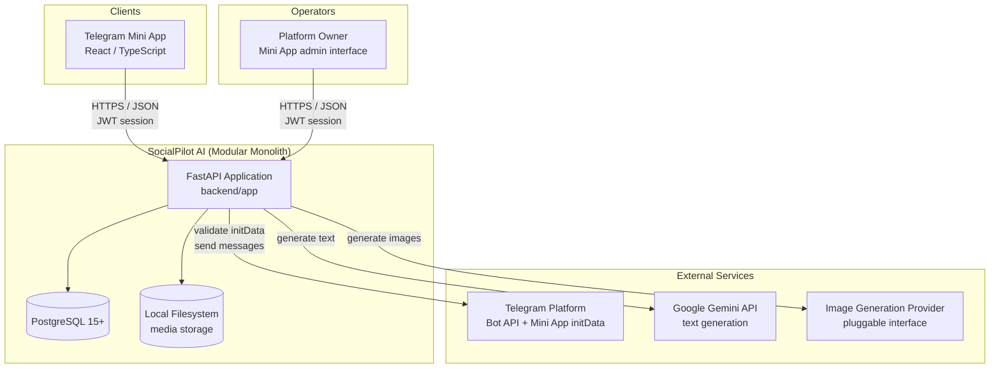
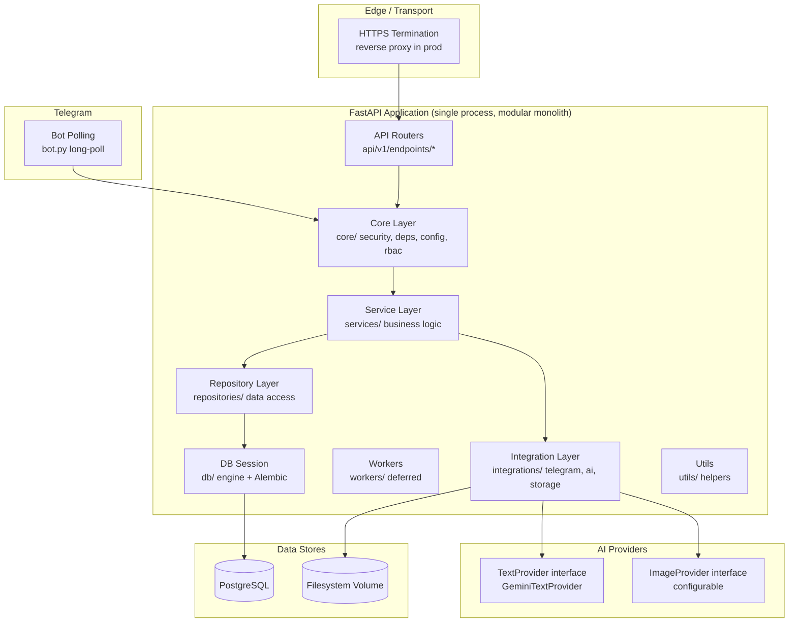
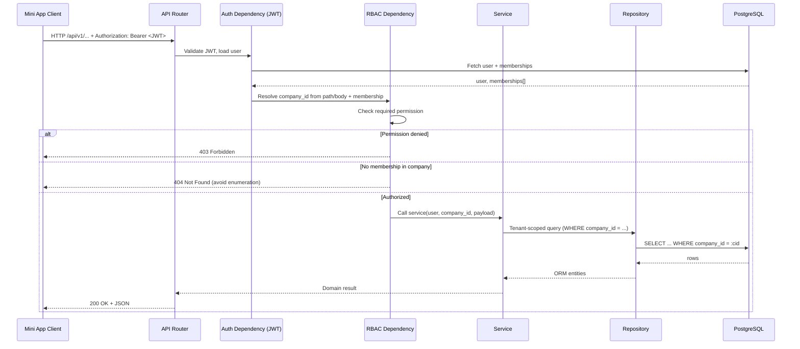
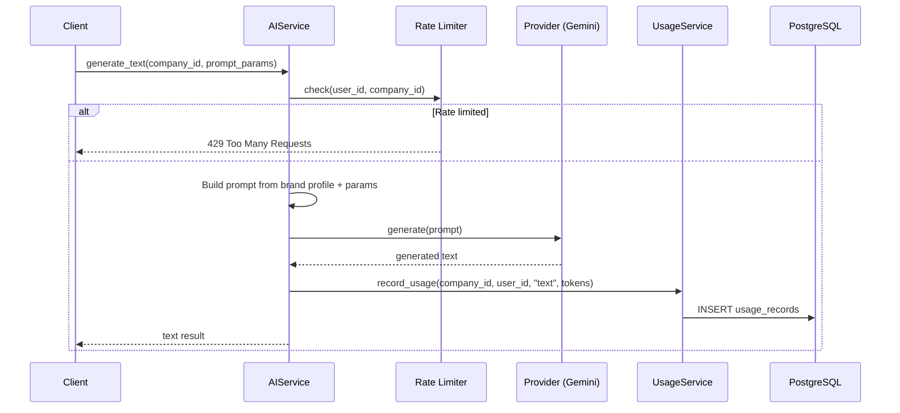
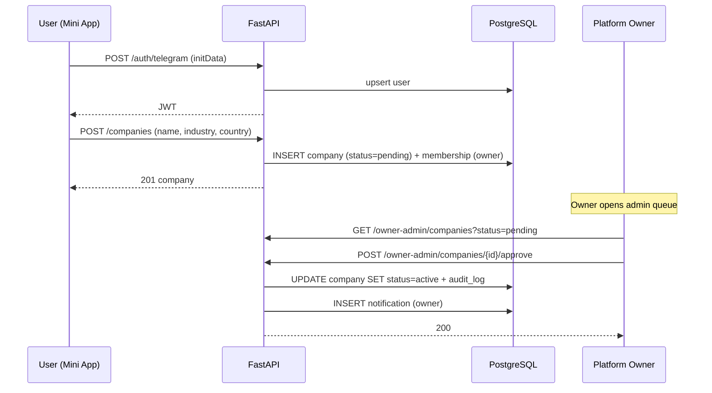
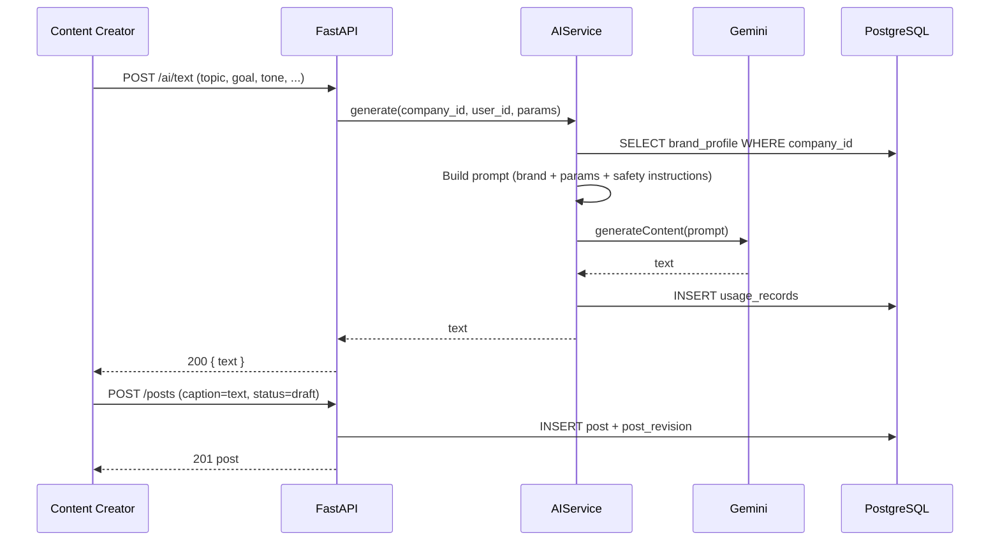
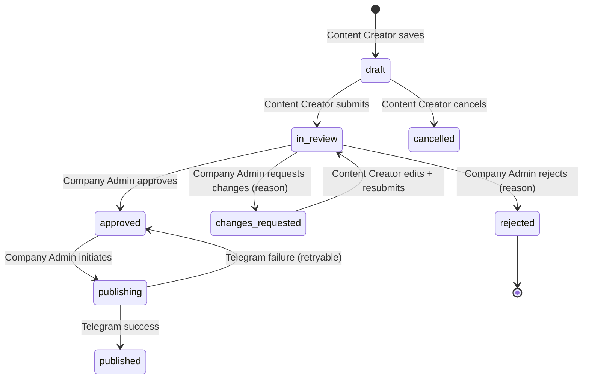
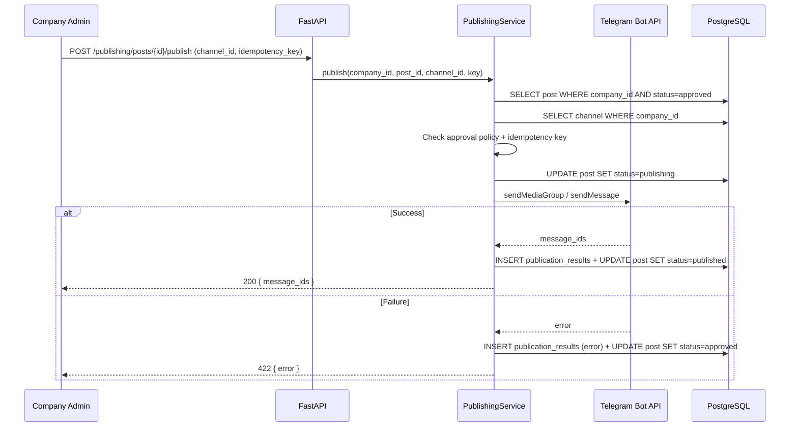
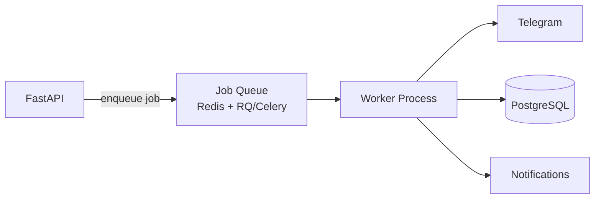
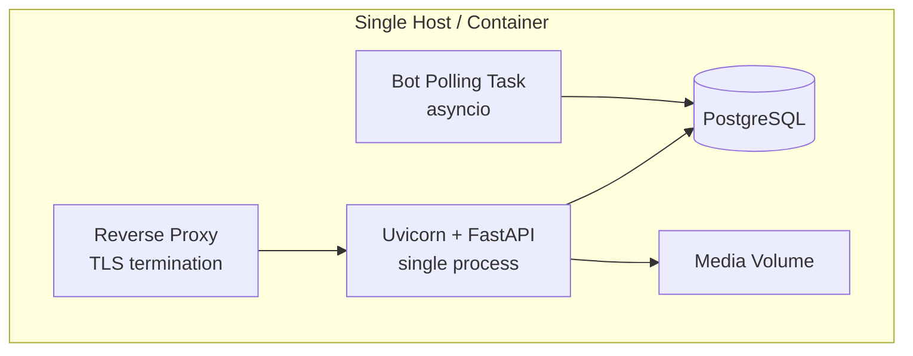

# System Architecture

This document describes the target system architecture for SocialPilot AI: a multi-tenant SaaS delivered as a Telegram Mini App. It covers the system context, container/component structure, request lifecycle, module layout, data flows, caching, and background job strategy.

Related documents: [01-project-vision-and-scope.md](01-project-vision-and-scope.md), [02-software-requirements.md](02-software-requirements.md), [03-user-roles-and-use-cases.md](03-user-roles-and-use-cases.md), [05-database-design.md](05-database-design.md), [06-api-specification.md](06-api-specification.md).

---

## 1. System Context

SocialPilot AI is a **modular monolith**: a single FastAPI application owning all business logic, a single PostgreSQL database, and a React/TypeScript Telegram Mini App frontend. External dependencies are the Telegram Bot/Mini App platform, the Gemini text API, and a pluggable image generation provider.



### Context Notes

- The **only client** is the Telegram Mini App (mobile and desktop). There is no standalone web frontend in MVP.
- The **platform owner** uses the same Mini App with an additional admin interface gated by `platform_*` permissions.
- All external calls (Telegram, Gemini, image provider) are made **server-side**; API keys never reach the client.
- The filesystem is a mounted volume in production; in local development it is a directory on the host.

---

## 2. Container / Component Architecture



### Component Responsibilities

| Component | Layer | Responsibility |
|-----------|-------|----------------|
| `api/v1/endpoints/*` | Transport | HTTP routing, request validation (Pydantic), response serialization, permission dependency injection |
| `core/` | Cross-cutting | Settings, DB session management, JWT auth, RBAC permission checks, exception handlers, middleware |
| `services/` | Business logic | Use-case orchestration, transaction boundaries, domain rules (approval workflow, publishing policy) |
| `repositories/` | Data access | SQLAlchemy queries, tenant-scoped filtering, no business rules |
| `integrations/telegram` | External | initData validation, Bot API client (send message, media group, getChatAdministrators), polling loop |
| `integrations/ai` | External | `TextProvider` / `ImageProvider` interfaces, Gemini implementation, prompt building, rate-limit accounting |
| `integrations/storage` | External | Local filesystem storage client (put, get, delete, URL signing); S3-compatible interface for later |
| `workers/` | Background | Placeholder module; scheduled publishing and export jobs land here post-MVP |
| `db/` | Infrastructure | Engine, session factory, Alembic migrations, base model with `company_id` mixin |
| `utils/` | Helpers | ID generation, normalization, datetime, pagination, hashing |

---

## 3. Request Lifecycle

### 3.1 Authenticated API Request



### 3.2 Key Lifecycle Rules

1. **Authentication** — JWT is issued only after server-side Telegram `initData` HMAC validation. Token lifetime: 12 hours inactivity sliding window.
2. **Tenant resolution** — `company_id` is never trusted from the request body alone. It is resolved from the authenticated user's memberships and the resource being accessed.
3. **Authorization** — Every endpoint declares a required permission. The RBAC dependency loads the user's role(s) for the resolved company and checks the permission string.
4. **Tenant scoping** — All repository queries include `WHERE company_id = :company_id` as a mandatory predicate. This is the primary isolation mechanism; PostgreSQL RLS is defense-in-depth (see [05-database-design.md](05-database-design.md)).
5. **Audit** — Sensitive actions emit `audit_logs` entries within the same transaction as the action.

### 3.3 AI Generation Request



---

## 4. Backend Module Structure

Target tree for the FastAPI application:

```
backend/
├── app/
│   ├── main.py                  # FastAPI app factory, router registration, exception handlers
│   ├── core/
│   │   ├── config.py            # Pydantic Settings (env-driven)
│   │   ├── security.py          # JWT encode/decode, initData HMAC validation
│   │   ├── deps.py              # FastAPI dependencies: get_db, get_current_user, get_current_membership
│   │   ├── rbac.py              # Permission enum, require_permission dependency
│   │   ├── exceptions.py        # Domain exceptions → HTTP status mapping
│   │   └── middleware.py        # Request ID, CORS, audit context
│   ├── api/
│   │   └── v1/
│   │       ├── router.py        # Aggregates all endpoint routers
│   │       └── endpoints/
│   │           ├── auth.py          # POST /auth/telegram, POST /auth/refresh
│   │           ├── companies.py     # Company CRUD, registration, suspension
│   │           ├── members.py       # Invitations, membership management
│   │           ├── channels.py      # Channel connect/verify/disconnect
│   │           ├── posts.py         # Draft CRUD, revisions, submit
│   │           ├── media.py         # Upload, list, delete media assets
│   │           ├── ai.py            # Text/image generation
│   │           ├── approvals.py     # Approve/reject/request changes
│   │           ├── publishing.py    # Publish approved post
│   │           ├── analytics.py     # History, calendar, usage
│   │           ├── notifications.py # List/mark-read notifications
│   │           └── owner_admin.py   # Platform owner: companies, providers, metrics
│   ├── models/                  # SQLAlchemy 2.0 ORM models (one file per entity)
│   ├── schemas/                 # Pydantic request/response schemas (one file per domain)
│   ├── repositories/            # Data access layer (one file per aggregate)
│   ├── services/                # Business logic (one file per domain)
│   │   ├── auth_service.py
│   │   ├── company_service.py
│   │   ├── member_service.py
│   │   ├── channel_service.py
│   │   ├── post_service.py
│   │   ├── media_service.py
│   │   ├── ai_service.py
│   │   ├── approval_service.py
│   │   ├── publishing_service.py
│   │   ├── analytics_service.py
│   │   └── notification_service.py
│   ├── integrations/
│   │   ├── telegram/
│   │   │   ├── init_data.py      # HMAC validation, parsing
│   │   │   ├── bot_client.py     # Bot API HTTP client
│   │   │   └── polling.py        # Long-polling loop (MVP)
│   │   ├── ai/
│   │   │   ├── base.py           # TextProvider / ImageProvider ABCs
│   │   │   ├── gemini_text.py    # Gemini implementation
│   │   │   └── image.py          # Image provider implementations
│   │   └── storage/
│   │       ├── base.py           # StorageProvider ABC
│   │       └── local.py          # Local filesystem implementation
│   ├── workers/
│   │   └── __init__.py           # Placeholder for future job workers
│   ├── db/
│   │   ├── base.py               # Declarative base, company_id mixin
│   │   ├── session.py            # Engine, session factory
│   │   └── migrations/           # Alembic
│   └── utils/
│       ├── ids.py                # UUID generation
│       ├── pagination.py         # Cursor/page helpers
│       ├── normalization.py      # Company name normalization
│       └── datetime.py           # Timezone-aware helpers
```

### Module Dependency Rule

```
endpoints → services → repositories → models
                     ↓
              integrations (telegram, ai, storage)
                     ↓
                   core (config, security, rbac)
```

Dependencies point **inward** only. Repositories never call services. Integrations never import endpoints. This enforces the modular monolith boundary: each module is a potential future service extraction point.

---

## 5. Frontend Module Structure

Target tree for the React/TypeScript Mini App:

```
frontend/
├── src/
│   ├── app/
│   │   ├── App.tsx               # Root component, router setup
│   │   ├── routes.tsx            # Route definitions + permission guards
│   │   └── providers.tsx         # Auth, Company, Theme providers
│   ├── components/               # Shared, reusable UI components
│   │   ├── ui/                   # Button, Input, Modal, Toast, Spinner
│   │   ├── layout/               # AppShell, Sidebar, Header
│   │   └── feedback/             # ErrorBoundary, EmptyState, Skeleton
│   ├── features/                 # Feature modules (one per domain)
│   │   ├── auth/                 # TelegramLogin, PendingApproval
│   │   ├── companies/            # CompanyList, CompanySettings, BrandProfile
│   │   ├── members/              # MemberList, InviteForm, RoleEditor
│   │   ├── channels/             # ChannelList, ConnectChannel, VerifyCode
│   │   ├── posts/                # PostEditor, PostList, PostPreview, RevisionHistory
│   │   ├── media/                # MediaLibrary, UploadZone, ImageGrid
│   │   ├── ai/                   # TextGenerator, ImageGenerator, PromptForm
│   │   ├── approvals/            # ApprovalQueue, ReviewPanel
│   │   ├── publishing/           # PublishDialog, PublishHistory
│   │   ├── analytics/            # HistoryView, CalendarView, UsageDashboard
│   │   ├── notifications/        # NotificationList, NotificationBell
│   │   └── owner-admin/          # CompanyQueue, ProviderSettings, PlatformMetrics
│   ├── hooks/                    # Shared React hooks
│   │   ├── useAuth.ts
│   │   ├── useCompany.ts
│   │   ├── usePermission.ts
│   │   └── useApi.ts             # Fetch wrapper with error handling
│   ├── lib/                      # Third-party clients and config
│   │   ├── api.ts                # Axios/fetch instance with interceptors
│   │   ├── telegram.ts           # Telegram WebApp SDK wrapper
│   │   └── constants.ts
│   ├── services/                 # API call functions (one per endpoint group)
│   │   ├── auth.service.ts
│   │   ├── company.service.ts
│   │   ├── post.service.ts
│   │   └── ...
│   ├── types/                    # TypeScript interfaces mirroring API schemas
│   │   ├── api.ts                # Generic ApiResponse, PaginatedResponse
│   │   ├── models.ts             # User, Company, Post, etc.
│   │   └── enums.ts              # PostStatus, Role, Permission
│   ├── utils/                    # Pure helper functions
│   │   ├── format.ts             # Date, number formatting
│   │   ├── validation.ts         # Client-side form validation
│   │   └── file.ts               # File type/size checks
│   └── styles/
│       ├── theme.css             # CSS custom properties, Telegram theme vars
│       └── global.css             # Reset, typography, utilities
```

### Frontend Conventions

- **Token storage**: JWT is held in React state / memory only (per FR-1.7). On Mini App relaunch, `initData` is re-sent and a new token is issued.
- **Permission gating**: `usePermission(permission)` hook drives UI visibility. Server-side RBAC remains the enforcement layer; UI gating is UX-only.
- **Telegram theming**: Use `window.Telegram.WebApp.themeParams` and `colorScheme` to match the user's Telegram client theme.
- **Optimistic UI**: Post status transitions (submit, approve, publish) use optimistic updates with rollback on error.

---

## 6. Data Flows for Key Operations

### 6.1 Company Registration and Approval



### 6.2 AI Text Generation to Draft



### 6.3 Approval Workflow



### 6.4 Publishing



---

## 7. Caching Strategy

### MVP: No Application-Level Cache

The MVP operates without a caching layer. Rationale:

- **Low concurrency**: Single-instance deployment; PostgreSQL query performance is sufficient for the expected load.
- **Multi-tenant complexity**: Cache keys must be tenant-scoped, invalidation must be tenant-aware. The complexity cost exceeds the benefit at MVP scale.
- **AI responses are not cacheable**: Each generation is unique (brand context + user params). Caching would only apply to repeated identical prompts, which is an edge case.

### What Is Cached Implicitly

| Data | Mechanism | TTL |
|------|-----------|-----|
| User session / memberships | JWT claims (stateless) | Token lifetime (12h) |
| Telegram bot token | In-memory singleton | Process lifetime |
| Brand profile | None (DB read per generation) | — |
| Static assets (frontend) | HTTP cache headers (CDN in prod) | 1 year (hashed assets) |

### Post-MVP: Redis

When justified by load, introduce Redis for:

1. **Rate limiting counters** — sliding window per user/company for AI generation.
2. **Session revocation** — denylist for compromised tokens.
3. **Provider response cache** — optional, only for identical prompt hashes (opt-in per company).
4. **Usage counters** — aggregated daily counts to reduce `usage_records` read load.

Cache invalidation strategy: **write-through with explicit invalidation** on company/brand/member changes. Tenant-scoped key pattern: `cache:{company_id}:{resource}:{id}`.

---

## 8. Background Jobs

### MVP: No Background Workers

The MVP is fully synchronous. All operations complete within the HTTP request/response cycle:

- **Publishing** — synchronous Telegram API call with a 30s timeout. The post status transitions to `publishing` and the client awaits the result.
- **Company deletion export** — synchronous generation of a JSON/CSV archive (small data volumes in MVP). The 24h retention window is enforced by a status flag, not a background job.
- **Bot polling** — a lightweight long-poll loop in a separate asyncio task within the same process. It handles channel verification callbacks only.

### Why No Workers in MVP

| Concern | MVP Approach | Risk |
|---------|--------------|------|
| Publishing latency | Synchronous call, p95 < 5s | Telegram API outage blocks the request; acceptable for MVP |
| Export generation | Synchronous, small data | Large companies may hit timeout; mitigate with pagination |
| Scheduled publishing | Not supported (FR-15 is FUTURE) | — |
| Email notifications | Not supported (Telegram notifications only) | — |

### Post-MVP: Worker Architecture

When scheduled publishing (FR-15) and other async work arrive:



- **Queue**: Redis-backed (RQ or Celery). Separate queue per job type (publishing, export, notifications).
- **Worker**: Separate process, same codebase, imports `workers/` module.
- **Retry policy**: Exponential backoff, max 3 attempts for Telegram API calls. Dead-letter queue for manual inspection.
- **Idempotency**: Jobs carry idempotency keys; workers check before executing.

---

## 9. Deployment Topology (MVP)



- **Single process** runs both the ASGI server and the bot polling loop (asyncio tasks).
- **PostgreSQL** runs as a sidecar container or managed service.
- **Media volume** is a bind mount or Docker volume.
- **Horizontal scaling** (future): stateless API replicas behind a load balancer; bot polling must be singleton (leader election or separate worker).

---

## 10. Cross-Cutting Concerns

| Concern | Approach |
|---------|----------|
| **Logging** | Structured JSON logs (structlog). Request ID propagated via middleware. No PII in logs. |
| **Error handling** | Domain exceptions in `core/exceptions.py` mapped to HTTP status codes. Consistent error envelope (see [06-api-specification.md](06-api-specification.md)). |
| **Configuration** | Pydantic Settings, env vars + `.env` file. Secrets via environment or secrets manager. No secrets in code. |
| **Database migrations** | Alembic, auto-generated + reviewed. Migrations run on deploy. |
| **Testing** | pytest with testcontainers for PostgreSQL. Integration tests for tenant isolation. See [12-testing-strategy.md](12-testing-strategy.md). |
| **Observability** | Health endpoint `/health`. Metrics endpoint (Prometheus) post-MVP. |
