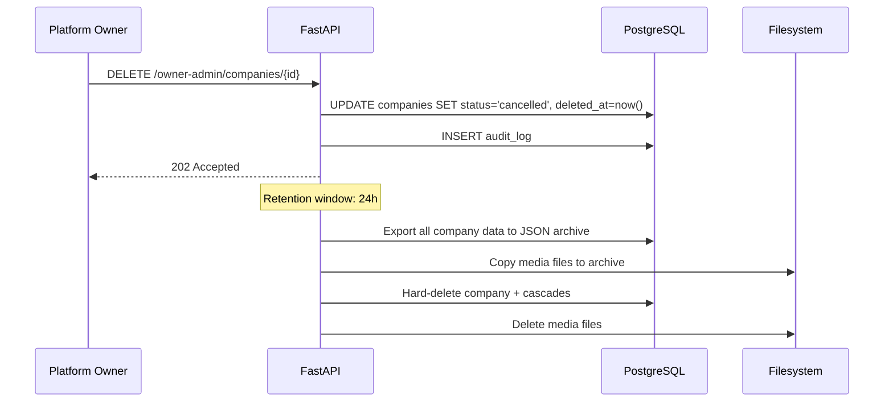

# Database Design

This document defines the PostgreSQL database schema for SocialPilot AI. It covers the complete entity-relationship model, per-table specifications, multi-tenancy isolation, secrets handling, deletion/export strategy, and index strategy.

Related documents: [04-system-architecture.md](04-system-architecture.md), [06-api-specification.md](06-api-specification.md), [03-user-roles-and-use-cases.md](03-user-roles-and-use-cases.md).

---

## 1. Design Principles

1. **UUID primary keys** — All tables use `UUID` PKs (v7 preferred for time-sortable IDs). Prevents ID enumeration and simplifies distributed systems later.
2. **Tenant ownership** — Every company-owned entity carries `company_id UUID NOT NULL`. Platform-scoped entities (users, telegram_identities, subscription_plans) do not.
3. **Application-layer isolation** — All queries include `WHERE company_id = :cid`. PostgreSQL RLS is defense-in-depth (see [Section 12](#12-postgresql-row-level-security)).
4. **Soft deletes** — Most entities use `deleted_at TIMESTAMPTZ` for soft delete. Hard delete only via platform owner with export.
5. **Audit timestamps** — `created_at` and `updated_at` on all tables. `created_at` is immutable.
6. **JSONB for flexibility** — Provider-specific metadata, notification preferences, and approval policy config use `JSONB` with GIN indexes where queried.

---

## 2. Entity-Relationship Diagram

```mermaid
erDiagram
    users ||--o{ telegram_identities : "has"
    users ||--o{ company_memberships : "holds"
    companies ||--o{ company_memberships : "has"
    companies ||--|| brand_profiles : "has"
    companies ||--o{ social_channels : "owns"
    social_channels ||--|| channel_credentials : "secures"
    companies ||--o{ posts : "contains"
    posts ||--o{ post_revisions : "versions"
    posts ||--o{ post_media : "attaches"
    media_assets ||--o{ post_media : "referenced by"
    companies ||--o{ media_assets : "owns"
    posts ||--o{ approval_events : "tracks"
    posts ||--o{ publishing_jobs : "scheduled"
    posts ||--o{ publication_results : "records"
    companies ||--o{ invitations : "issues"
    users ||--o{ invitations : "receives"
    company_memberships ||--o{ membership_roles : "assigns"
    roles ||--o{ membership_roles : "granted via"
    roles ||--o{ role_permissions : "bundles"
    permissions ||--o{ role_permissions : "assigned to"
    companies ||--o{ audit_logs : "logged"
    users ||--o{ audit_logs : "actor"
    subscription_plans ||--o{ company_subscriptions : "subscribed"
    companies ||--o{ company_subscriptions : "has"
    companies ||--o{ usage_records : "metered"
    users ||--o{ usage_records : "actor"
    users ||--o{ notification_preferences : "configures"
    companies ||--o{ notifications : "generates"

    users {
        uuid id PK
        string telegram_id UK
        string username
        string display_name
        string language_code
        timestamp created_at
        timestamp updated_at
    }
    telegram_identities {
        uuid id PK
        uuid user_id FK
        string telegram_id UK
        string first_name
        string last_name
        string photo_url
        timestamp created_at
    }
    companies {
        uuid id PK
        string name
        string normalized_name
        string industry
        string website
        string country
        string contact_email
        string status
        uuid owner_user_id FK
        timestamp created_at
        timestamp updated_at
        timestamp deleted_at
    }
    company_memberships {
        uuid id PK
        uuid company_id FK
        uuid user_id FK
        boolean is_active
        timestamp created_at
        timestamp updated_at
    }
    roles {
        uuid id PK
        string name UK
        string scope
        string description
    }
    permissions {
        uuid id PK
        string name UK
        string description
    }
    membership_roles {
        uuid id PK
        uuid membership_id FK
        uuid role_id FK
        timestamp created_at
    }
    role_permissions {
        uuid id PK
        uuid role_id FK
        uuid permission_id FK
    }
    invitations {
        uuid id PK
        uuid company_id FK
        uuid invited_by_user_id FK
        string telegram_username
        string status
        timestamp expires_at
        timestamp created_at
        timestamp accepted_at
    }
    brand_profiles {
        uuid id PK
        uuid company_id FK
        string display_name
        string tone
        string audience
        string language
        jsonb default_hashtags
        string default_cta
        timestamp created_at
        timestamp updated_at
    }
    social_channels {
        uuid id PK
        uuid company_id FK
        string telegram_channel_id
        string title
        string username
        string type
        integer member_count
        string status
        timestamp connected_at
        timestamp created_at
        timestamp updated_at
    }
    channel_credentials {
        uuid id PK
        uuid channel_id FK
        string credential_type
        string encrypted_value
        timestamp created_at
        timestamp updated_at
    }
    posts {
        uuid id PK
        uuid company_id FK
        uuid author_user_id FK
        string status
        text caption
        jsonb hashtags
        string cta
        uuid brand_profile_id FK
        timestamp created_at
        timestamp updated_at
        timestamp deleted_at
    }
    post_revisions {
        uuid id PK
        uuid post_id FK
        uuid author_user_id FK
        integer version_number
        text caption
        jsonb hashtags
        string cta
        timestamp created_at
    }
    post_media {
        uuid id PK
        uuid post_id FK
        uuid media_asset_id FK
        integer position
        timestamp created_at
    }
    media_assets {
        uuid id PK
        uuid company_id FK
        uuid uploaded_by_user_id FK
        string storage_path
        string mime_type
        bigint file_size_bytes
        integer width
        integer height
        string sha256_hash
        string source
        timestamp created_at
        timestamp deleted_at
    }
    approval_events {
        uuid id PK
        uuid post_id FK
        uuid actor_user_id FK
        string action
        text reason
        timestamp created_at
    }
    publishing_jobs {
        uuid id PK
        uuid post_id FK
        uuid channel_id FK
        uuid requested_by_user_id FK
        string status
        string idempotency_key
        timestamp scheduled_at
        timestamp created_at
        timestamp updated_at
    }
    publication_results {
        uuid id PK
        uuid post_id FK
        uuid channel_id FK
        string status
        jsonb telegram_message_ids
        text error_message
        timestamp created_at
    }
    audit_logs {
        uuid id PK
        uuid company_id FK
        uuid actor_user_id FK
        string action
        string entity_type
        uuid entity_id
        jsonb metadata
        string ip_address
        timestamp created_at
    }
    subscription_plans {
        uuid id PK
        string name
        string billing_interval
        integer price_cents
        jsonb features
        boolean is_active
        timestamp created_at
    }
    company_subscriptions {
        uuid id PK
        uuid company_id FK
        uuid plan_id FK
        string status
        timestamp started_at
        timestamp expires_at
        timestamp created_at
    }
    usage_records {
        uuid id PK
        uuid company_id FK
        uuid user_id FK
        string feature
        integer quantity
        jsonb metadata
        timestamp created_at
    }
    notification_preferences {
        uuid id PK
        uuid user_id FK
        uuid company_id FK
        string channel
        boolean enabled
        timestamp created_at
        timestamp updated_at
    }
```



---

## 3. Table Specifications

### 3.1 `users`

Platform-level user record. One per Telegram account.

| Column | Type | Constraints | Nullable | Description |
|--------|------|-------------|----------|-------------|
| `id` | `UUID` | PK | No | |
| `telegram_id` | `BIGINT` | UNIQUE | No | Telegram user ID |
| `username` | `VARCHAR(64)` | | Yes | Telegram username (may be null) |
| `display_name` | `VARCHAR(128)` | | No | Cached first + last name |
| `language_code` | `VARCHAR(8)` | | Yes | Telegram language code |
| `created_at` | `TIMESTAMPTZ` | DEFAULT now() | No | |
| `updated_at` | `TIMESTAMPTZ` | DEFAULT now() | No | |

**Indexes:** `UNIQUE (telegram_id)`

**Tenant ownership:** Platform-scoped. No `company_id`.

**Retention:** Retained until platform owner purges (post-MVP).

---

### 3.2 `telegram_identities`

Links a user to their Telegram identity snapshot. Supports future multi-account linking.

| Column | Type | Constraints | Nullable | Description |
|--------|------|-------------|----------|-------------|
| `id` | `UUID` | PK | No | |
| `user_id` | `UUID` | FK → users.id | No | |
| `telegram_id` | `BIGINT` | UNIQUE | No | |
| `first_name` | `VARCHAR(128)` | | No | |
| `last_name` | `VARCHAR(128)` | | Yes | |
| `photo_url` | `TEXT` | | Yes | |
| `created_at` | `TIMESTAMPTZ` | | No | |

**Indexes:** `UNIQUE (telegram_id)`, `INDEX (user_id)`

**Tenant ownership:** Platform-scoped.

**Retention:** Lifecycle-bound to user.

---

### 3.3 `companies`

A tenant workspace. The root of all company-owned data.

| Column | Type | Constraints | Nullable | Description |
|--------|------|-------------|----------|-------------|
| `id` | `UUID` | PK | No | |
| `name` | `VARCHAR(255)` | | No | Display name |
| `normalized_name` | `VARCHAR(255)` | | No | Lowercase, stripped — for duplicate detection |
| `industry` | `VARCHAR(128)` | | Yes | |
| `website` | `VARCHAR(512)` | | Yes | |
| `country` | `VARCHAR(2)` | | Yes | ISO 3166-1 alpha-2 |
| `contact_email` | `VARCHAR(255)` | | Yes | |
| `status` | `VARCHAR(32)` | CHECK in ('pending','active','suspended','rejected','info_requested','cancelled') | No | |
| `owner_user_id` | `UUID` | FK → users.id | No | The company_owner |
| `created_at` | `TIMESTAMPTZ` | | No | |
| `updated_at` | `TIMESTAMPTZ` | | No | |
| `deleted_at` | `TIMESTAMPTZ` | | Yes | Soft delete |

**Indexes:** `INDEX (status)`, `INDEX (owner_user_id)`, `UNIQUE (normalized_name, owner_user_id)` — a user cannot register two companies with the same normalized name.

**Tenant ownership:** This IS the tenant root.

**Retention:** Soft-deleted companies retained 24h, then hard-deleted via cascade (see [Section 14](#14-company-deletion-and-data-export)).

---

### 3.4 `company_memberships`

Join table: which users belong to which companies.

| Column | Type | Constraints | Nullable | Description |
|--------|------|-------------|----------|-------------|
| `id` | `UUID` | PK | No | |
| `company_id` | `UUID` | FK → companies.id | No | |
| `user_id` | `UUID` | FK → users.id | No | |
| `is_active` | `BOOLEAN` | DEFAULT true | No | Set false on removal |
| `created_at` | `TIMESTAMPTZ` | | No | |
| `updated_at` | `TIMESTAMPTZ` | | No | |

**Indexes:** `UNIQUE (company_id, user_id)`, `INDEX (user_id)`

**Tenant ownership:** Company-owned.

**Retention:** Retained for audit; `is_active=false` on removal.

---

### 3.5 `roles`

Named role definitions (platform_owner, company_owner, company_admin, creator, approver, publisher, analyst).

| Column | Type | Constraints | Nullable | Description |
|--------|------|-------------|----------|-------------|
| `id` | `UUID` | PK | No | |
| `name` | `VARCHAR(64)` | UNIQUE | No | |
| `scope` | `VARCHAR(32)` | CHECK in ('platform','company') | No | |
| `description` | `TEXT` | | Yes | |

**Indexes:** `UNIQUE (name)`

**Tenant ownership:** Platform-scoped (seeded).

**Retention:** Permanent.

---

### 3.6 `permissions`

Explicit action strings (`resource:action`).

| Column | Type | Constraints | Nullable | Description |
|--------|------|-------------|----------|-------------|
| `id` | `UUID` | PK | No | |
| `name` | `VARCHAR(128)` | UNIQUE | No | e.g. `post:create` |
| `description` | `TEXT` | | Yes | |

**Indexes:** `UNIQUE (name)`

**Tenant ownership:** Platform-scoped (seeded).

**Retention:** Permanent.

---

### 3.7 `membership_roles`

Assigns roles to a membership. A membership can have multiple roles.

| Column | Type | Constraints | Nullable | Description |
|--------|------|-------------|----------|-------------|
| `id` | `UUID` | PK | No | |
| `membership_id` | `UUID` | FK → company_memberships.id | No | |
| `role_id` | `UUID` | FK → roles.id | No | |
| `created_at` | `TIMESTAMPTZ` | | No | |

**Indexes:** `UNIQUE (membership_id, role_id)`, `INDEX (role_id)`

**Tenant ownership:** Company-owned (via membership).

**Retention:** Lifecycle-bound to membership.

---

### 3.8 `role_permissions`

Bundles permissions into roles.

| Column | Type | Constraints | Nullable | Description |
|--------|------|-------------|----------|-------------|
| `id` | `UUID` | PK | No | |
| `role_id` | `UUID` | FK → roles.id | No | |
| `permission_id` | `UUID` | FK → permissions.id | No | |

**Indexes:** `UNIQUE (role_id, permission_id)`, `INDEX (permission_id)`

**Tenant ownership:** Platform-scoped (seeded).

**Retention:** Permanent.

---

### 3.9 `invitations`

Pending team invitations.

| Column | Type | Constraints | Nullable | Description |
|--------|------|-------------|----------|-------------|
| `id` | `UUID` | PK | No | |
| `company_id` | `UUID` | FK → companies.id | No | |
| `invited_by_user_id` | `UUID` | FK → users.id | No | |
| `telegram_username` | `VARCHAR(64)` | | No | Target user's Telegram username |
| `status` | `VARCHAR(32)` | CHECK in ('pending','accepted','revoked','expired') | No | |
| `expires_at` | `TIMESTAMPTZ` | | No | created_at + 7 days |
| `created_at` | `TIMESTAMPTZ` | | No | |
| `accepted_at` | `TIMESTAMPTZ` | | Yes | |

**Indexes:** `INDEX (company_id, status)`, `INDEX (telegram_username, status)`

**Tenant ownership:** Company-owned.

**Retention:** 90 days after resolution.

---

### 3.10 `brand_profiles`

Company brand voice and defaults for AI generation.

| Column | Type | Constraints | Nullable | Description |
|--------|------|-------------|----------|-------------|
| `id` | `UUID` | PK | No | |
| `company_id` | `UUID` | FK → companies.id | No | |
| `display_name` | `VARCHAR(255)` | | No | Brand name for prompts |
| `tone` | `VARCHAR(64)` | | Yes | e.g. professional, casual |
| `audience` | `TEXT` | | Yes | Target audience description |
| `language` | `VARCHAR(8)` | | No | Default generation language |
| `default_hashtags` | `JSONB` | | Yes | Array of hashtag strings |
| `default_cta` | `VARCHAR(255)` | | Yes | Default call-to-action |
| `created_at` | `TIMESTAMPTZ` | | No | |
| `updated_at` | `TIMESTAMPTZ` | | No | |

**Indexes:** `UNIQUE (company_id)`

**Tenant ownership:** Company-owned.

**Retention:** Lifecycle-bound to company.

---

### 3.11 `social_channels`

Connected Telegram channels.

| Column | Type | Constraints | Nullable | Description |
|--------|------|-------------|----------|-------------|
| `id` | `UUID` | PK | No | |
| `company_id` | `UUID` | FK → companies.id | No | |
| `telegram_channel_id` | `BIGINT` | | No | Telegram's channel ID |
| `title` | `VARCHAR(255)` | | No | |
| `username` | `VARCHAR(64)` | | Yes | Public channel username |
| `type` | `VARCHAR(32)` | CHECK in ('channel','supergroup') | No | |
| `member_count` | `INTEGER` | | Yes | Cached at connect time |
| `status` | `VARCHAR(32)` | CHECK in ('active','disconnected') | No | |
| `connected_at` | `TIMESTAMPTZ` | | No | |
| `created_at` | `TIMESTAMPTZ` | | No | |
| `updated_at` | `TIMESTAMPTZ` | | No | |

**Indexes:** `UNIQUE (company_id, telegram_channel_id)`, `UNIQUE (telegram_channel_id)` — a channel can only belong to one company (FR-5.7).

**Tenant ownership:** Company-owned.

**Retention:** Retained after disconnect (historical publications reference it).

---

### 3.12 `channel_credentials`

Encrypted credentials for channel operations (e.g., bot token scoped to channel, verification codes).

| Column | Type | Constraints | Nullable | Description |
|--------|------|-------------|----------|-------------|
| `id` | `UUID` | PK | No | |
| `channel_id` | `UUID` | FK → social_channels.id | No | |
| `credential_type` | `VARCHAR(64)` | | No | e.g. 'bot_token', 'verification_code' |
| `encrypted_value` | `TEXT` | | No | AES-256-GCM encrypted |
| `created_at` | `TIMESTAMPTZ` | | No | |
| `updated_at` | `TIMESTAMPTZ` | | No | |

**Indexes:** `UNIQUE (channel_id, credential_type)`

**Tenant ownership:** Company-owned (via channel).

**Retention:** Deleted on channel disconnect or company deletion.

**Secrets:** See [Section 13](#13-secrets-and-credentials-handling).

---

### 3.13 `posts`

Content drafts and published posts.

| Column | Type | Constraints | Nullable | Description |
|--------|------|-------------|----------|-------------|
| `id` | `UUID` | PK | No | |
| `company_id` | `UUID` | FK → companies.id | No | |
| `author_user_id` | `UUID` | FK → users.id | No | Original creator |
| `status` | `VARCHAR(32)` | CHECK in ('draft','in_review','approved','changes_requested','rejected','publishing','published','cancelled') | No | |
| `caption` | `TEXT` | | Yes | Post text (null for media-only) |
| `hashtags` | `JSONB` | | Yes | Array of strings |
| `cta` | `VARCHAR(255)` | | Yes | |
| `brand_profile_id` | `UUID` | FK → brand_profiles.id | Yes | Snapshot at creation |
| `created_at` | `TIMESTAMPTZ` | | No | |
| `updated_at` | `TIMESTAMPTZ` | | No | |
| `deleted_at` | `TIMESTAMPTZ` | | Yes | Soft delete (cancel) |

**Indexes:** `INDEX (company_id, status)`, `INDEX (company_id, created_at DESC)`, `INDEX (author_user_id)`

**Tenant ownership:** Company-owned.

**Retention:** Cancelled drafts 90 days (NFR-14). Published posts retained indefinitely.

---

### 3.14 `post_revisions`

Immutable revision history for posts.

| Column | Type | Constraints | Nullable | Description |
|--------|------|-------------|----------|-------------|
| `id` | `UUID` | PK | No | |
| `post_id` | `UUID` | FK → posts.id | No | |
| `author_user_id` | `UUID` | FK → users.id | No | Who made the edit |
| `version_number` | `INTEGER` | | No | Sequential per post |
| `caption` | `TEXT` | | Yes | |
| `hashtags` | `JSONB` | | Yes | |
| `cta` | `VARCHAR(255)` | | Yes | |
| `created_at` | `TIMESTAMPTZ` | | No | |

**Indexes:** `UNIQUE (post_id, version_number)`, `INDEX (post_id, created_at DESC)`

**Tenant ownership:** Company-owned (via post).

**Retention:** Lifecycle-bound to post.

---

### 3.15 `post_media`

Ordered media attachments for a post.

| Column | Type | Constraints | Nullable | Description |
|--------|------|-------------|----------|-------------|
| `id` | `UUID` | PK | No | |
| `post_id` | `UUID` | FK → posts.id | No | |
| `media_asset_id` | `UUID` | FK → media_assets.id | No | |
| `position` | `INTEGER` | | No | 0-based order in album |
| `created_at` | `TIMESTAMPTZ` | | No | |

**Indexes:** `UNIQUE (post_id, position)`, `INDEX (media_asset_id)`

**Tenant ownership:** Company-owned (via post and media_asset).

**Retention:** Lifecycle-bound to post.

---

### 3.16 `media_assets`

Uploaded or AI-generated media files.

| Column | Type | Constraints | Nullable | Description |
|--------|------|-------------|----------|-------------|
| `id` | `UUID` | PK | No | |
| `company_id` | `UUID` | FK → companies.id | No | |
| `uploaded_by_user_id` | `UUID` | FK → users.id | No | |
| `storage_path` | `TEXT` | | No | Relative path on filesystem |
| `mime_type` | `VARCHAR(64)` | | No | image/jpeg, image/png, etc. |
| `file_size_bytes` | `BIGINT` | | No | |
| `width` | `INTEGER` | | Yes | Image width in px |
| `height` | `INTEGER` | | Yes | Image height in px |
| `sha256_hash` | `CHAR(64)` | | No | Deduplication + integrity |
| `source` | `VARCHAR(32)` | CHECK in ('upload','ai_generated') | No | |
| `created_at` | `TIMESTAMPTZ` | | No | |
| `deleted_at` | `TIMESTAMPTZ` | | Yes | Soft delete |

**Indexes:** `INDEX (company_id, created_at DESC)`, `INDEX (company_id, sha256_hash)`, `INDEX (uploaded_by_user_id)`

**Tenant ownership:** Company-owned.

**Retention:** Soft-deleted assets purged after 30 days.

---

### 3.17 `approval_events`

Audit trail of approval workflow actions.

| Column | Type | Constraints | Nullable | Description |
|--------|------|-------------|----------|-------------|
| `id` | `UUID` | PK | No | |
| `post_id` | `UUID` | FK → posts.id | No | |
| `actor_user_id` | `UUID` | FK → users.id | No | |
| `action` | `VARCHAR(32)` | CHECK in ('submit','approve','reject','request_changes') | No | |
| `reason` | `TEXT` | | Yes | Required for reject/request_changes |
| `created_at` | `TIMESTAMPTZ` | | No | |

**Indexes:** `INDEX (post_id, created_at DESC)`

**Tenant ownership:** Company-owned (via post).

**Retention:** Lifecycle-bound to post.

---

### 3.18 `publishing_jobs`

Publishing attempts (immediate in MVP; scheduled post-MVP).

| Column | Type | Constraints | Nullable | Description |
|--------|------|-------------|----------|-------------|
| `id` | `UUID` | PK | No | |
| `post_id` | `UUID` | FK → posts.id | No | |
| `channel_id` | `UUID` | FK → social_channels.id | No | |
| `requested_by_user_id` | `UUID` | FK → users.id | No | |
| `status` | `VARCHAR(32)` | CHECK in ('pending','in_progress','completed','failed','cancelled') | No | |
| `idempotency_key` | `VARCHAR(128)` | | No | Client-generated dedup key |
| `scheduled_at` | `TIMESTAMPTZ` | | Yes | NULL for immediate |
| `created_at` | `TIMESTAMPTZ` | | No | |
| `updated_at` | `TIMESTAMPTZ` | | No | |

**Indexes:** `UNIQUE (post_id, idempotency_key)`, `INDEX (status, scheduled_at)` — for future worker polling.

**Tenant ownership:** Company-owned (via post/channel).

**Retention:** 12 months.

---

### 3.19 `publication_results`

Outcome of each publishing attempt.

| Column | Type | Constraints | Nullable | Description |
|--------|------|-------------|----------|-------------|
| `id` | `UUID` | PK | No | |
| `post_id` | `UUID` | FK → posts.id | No | |
| `channel_id` | `UUID` | FK → social_channels.id | No | |
| `status` | `VARCHAR(32)` | CHECK in ('success','partial','failed') | No | |
| `telegram_message_ids` | `JSONB` | | Yes | Array of message IDs |
| `error_message` | `TEXT` | | Yes | Sanitized error (no API keys) |
| `created_at` | `TIMESTAMPTZ` | | No | |

**Indexes:** `INDEX (post_id, created_at DESC)`, `INDEX (channel_id, created_at DESC)`

**Tenant ownership:** Company-owned.

**Retention:** Indefinite (publication history).

---

### 3.20 `audit_logs`

Security-relevant action log.

| Column | Type | Constraints | Nullable | Description |
|--------|------|-------------|----------|-------------|
| `id` | `UUID` | PK | No | |
| `company_id` | `UUID` | FK → companies.id | Yes | NULL for platform-level actions |
| `actor_user_id` | `UUID` | FK → users.id | No | |
| `action` | `VARCHAR(128)` | | No | e.g. 'company.approved', 'member.removed' |
| `entity_type` | `VARCHAR(64)` | | No | e.g. 'company', 'post' |
| `entity_id` | `UUID` | | Yes | |
| `metadata` | `JSONB` | | Yes | Action-specific context |
| `ip_address` | `INET` | | Yes | |
| `created_at` | `TIMESTAMPTZ` | | No | |

**Indexes:** `INDEX (company_id, created_at DESC)`, `INDEX (actor_user_id, created_at DESC)`, `INDEX (entity_type, entity_id)`

**Tenant ownership:** Company-owned (nullable for platform actions).

**Retention:** 12 months (NFR-14). Partitioned by month when volume justifies.

---

### 3.21 `subscription_plans`

Platform-defined subscription tiers.

| Column | Type | Constraints | Nullable | Description |
|--------|------|-------------|----------|-------------|
| `id` | `UUID` | PK | No | |
| `name` | `VARCHAR(128)` | | No | |
| `billing_interval` | `VARCHAR(32)` | CHECK in ('monthly','yearly') | No | |
| `price_cents` | `INTEGER` | | No | |
| `features` | `JSONB` | | No | Feature flags and limits |
| `is_active` | `BOOLEAN` | DEFAULT true | No | |
| `created_at` | `TIMESTAMPTZ` | | No | |

**Tenant ownership:** Platform-scoped.

**Retention:** Permanent.

---

### 3.22 `company_subscriptions`

Company's current subscription.

| Column | Type | Constraints | Nullable | Description |
|--------|------|-------------|----------|-------------|
| `id` | `UUID` | PK | No | |
| `company_id` | `UUID` | FK → companies.id | No | |
| `plan_id` | `UUID` | FK → subscription_plans.id | No | |
| `status` | `VARCHAR(32)` | CHECK in ('active','cancelled','expired') | No | |
| `started_at` | `TIMESTAMPTZ` | | No | |
| `expires_at` | `TIMESTAMPTZ` | | Yes | |
| `created_at` | `TIMESTAMPTZ` | | No | |

**Indexes:** `UNIQUE (company_id) WHERE status = 'active'` — partial index, one active subscription per company.

**Tenant ownership:** Company-owned.

**Retention:** Permanent.

---

### 3.23 `usage_records`

Per-company usage metering for AI calls, storage, posts.

| Column | Type | Constraints | Nullable | Description |
|--------|------|-------------|----------|-------------|
| `id` | `UUID` | PK | No | |
| `company_id` | `UUID` | FK → companies.id | No | |
| `user_id` | `UUID` | FK → users.id | No | Who triggered the usage |
| `feature` | `VARCHAR(64)` | | No | 'text_generation', 'image_generation', 'storage', 'post_created' |
| `quantity` | `INTEGER` | | No | e.g., tokens, images count, bytes |
| `metadata` | `JSONB` | | Yes | Provider-specific details |
| `created_at` | `TIMESTAMPTZ` | | No | |

**Indexes:** `INDEX (company_id, feature, created_at DESC)`, `INDEX (user_id, created_at DESC)`

**Tenant ownership:** Company-owned.

**Retention:** 12 months. Aggregated into daily rollups for reporting.

---

### 3.24 `notification_preferences`

Per-user, per-company notification settings.

| Column | Type | Constraints | Nullable | Description |
|--------|------|-------------|----------|-------------|
| `id` | `UUID` | PK | No | |
| `user_id` | `UUID` | FK → users.id | No | |
| `company_id` | `UUID` | FK → companies.id | No | |
| `channel` | `VARCHAR(32)` | CHECK in ('in_app','telegram') | No | |
| `enabled` | `BOOLEAN` | DEFAULT true | No | |
| `created_at` | `TIMESTAMPTZ` | | No | |
| `updated_at` | `TIMESTAMPTZ` | | No | |

**Indexes:** `UNIQUE (user_id, company_id, channel)`

**Tenant ownership:** Company-owned.

**Retention:** Lifecycle-bound to membership.

---

## 4. Index Strategy Summary

| Index Type | Usage | Examples |
|------------|-------|----------|
| **B-tree** | Equality and range queries on scalars | `company_id`, `status`, `created_at` |
| **Composite B-tree** | Multi-column filters | `(company_id, status)`, `(post_id, version_number)` |
| **Partial B-tree** | Filtered subsets | `UNIQUE (company_id) WHERE status = 'active'` |
| **GIN** | JSONB containment queries | `metadata`, `hashtags`, `features` |
| **Hash** | Exact match on long strings | `sha256_hash` (if cardinality is high) |

### Indexing Rules

1. Every `company_id` FK gets an index (tenant isolation queries).
2. Every `status` column used in filters gets an index.
3. `created_at DESC` indexes for time-ordered listing.
4. JSONB columns queried with `@>` get GIN indexes.
5. Unique constraints are enforced via unique indexes (not separate constraints).

---

## 5. Key Integrity Constraints

| Constraint | Type | Purpose |
|------------|------|---------|
| `users.telegram_id` UNIQUE | Prevents duplicate user records |
| `companies (normalized_name, owner_user_id)` UNIQUE | Prevents duplicate company registration per user (FR-2.10) |
| `company_memberships (company_id, user_id)` UNIQUE | Prevents duplicate memberships |
| `social_channels.telegram_channel_id` UNIQUE | Channel belongs to exactly one company (FR-5.7) |
| `post_revisions (post_id, version_number)` UNIQUE | Sequential revision numbering |
| `post_media (post_id, position)` UNIQUE | No duplicate positions in album |
| `publishing_jobs (post_id, idempotency_key)` UNIQUE | Prevents duplicate publish (FR-11.8) |
| `company_subscriptions` partial UNIQUE | One active subscription per company |
| `membership_roles (membership_id, role_id)` UNIQUE | No duplicate role assignments |
| `role_permissions (role_id, permission_id)` UNIQUE | No duplicate permission grants |
| `notification_preferences (user_id, company_id, channel)` UNIQUE | One preference record per channel |
| All FK `ON DELETE` behavior | `CASCADE` for dependent children, `RESTRICT` for referenced parents | Prevents orphaned records |

### Cascade Rules

- `companies` → `company_memberships`, `brand_profiles`, `social_channels`, `posts`, `media_assets`, `invitations`, `audit_logs`, `usage_records`, `notification_preferences`: **CASCADE** on hard delete.
- `posts` → `post_revisions`, `post_media`, `approval_events`, `publishing_jobs`, `publication_results`: **CASCADE**.
- `social_channels` → `channel_credentials`: **CASCADE**.
- `users` → `company_memberships`: **RESTRICT** (must remove memberships first).
- `roles` → `membership_roles`, `role_permissions`: **RESTRICT** (seeded data, never deleted).

---

## 6. PostgreSQL Row-Level Security

### 6.1 Strategy

RLS is enabled on all company-owned tables as **defense-in-depth**. The application layer remains the primary isolation mechanism (every query includes `company_id = :cid`). RLS provides a safety net against application bugs.

### 6.2 Policy Pattern

```sql
-- Example: posts table
ALTER TABLE posts ENABLE ROW LEVEL SECURITY;

CREATE POLICY posts_tenant_isolation ON posts
    USING (company_id = current_setting('app.current_company_id')::UUID)
    WITH CHECK (company_id = current_setting('app.current_company_id')::UUID);
```

### 6.3 Implementation Notes

- The application sets `app.current_company_id` via `SET LOCAL` at the start of each transaction (in the DB session dependency).
- RLS policies are **permissive** (OR'd together) but the application sets exactly one company_id per request, so only one policy matches.
- Platform-scoped tables (`users`, `roles`, `permissions`, `subscription_plans`) do not use RLS.
- RLS adds ~5-10% query overhead. This is acceptable for the safety guarantee.
- Integration tests verify RLS by attempting cross-tenant queries with a different `app.current_company_id` and asserting zero rows returned.

### 6.4 When RLS Is Not Enough

RLS does not protect against:
- **Application logic bugs** that set the wrong `company_id` — mitigated by code review and integration tests.
- **Direct database access** — mitigated by separate DB roles for application (with RLS) and migrations (without RLS).
- **Aggregated queries** that span companies — mitigated by platform owner endpoints using a separate DB role with RLS bypassed, scoped to platform-level aggregates only.

---

## 7. Secrets and Credentials Handling

### 7.1 Secret Categories

| Category | Examples | Storage |
|----------|----------|---------|
| **Platform secrets** | Bot token, JWT signing key, Gemini API key, DB password | Environment variables / secrets manager (Docker Secrets, AWS Secrets Manager) |
| **Channel credentials** | Bot token scoped to channel, verification codes | `channel_credentials.encrypted_value` (AES-256-GCM) |
| **User secrets** | None — JWT is stateless | N/A |

### 7.2 Encryption at Rest

- **Channel credentials** are encrypted with AES-256-GCM before storage. The encryption key is derived from a master key via HKDF.
- The master key is injected via environment variable (`CREDENTIAL_ENCRYPTION_KEY`). It is never stored in the database.
- Encryption/decryption happens in `integrations/telegram/credentials.py`. The service layer never sees plaintext credentials.

### 7.3 Encryption in Transit

- All external API calls (Telegram, Gemini, image provider) use HTTPS/TLS 1.2+.
- Database connections use TLS (`sslmode=require` in production).
- The Mini App communicates with the API over HTTPS (Telegram enforces this for Mini Apps).

### 7.4 Secret Rotation

| Secret | Rotation Frequency | Procedure |
|--------|-------------------|-----------|
| Bot token | On suspicion of compromise | Revoke via @BotFather, update env, restart |
| JWT signing key | Quarterly | Generate new key, update env, existing tokens expire naturally (12h) |
| Gemini API key | On suspicion of compromise | Rotate in Google Cloud Console, update env |
| DB password | Quarterly | Rotate in PostgreSQL, update env, restart |
| Credential encryption key | Annually | Re-encrypt all `channel_credentials` via migration script |

### 7.5 What Is Never Stored

- Raw Telegram `initData` strings (validated then discarded).
- Gemini API responses containing internal metadata.
- User passwords (Telegram handles authentication; we never see credentials).

---

## 8. Company Deletion and Data Export

### 8.1 Deletion Flow



### 8.2 Export Format

The export is a ZIP archive containing:

```
export_{company_id}_{timestamp}/
├── company.json              # Company profile, brand profile
├── members.json              # Memberships and roles
├── channels.json             # Channel metadata (no credentials)
├── posts.json                # All posts with revisions
├── approvals.json            # Approval events
├── publications.json         # Publication results
├── usage.json                # Usage records
├── audit.json                # Audit logs
└── media/                    # All media files
    ├── {media_asset_id}.jpg
    └── ...
```

### 8.3 Retention Windows

| Data | Soft Delete | Hard Delete | Export Available |
|------|-------------|-------------|------------------|
| Company (cancelled) | `deleted_at` set | 24h after cancellation | During 24h window |
| Cancelled posts | `deleted_at` set | 90 days | On demand |
| Media assets | `deleted_at` set | 30 days | On demand |
| Audit logs | Never | 12 months | On demand |
| Usage records | Never | 12 months | On demand |

### 8.4 Self-Suspension vs Platform Deletion

- **Self-suspension** (owner-initiated): Company `status=suspended`. Data retained. Workspace read-only. Reversible by platform owner.
- **Platform deletion** (owner-initiated): Full export → retention → hard delete. Irreversible.

---

## 9. Partitioning Strategy

### MVP: No Partitioning

Single-instance PostgreSQL with expected data volumes (thousands of companies, millions of posts) performs well without partitioning.

### Post-MVP: Partition When Needed

| Table | Partition Key | Strategy | Trigger |
|-------|---------------|----------|---------|
| `audit_logs` | `created_at` (monthly) | Range | > 10M rows |
| `usage_records` | `created_at` (monthly) | Range | > 50M rows |
| `publication_results` | `created_at` (monthly) | Range | > 5M rows |

---

## 10. Migration Strategy

- **Tool**: Alembic
- **Naming**: `alembic revision --autogenerate -m "description"`
- **Review**: All auto-generated migrations are reviewed before commit.
- **Zero-downtime**: Additive changes (new columns, new tables) are safe. Destructive changes (drop column) require a two-deploy process: first stop writing, then migrate, then start reading.
- **Testing**: Migrations are tested against a fresh database and a copy of production-like data in CI.

---

## 11. Connection Pooling

| Setting | MVP Value | Rationale |
|---------|-----------|-----------|
| `pool_size` | 10 | Single-process app |
| `max_overflow` | 20 | Burst handling |
| `pool_timeout` | 30s | Wait for available connection |
| `pool_recycle` | 3600s | Prevent stale connections |
| `pool_pre_ping` | True | Health check before use |

PostgreSQL `max_connections` must be set to `(pool_size + max_overflow) * num_processes + reserved`. For MVP single process: 30 + 5 reserved = 35.

---

## 12. Summary: Tenant Isolation Mechanisms

| Layer | Mechanism | Guarantees |
|-------|-----------|------------|
| **API** | JWT auth + RBAC permission check | Only authorized users access endpoints |
| **Service** | `company_id` derived from membership, not request body | Tenant context is server-derived |
| **Repository** | `WHERE company_id = :cid` on every query | No cross-tenant data in results |
| **Database** | RLS policies on company-owned tables | Safety net against app bugs |
| **Filesystem** | Media paths include `company_id` prefix | No cross-tenant file access |
| **Audit** | `company_id` on all audit entries | Tenant-scoped audit trail |
