# 07 — User Flows and State Machines

SocialPilot AI · Multi-Tenant Telegram Mini App SaaS

---

## Table of Contents

1. [Registration and Onboarding Flow](#registration-and-onboarding-flow)
2. [Company State Machine](#company-state-machine)
3. [User State Machine](#user-state-machine)
4. [Invitation State Machine](#invitation-state-machine)
5. [Membership State Machine](#membership-state-machine)
6. [Post State Machine](#post-state-machine)
7. [Approval Transition Rules](#approval-transition-rules)
8. [Channel Connection Flow](#channel-connection-flow)
9. [AI Text Generation Flow](#ai-text-generation-flow)
10. [Image Generation and Upload Flow](#image-generation-and-upload-flow)
11. [Post Editing and Revision History](#post-editing-and-revision-history)
12. [Approval Workflow](#approval-workflow)
13. [Multi-Image Publishing Flow](#multi-image-publishing-flow)
14. [Failure and Retry Handling](#failure-and-retry-handling)
15. [Tenant-Isolated Request Authorization](#tenant-isolated-request-authorization)

---

## Registration and Onboarding Flow

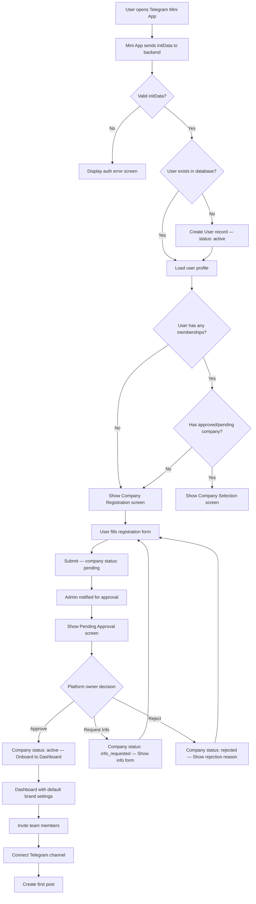

### Onboarding Steps

| Step | Description | Actor |
|------|-------------|-------|
| 1 | User launches Mini App via Telegram | System |
| 2 | Backend validates Telegram `initData` signature | System |
| 3 | User record created or loaded | System |
| 4 | If no active company, present registration form | User |
| 5 | Platform owner reviews and approves | Platform Owner |
| 6 | User selects or is assigned to the company | System |
| 7 | User invites team members (optional) | Company Admin |
| 8 | User connects a Telegram channel | Company Admin |
| 9 | User creates and publishes first post | Content Creator |

---

## Company State Machine

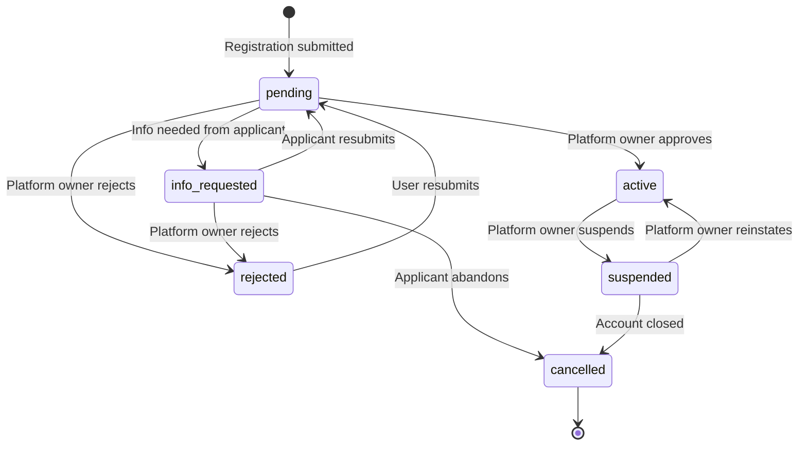

| State | Description | Allowed Transitions |
|-------|-------------|---------------------|
| `pending` | Awaiting platform-owner review | → `active`, `info_requested`, `rejected` |
| `active` | Fully operational tenant | → `suspended` |
| `suspended` | Temporarily blocked (billing, abuse) | → `active`, `cancelled` |
| `rejected` | Application denied | → `pending` (resubmit) |
| `cancelled` | Permanently closed | Terminal |
| `info_requested` | Additional info needed from applicant | → `pending`, `rejected`, `cancelled` |

---

## User State Machine

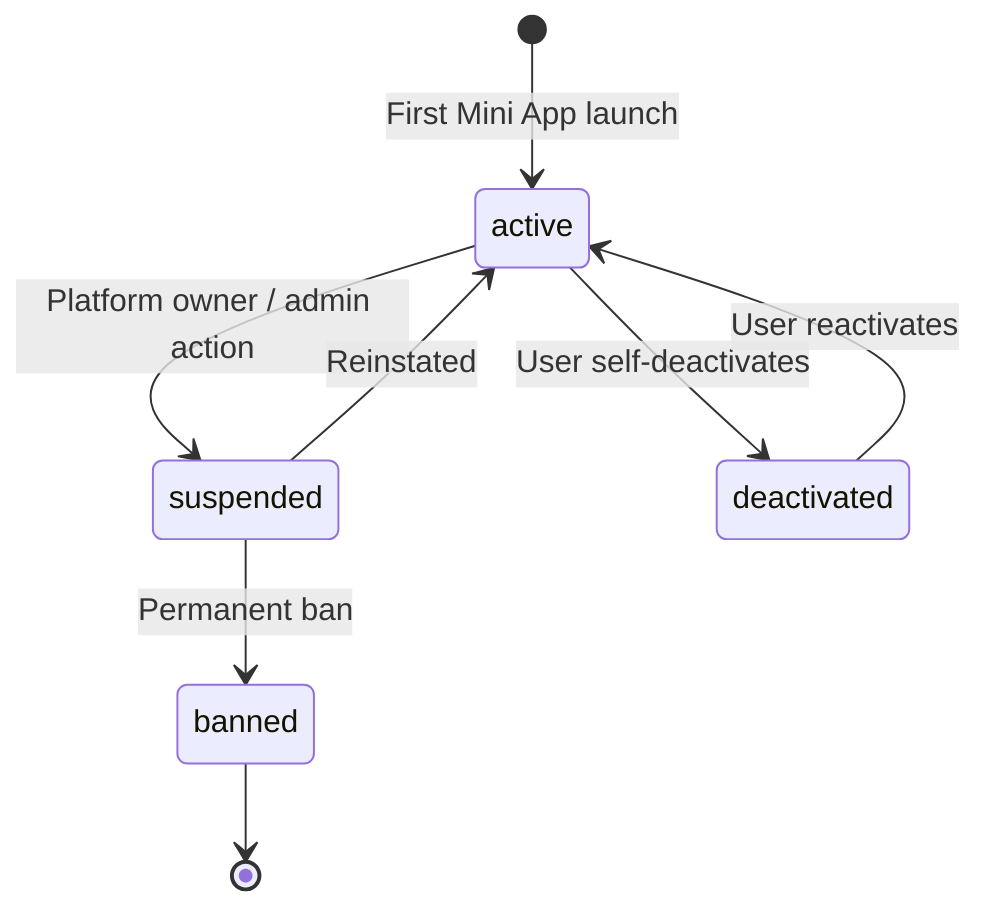

| State | Description |
|-------|-------------|
| `active` | Can authenticate, view data, perform role actions |
| `suspended` | Read-only; cannot create/edit/publish |
| `banned` | No access; initData still valid but rejected |
| `deactivated` | Self-service account freeze |

---

## Invitation State Machine

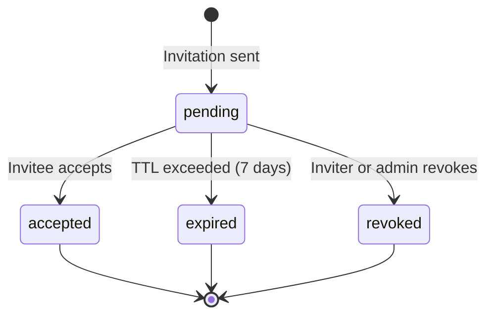

| State | Description | TTL / Notes |
|-------|-------------|-------------|
| `pending` | Awaiting invitee response | 7-day expiry |
| `accepted` | Invitee joined the company | Creates a Membership record |
| `expired` | Window elapsed without response | Non-recoverable |
| `revoked` | Manually cancelled by inviter/admin | Non-recoverable |

---

## Membership State Machine

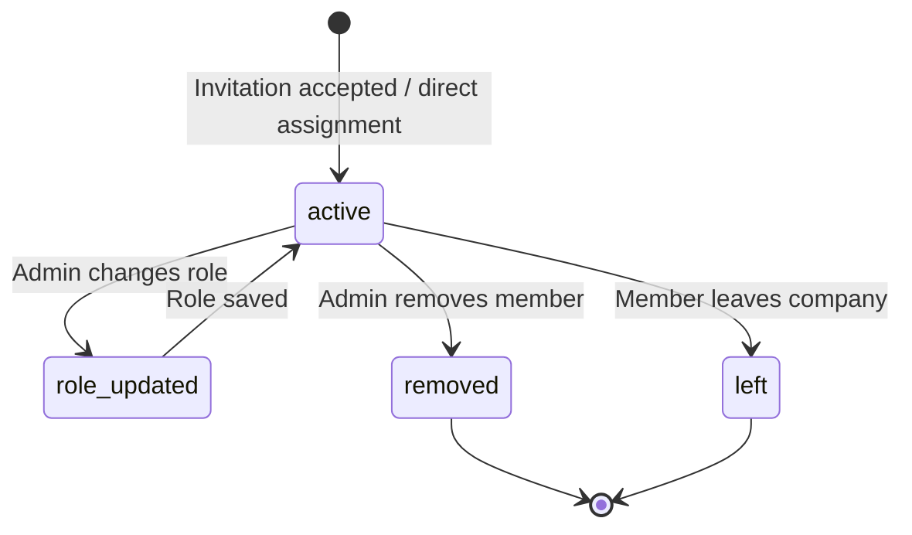

---

## Post State Machine

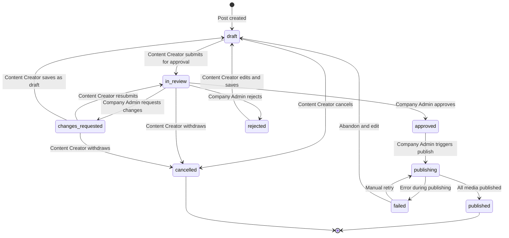

### State Descriptions

| State | Description | Terminal? |
|-------|-------------|-----------|
| `draft` | Being authored; not yet submitted | No |
| `in_review` | Submitted; awaiting Company Admin decision | No |
| `changes_requested` | Company Admin returned post with feedback | No |
| `approved` | Approved and ready to publish | No |
| `rejected` | Company Admin declined the post | No |
| `publishing` | Actively sending to Telegram | No |
| `published` | Successfully published to channel | Yes |
| `failed` | Publishing encountered an error | No |
| `cancelled` | Abandoned by Content Creator | Yes |

---

## Approval Transition Rules

| From State | Action | Required Role | Side Effects |
|------------|--------|---------------|--------------|
| `draft` | Submit for review | Content Creator | Post → `in_review`; notify Company Admins |
| `in_review` | Approve | Company Admin | Post → `approved`; notify Content Creator |
| `in_review` | Request changes | Company Admin | Post → `changes_requested`; notify Content Creator |
| `in_review` | Reject | Company Admin | Post → `rejected`; notify Content Creator |
| `changes_requested` | Resubmit | Content Creator | Post → `in_review`; bump revision |
| `changes_requested` | Save as draft | Content Creator | Post → `draft` |
| `changes_requested` | Withdraw | Content Creator | Post → `cancelled` |
| `approved` | Publish | Company Admin | Post → `publishing` |
| `rejected` | Edit and save | Content Creator | Post → `draft`; bump revision |
| `publishing` | Auto-retry | System | Retry count incremented |
| `failed` | Manual retry | Company Admin | Post → `publishing` |
| `failed` | Abandon | Company Admin | Post → `draft` |

> **Note:** Company Admins cannot approve their own submissions. If a user is both Content Creator and Company Admin, a second Company Admin must approve.

---

## Channel Connection Flow

```mermaid
sequenceDiagram
    participant U as User (Company Admin)
    participant MA as Mini App
    participant BE as Backend
    participant TG as Telegram Bot API

    U->>MA: Tap "Connect Channel"
    MA->>BE: GET /channels/connection-token
    BE->>BE: Generate one-time token (15-min TTL)
    BE-->>MA: { token, botUsername }
    MA->>TG: Deep link to bot with token
    TG->>BE: Webhook — user starts bot
    BE->>BE: Validate token; associate user with channel
    U->>TG: Add bot as channel admin
    TG->>BE: Webhook — chat member update
    BE->>BE: Verify bot has "Post Messages" permission
    BE->>BE: Channel record → connected
    BE-->>MA: WebSocket push — channel_connected
    MA-->>U: Success — channel listed
```

### Required Bot Permissions

| Permission | Purpose |
|------------|---------|
| `can_post_messages` | Send posts to the channel |
| `can_edit_messages` | Edit published posts (optional) |
| `can_delete_messages` | Remove failed posts (optional) |

---

## AI Text Generation Flow

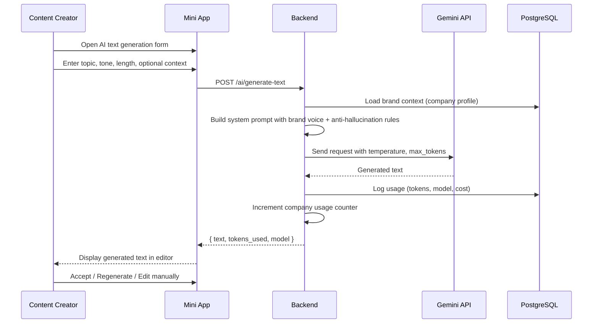

### Anti-Hallucination Rules

1. System prompt enforces: *"Use only the provided brand context. Do not invent facts about the company."*
2. If brand context is empty, generation is blocked with a clear message.
3. Response includes a `confidence` score; low-confidence outputs are flagged.
4. All generated text is treated as a suggestion, never auto-published.

---

## Image Generation and Upload Flow

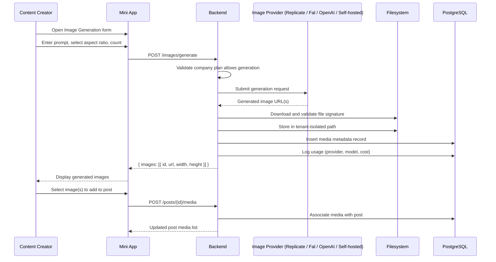

### Image Provider Fallback

If the primary provider returns a `5xx` or timeout:

1. Retry with exponential backoff (max 2 retries).
2. If still failing, attempt failover to secondary provider if configured.
3. If all providers fail, return structured error to UI with user-friendly message.

---

## Post Editing and Revision History

### Revision Lifecycle

| Event | Action | Stored |
|-------|--------|--------|
| Post created | Initial snapshot | `revisions[0]` |
| Content Creator saves draft | New snapshot | `revisions[n]` |
| Submitted for review | Snapshot tagged `submitted` | `revisions[n]` |
| Changes requested | Snapshot tagged `changes_requested` | `revisions[n]` |
| Resubmitted | New snapshot tagged `submitted` | `revisions[n+1]` |
| Approved | Snapshot tagged `approved` | `revisions[n+1]` |

### Revision Record Schema (Conceptual)

| Field | Type | Description |
|-------|------|-------------|
| `id` | UUID | Revision identifier |
| `post_id` | UUID FK | Parent post |
| `version` | integer | Monotonically increasing |
| `caption` | text | Post body |
| `hashtags` | text[] | Hashtag list |
| `cta` | jsonb | Call-to-action object |
| `media_ids` | uuid[] | Ordered media references |
| `created_by` | UUID FK | User who made the change |
| `created_at` | timestamp | Change timestamp |
| `label` | text | Snapshot tag (draft, submitted, etc.) |

> Any user with `Content Creator` role or above can view revision history and restore a prior version.

---

## Approval Workflow

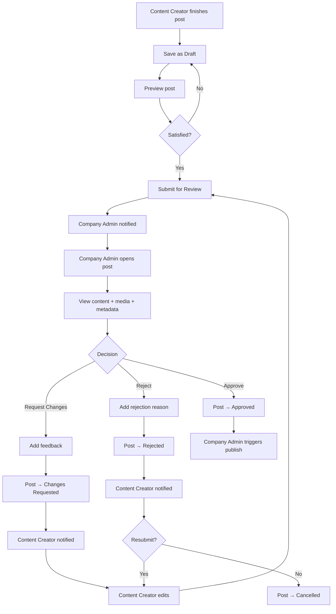

---

## Multi-Image Publishing Flow

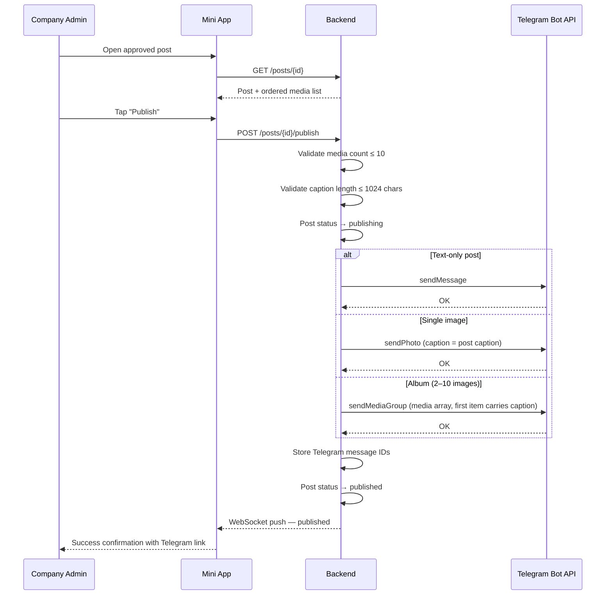

### Album Caption Placement

For multi-image albums, Telegram places the caption on the **first media item** in the array. The backend constructs the album so the first element carries the full post caption; remaining elements have empty captions.

---

## Failure and Retry Handling

### Retry Matrix

| Failure Point | Retry Strategy | Max Retries | User Notification |
|---------------|----------------|-------------|-------------------|
| Telegram API timeout | Exponential backoff (2s, 4s, 8s) | 3 | Silent retry; toast on final failure |
| Telegram rate limit | Wait `retry_after` seconds | Per Telegram response | Toast: "Rate limited — retrying" |
| Image generation provider 5xx | Exponential backoff + failover | 2 per provider | Toast on all-providers failure |
| Image generation provider timeout | Retry with same provider | 1 | Toast on failure |
| Gemini API error | Exponential backoff | 2 | Inline error in editor |
| Media upload (local file) | Immediate retry | 1 | Toast with error detail |

### Post Publishing Failure

1. Post transitions to `failed` with `failure_reason` stored.
2. Failed post is visible in Publication History with a "Retry" button.
3. Retry re-enters `publishing` state; previous Telegram message IDs are checked to avoid duplicates.
4. If 3 retries exhausted, post remains `failed`; user can abandon to `draft` or retry manually.

### Idempotency

All publish requests include an `Idempotency-Key` (UUID) generated by the backend. Telegram API deduplication is leveraged to prevent double-publishing on retry.

---

## Tenant-Isolated Request Authorization

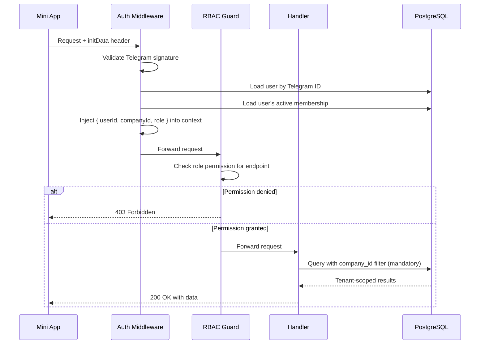

### Isolation Guarantees

| Layer | Mechanism |
|-------|-----------|
| Authentication | Telegram `initData` HMAC validation on every request |
| Authorization | RBAC guard checks role against endpoint permission map |
| Data isolation | Every database query includes `company_id = $current_tenant` |
| File storage | Media stored under `/tenants/{company_id}/...` prefix |
| Cache keys | All Redis cache keys prefixed with `{companyId}:` |
| WebSocket | Connection bound to `companyId` on auth; events filtered per tenant |

---

*End of document.*
