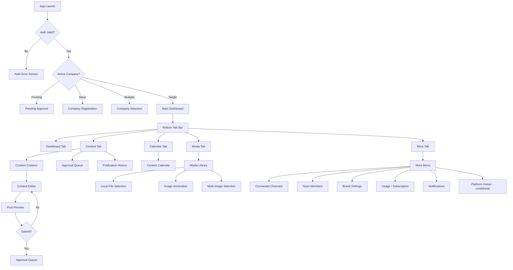

# 08 — Mini App UI/UX Specification

SocialPilot AI · Multi-Tenant Telegram Mini App SaaS

---

## Table of Contents

1. [Navigation Structure](#navigation-structure)
2. [Screen Specifications](#screen-specifications)
   - [01 · App Launch / Auth](#01--app-launch--auth)
   - [02 · Company Registration](#02--company-registration)
   - [03 · Pending Approval](#03--pending-approval)
   - [04 · Company Selection](#04--company-selection)
   - [05 · Main Dashboard](#05--main-dashboard)
   - [06 · Content Creation](#06--content-creation)
   - [07 · AI Text Generation Form](#07--ai-text-generation-form)
   - [08 · Image Generation Form](#08--image-generation-form)
   - [09 · Media Library](#09--media-library)
   - [10 · Local File Selection / Upload](#10--local-file-selection--upload)
   - [11 · Multi-Image Selection / Ordering](#11--multi-image-selection--ordering)
   - [12 · Content Editor](#12--content-editor)
   - [13 · Post Preview](#13--post-preview)
   - [14 · Approval Queue](#14--approval-queue)
   - [15 · Post Details / Revisions](#15--post-details--revisions)
   - [16 · Content Calendar](#16--content-calendar)
   - [17 · Connected Channels](#17--connected-channels)
   - [18 · Team Members / Invitations](#18--team-members--invitations)
   - [19 · Company Profile / Brand Settings](#19--company-profile--brand-settings)
   - [20 · Usage / Subscription](#20--usage--subscription)
   - [21 · Publication History / Analytics](#21--publication-history--analytics)
   - [22 · Notifications / Activity Log](#22--notifications--activity-log)
   - [23 · Platform-Owner Approval Interface](#23--platform-owner-approval-interface)
   - [24 · Platform-Owner Management Interface](#24--platform-owner-management-interface)
3. [Telegram Theme Integration](#telegram-theme-integration)
4. [Responsive / Mobile-First Design Principles](#responsive--mobile-first-design-principles)
5. [Accessibility Requirements](#accessibility-requirements)
6. [Component Library Structure](#component-library-structure)

---

## Navigation Structure



### Bottom Tab Bar

| Tab | Label | Icon | Badge |
|-----|-------|------|-------|
| 1 | Dashboard | Home | — |
| 2 | Content | Plus / Create | Pending count |
| 3 | Calendar | Calendar | — |
| 4 | Media | Image | — |
| 5 | More | Menu / Dots | Notification count |

---

## Screen Specifications

### 01 · App Launch / Auth

| Attribute | Specification |
|-----------|---------------|
| **Purpose** | Authenticate the user via Telegram initData and bootstrap the session. |
| **Entry point** | User taps the Mini App from Telegram chat or bot menu. |
| **Layout** | Full-screen centered layout. App logo (animated), loading spinner, status text. |
| **Components** | `SplashScreen`, `LoadingSpinner`, `ErrorBanner`, `RetryButton` |
| **Data displayed** | App branding, loading state indicator. |
| **User actions** | None (automatic flow). "Retry" button on error. |
| **Required permissions** | None (pre-auth). |
| **Loading state** | Animated spinner with "Authenticating…" text. |
| **Empty state** | Not applicable. |
| **Error state** | `ErrorBanner` with message "Authentication failed. Please restart the Mini App." + `RetryButton`. |
| **Form validation** | N/A. |
| **API requests** | `POST /auth/init-data` (sends raw initData string). |
| **Success feedback** | Navigates to Company Selection or Dashboard. |
| **Failure feedback** | Error banner with retry option. |

---

### 02 · Company Registration

| Attribute | Specification |
|-----------|---------------|
| **Purpose** | Allow a new user to register a company for platform-owner approval. |
| **Entry point** | Auto-navigated when user has zero active memberships. |
| **Layout** | Scrollable form, single column, grouped sections with headers. |
| **Components** | `FormInput`, `FormSelect`, `TextArea`, `SubmitButton`, `FormValidationMessage`, `SectionCard` |
| **Data displayed** | Form fields (company name, industry, website, description, logo upload). |
| **User actions** | Fill form, upload logo, submit. |
| **Required permissions** | Any authenticated user. |
| **Loading state** | Submit button shows spinner; form fields disabled. |
| **Empty state** | N/A (registration form is always shown). |
| **Error state** | Inline field-level validation errors; server errors shown as toast. |
| **Form validation** | Company name: required, 3–100 chars. Industry: required, select from list. Website: valid URL. Description: max 500 chars. Logo: image file, max 5 MB. |
| **API requests** | `POST /companies` (multipart/form-data for logo). |
| **Success feedback** | Navigate to Pending Approval screen. Toast: "Application submitted". |
| **Failure feedback** | Inline field errors; toast for server errors. |

---

### 03 · Pending Approval

| Attribute | Specification |
|-----------|---------------|
| **Purpose** | Inform the user that their company application is under review. |
| **Entry point** | After company registration submission. |
| **Layout** | Centered card with status illustration, description text, action buttons. |
| **Components** | `StatusIllustration`, `InfoCard`, `CancelApplicationButton`, `EditApplicationButton` |
| **Data displayed** | Company name, submission date, estimated review time, application status badge. |
| **User actions** | Cancel application, view/edit application (if `info_requested`). |
| **Required permissions** | Company applicant. |
| **Loading state** | N/A (static content). |
| **Empty state** | If application was rejected → show rejection reason card. |
| **Error state** | N/A. |
| **Form validation** | N/A. |
| **API requests** | `GET /companies/{id}/status` (polling every 30s or WebSocket event). |
| **Success feedback** | Auto-navigates to Dashboard on WebSocket `company_approved` event. |
| **Failure feedback** | Graceful fallback if WebSocket disconnects — polling continues. |

---

### 04 · Company Selection

| Attribute | Specification |
|-----------|---------------|
| **Purpose** | Let the user choose which company context to work in. |
| **Entry point** | When user has 2+ active memberships. |
| **Layout** | Vertical list of company cards, each with logo, name, role badge. |
| **Components** | `CompanyCard`, `RoleBadge`, `CreateCompanyButton` |
| **Data displayed** | Company logo, company name, user's role in each company. |
| **User actions** | Tap a company card to enter; tap "Register New Company" to start new registration. |
| **Required permissions** | Any authenticated user. |
| **Loading state** | Skeleton cards while loading. |
| **Empty state** | "No companies found" with CTA to register. |
| **Error state** | Error card with retry button. |
| **Form validation** | N/A. |
| **API requests** | `GET /companies/my` — returns all companies the user belongs to. |
| **Success feedback** | Navigates to Dashboard with selected company context. |
| **Failure feedback** | Error card with retry. |

---

### 05 · Main Dashboard

| Attribute | Specification |
|-----------|---------------|
| **Purpose** | Provide an at-a-glance overview of content pipeline, recent activity, and quick actions. |
| **Entry point** | Default landing screen after company selection. |
| **Layout** | Scrollable vertical feed: greeting header → stats row → quick actions → recent activity → upcoming scheduled posts. |
| **Components** | `GreetingHeader`, `StatCard`, `QuickActionButton`, `ActivityFeedItem`, `ScheduledPostCard`, `EmptyState` |
| **Data displayed** | User greeting, company name; stats: posts this week, pending reviews, connected channels; recent activity (last 5); upcoming scheduled posts (next 3). |
| **User actions** | Quick action: New Post, Generate AI Text, Upload Media; tap activity item for detail; tap scheduled post to view. |
| **Required permissions** | Any company member. |
| **Loading state** | Skeleton cards for all sections. |
| **Empty state** | "No recent activity" + "No upcoming posts" placeholders with CTAs. |
| **Error state** | Per-section error banners with retry; partial data still renders. |
| **Form validation** | N/A. |
| **API requests** | `GET /dashboard/summary`, `GET /dashboard/activity`, `GET /dashboard/upcoming`. |
| **Success feedback** | Data populates; pull-to-refresh available. |
| **Failure feedback** | Per-section error banners. |

---

### 06 · Content Creation

| Attribute | Specification |
|-----------|---------------|
| **Purpose** | Hub for initiating content creation from various starting points. |
| **Entry point** | Content tab → "Create" button. |
| **Layout** | Grid of creation option cards (2×2 or list). |
| **Components** | `CreationOptionCard`, `RecentDraftCard` |
| **Data displayed** | Options: Text Post, Image Post, Album Post, AI-Assisted Post. Recent drafts list (last 3). |
| **User actions** | Select creation type; tap recent draft to resume editing. |
| **Required permissions** | Content Creator. |
| **Loading state** | Skeleton cards. |
| **Empty state** | "No drafts yet" if no recent drafts. |
| **Error state** | Error banner on draft load failure. |
| **Form validation** | N/A. |
| **API requests** | `GET /posts?status=draft&limit=3`. |
| **Success feedback** | Navigates to Content Editor or AI Text Gen form based on selection. |
| **Failure feedback** | Error banner. |

---

### 07 · AI Text Generation Form

| Attribute | Specification |
|-----------|---------------|
| **Purpose** | Generate AI-powered post copy using Gemini with brand context. |
| **Entry point** | Content Creation → "AI-Assisted Post" or Content Editor → "Generate with AI" button. |
| **Layout** | Single-column form: topic input → tone selector → length slider → context textarea → generate button → result area. |
| **Components** | `FormInput`, `ToneSelector` (chip group), `Slider`, `TextArea`, `GenerateButton`, `GeneratedTextCard`, `RegenerateButton`, `AcceptButton`, `CopyButton` |
| **Data displayed** | Generated text output, token count, model badge, confidence indicator. |
| **User actions** | Enter parameters, generate, regenerate, accept into editor, copy to clipboard. |
| **Required permissions** | Content Creator. |
| **Loading state** | Generate button shows spinner; skeleton text area while streaming. |
| **Empty state** | Prompt area with example topic suggestions (chips). |
| **Error state** | Inline error if brand context missing: "Complete your brand settings first." API errors shown as toast. |
| **Form validation** | Topic: required, min 5 chars. Tone: required selection. Length: 50–2000 chars range. Context: max 1000 chars optional. |
| **API requests** | `POST /ai/generate-text` (streaming SSE response). |
| **Success feedback** | Generated text appears with subtle animation; accept button enabled. |
| **Failure feedback** | Toast with specific error; "Try Again" button on result area. |

---

### 08 · Image Generation Form

| Attribute | Specification |
|-----------|---------------|
| **Purpose** | Generate AI images via provider interface with configurable prompt, ratio, and count. |
| **Entry point** | Media tab → "Generate Image" or Content Editor → "Add Generated Image". |
| **Layout** | Form section (prompt, aspect ratio, count) → generate button → results grid (2-col). |
| **Components** | `TextArea`, `AspectRatioSelector` (button group), `CountStepper`, `GenerateButton`, `ImageResultCard`, `SelectButton`, `RegenerateButton`, `ProviderBadge` |
| **Data displayed** | Generated image thumbnails, provider name badge, generation status per image. |
| **User actions** | Enter prompt, select ratio (1:1, 16:9, 9:16, 4:3), set count (1–4), generate, select result, regenerate. |
| **Required permissions** | Content Creator. |
| **Loading state** | Skeleton image placeholders with shimmer; per-image loading indicator. |
| **Empty state** | Prompt area with example prompt suggestions. |
| **Error state** | Per-image error overlay with retry; global error if provider unavailable. |
| **Form validation** | Prompt: required, min 10 chars. Aspect ratio: required. Count: 1–4. |
| **API requests** | `POST /images/generate`. |
| **Success feedback** | Images populate grid with fade-in animation; select button enabled. |
| **Failure feedback** | Per-image error with retry; global provider error toast. |

---

### 09 · Media Library

| Attribute | Specification |
|-----------|---------------|
| **Purpose** | Browse all uploaded and generated media assets for the current company. |
| **Entry point** | Media tab. |
| **Layout** | Filter bar (tabs: All / Uploaded / Generated / Used in Posts) → search input → grid (3-col) of media thumbnails. |
| **Components** | `FilterTabBar`, `SearchInput`, `MediaGrid`, `MediaThumbnail`, `MediaFilterChip`, `EmptyState` |
| **Data displayed** | Media thumbnails with type badge (uploaded/generated), usage indicator. |
| **User actions** | Filter, search, tap thumbnail to preview, long-press for multi-select. |
| **Required permissions** | Any company member (read). |
| **Loading state** | Skeleton grid. |
| **Empty state** | "No media yet" with CTA buttons: "Upload" and "Generate". |
| **Error state** | Error banner with retry. |
| **Form validation** | N/A. |
| **API requests** | `GET /media?type=&search=&page=`. |
| **Success feedback** | Grid populates; pull-to-refresh. |
| **Failure feedback** | Error banner. |

---

### 10 · Local File Selection / Upload

| Attribute | Specification |
|-----------|---------------|
| **Purpose** | Select and upload local device images to the company media library. |
| **Entry point** | Media Library → "Upload" button or Content Editor → "Upload from Device". |
| **Layout** | Native file picker → selected files preview list (horizontal scroll) → upload button → progress overlay. |
| **Components** | `FilePickerButton` (uses Telegram `openFilePicker` or native input), `SelectedFileCard`, `RemoveButton`, `UploadProgressBar`, `UploadCompleteToast` |
| **Data displayed** | File thumbnails, file names, file sizes, upload progress per file. |
| **User actions** | Open file picker, select multiple files, remove individual files, confirm upload. |
| **Required permissions** | Content Creator. |
| **Loading state** | Progress bar per file; disable remove during upload. |
| **Empty state** | "Select images to upload" placeholder. |
| **Error state** | Per-file error badge with reason (size, type, signature mismatch); retry option. |
| **Form validation** | Max 10 files per selection. Max 10 MB per file. Allowed: JPEG, PNG, WebP, GIF. File signature (magic bytes) validated server-side. |
| **API requests** | `POST /media/upload` (multipart/form-data, supports batch). |
| **Success feedback** | Toast: "3 images uploaded"; images appear in Media Library. |
| **Failure feedback** | Per-file error badges; partial success indicated ("2 of 3 uploaded"). |

---

### 11 · Multi-Image Selection / Ordering

| Attribute | Specification |
|-----------|---------------|
| **Purpose** | Select multiple media items and arrange their order for album posts. |
| **Entry point** | Content Editor → "Add Multiple Images" or Media Library → long-press → "Add to Post". |
| **Layout** | Grid of selectable media (3-col) with selection counter → bottom bar shows selected count and "Add" button → after add: horizontal ordered list with drag handles. |
| **Components** | `SelectableMediaGrid`, `SelectionCounter`, `OrderedMediaList`, `DragHandle`, `RemoveButton`, `AddToPostButton` |
| **Data displayed** | Media thumbnails with selection order badges (1, 2, 3...), drag handle icons. |
| **User actions** | Tap to select/deselect, drag to reorder, remove from selection, confirm add to post. |
| **Required permissions** | Content Creator. |
| **Loading state** | Skeleton grid. |
| **Empty state** | "No media available" with upload/generate CTAs. |
| **Error state** | Error banner. |
| **Form validation** | Min 2, max 10 images for album. Warn if >10 selected: "Telegram albums support up to 10 images." |
| **API requests** | `GET /media` for library; `POST /posts/{id}/media` to attach. |
| **Success feedback** | Toast: "5 images added to post"; navigate to Content Editor. |
| **Failure feedback** | Toast with error; selected state preserved. |

---

### 12 · Content Editor

| Attribute | Specification |
|-----------|---------------|
| **Purpose** | Compose and edit post content: caption, media, hashtags, CTA. |
| **Entry point** | Content Creation flow, Post Details → Edit, Draft resume. |
| **Layout** | Vertical scroll: media strip (horizontal scroll) → caption textarea (auto-resize) → hashtag chips input → CTA configurator → bottom action bar. |
| **Components** | `MediaStrip`, `CaptionTextArea`, `HashtagInput`, `CTAPicker`, `SaveDraftButton`, `PreviewButton`, `SubmitButton`, `WordCounter`, `MediaAddButton`, `MediaRemoveButton`, `AIMagicButton` |
| **Data displayed** | Current post content, media items in order, character/word count, revision indicator. |
| **User actions** | Edit caption, add/remove/reorder media, add hashtags, configure CTA, generate AI text, save draft, preview, submit. |
| **Required permissions** | Content Creator. |
| **Loading state** | Skeleton for media strip and text areas. |
| **Empty state** | "Start writing your post…" placeholder in caption area; "Add media" empty strip. |
| **Error state** | Autosave failure banner: "Could not auto-save. Retry." |
| **Form validation** | Caption: 1–1024 chars (Telegram limit). Hashtags: max 30, each max 100 chars, auto-prepend #. CTA: max 1, URL required if label set. |
| **API requests** | `GET /posts/{id}`, `PUT /posts/{id}` (autosave debounced 2s), `POST /ai/generate-text`, `POST /images/generate`, `POST /media/upload`. |
| **Success feedback** | "Draft saved" toast on autosave; media add/remove animations. |
| **Failure feedback** | Autosave retry banner; API error toasts. |

---

### 13 · Post Preview

| Attribute | Specification |
|-----------|---------------|
| **Purpose** | Show a Telegram-accurate preview of how the post will appear in the channel. |
| **Entry point** | Content Editor → "Preview" button. |
| **Layout** | Phone-mockup frame containing simulated Telegram message bubble with rendered media and caption. |
| **Components** | `PhoneMockup`, `TelegramMessageBubble`, `MediaPreview`, `CaptionPreview`, `CloseButton`, `EditButton`, `SubmitButton` |
| **Data displayed** | Rendered media (album grid or single), caption with hashtags, CTA button mockup. |
| **User actions** | Close preview, navigate back to editor, submit for review. |
| **Required permissions** | Content Creator. |
| **Loading state** | Skeleton bubble while media URLs resolve. |
| **Empty state** | "Nothing to preview" if post is completely empty. |
| **Error state** | Media load failure shows placeholder thumbnail. |
| **Form validation** | N/A (read-only preview). |
| **API requests** | None (uses already-loaded post data). |
| **Success feedback** | Preview renders accurately. |
| **Failure feedback** | Placeholder for failed media. |

---

### 14 · Approval Queue

| Attribute | Specification |
|-----------|---------------|
| **Purpose** | Display posts awaiting approval for the current company. |
| **Entry point** | Content tab → "Approvals" or bottom tab badge. |
| **Layout** | Filter tabs (Pending / Changes Requested) → vertical list of post cards. |
| **Components** | `FilterTabBar`, `PostCard`, `StatusBadge`, `ApproverAvatar`, `EmptyState` |
| **Data displayed** | Post thumbnails, title/excerpt, submitted by, submission date, status badge, feedback snippet (for changes requested). |
| **User actions** | Tap card to open Post Details; filter by status. |
| **Required permissions** | Company Admin (to act); Content Creator (to view own submissions). |
| **Loading state** | Skeleton cards. |
| **Empty state** | "No posts awaiting approval" illustration. |
| **Error state** | Error banner with retry. |
| **Form validation** | N/A. |
| **API requests** | `GET /posts?status=in_review,changes_requested&role=approver`. |
| **Success feedback** | List populates; real-time updates via WebSocket. |
| **Failure feedback** | Error banner. |

---

### 15 · Post Details / Revisions

| Attribute | Specification |
|-----------|---------------|
| **Purpose** | View full post content, media, metadata, and complete revision history. |
| **Entry point** | Approval Queue → tap post; Content → Post History → tap post; Dashboard → activity item. |
| **Layout** | Scrollable: post content → media grid → metadata section → revision history timeline → action buttons. |
| **Components** | `PostContent`, `MediaGrid`, `MetadataSection`, `RevisionTimeline`, `RevisionCard`, `RestoreButton`, `ActionButtonGroup` |
| **Data displayed** | Full caption, media, hashtags, CTA, status, submitter, timestamps; full revision list with author, date, change summary. |
| **User actions** | View details, restore previous revision, perform approval actions, navigate to editor. |
| **Required permissions** | Any company member (read); Company Admin for actions. |
| **Loading state** | Skeleton for all sections. |
| **Empty state** | "Post not found" (deleted or inaccessible). |
| **Error state** | Error banner with retry. |
| **Form validation** | N/A. |
| **API requests** | `GET /posts/{id}`, `GET /posts/{id}/revisions`. |
| **Success feedback** | Full post renders; revision history timeline visible. |
| **Failure feedback** | Error banner; 404 shows "Post not found". |

---

### 16 · Content Calendar

| Attribute | Specification |
|-----------|---------------|
| **Purpose** | Visualize scheduled and published posts on a monthly calendar. |
| **Entry point** | Calendar tab. |
| **Layout** | Month grid with navigation arrows → post dots/thumbnails on dates → tap date to see list below. |
| **Components** | `CalendarGrid`, `CalendarDay`, `PostDot`, `PostThumbnailMini`, `DateDetailList`, `MonthNavigator` |
| **Data displayed** | Post thumbnails/dots on dates, post count per day, status color coding. |
| **User actions** | Swipe between months, tap date to filter, tap post to view details. |
| **Required permissions** | Any company member. |
| **Loading state** | Skeleton calendar grid. |
| **Empty state** | "No posts this month" below calendar. |
| **Error state** | Error banner. |
| **Form validation** | N/A. |
| **API requests** | `GET /posts?month=YYYY-MM&view=calendar`. |
| **Success feedback** | Calendar populates with post indicators. |
| **Failure feedback** | Error banner. |

---

### 17 · Connected Channels

| Attribute | Specification |
|-----------|---------------|
| **Purpose** | Manage Telegram channels connected to the company. |
| **Entry point** | More tab → "Channels". |
| **Layout** | List of connected channel cards → "Connect New Channel" button at bottom. |
| **Components** | `ChannelCard`, `ChannelStatusBadge`, `DisconnectButton`, `ConnectButton`, `BotInstructionStep`, `EmptyState` |
| **Data displayed** | Channel name, Telegram handle, connection status, bot admin status, connected date, post count. |
| **User actions** | Connect new channel (deep link flow), view instructions, disconnect channel. |
| **Required permissions** | Company Admin. |
| **Loading state** | Skeleton cards. |
| **Empty state** | "No channels connected" with illustration and CTA. |
| **Error state** | Error banner; connection failure shows specific reason. |
| **Form validation** | N/A (channel connection is bot-driven). |
| **API requests** | `GET /channels`, `DELETE /channels/{id}`, `GET /channels/connection-token`. |
| **Success feedback** | "Channel connected" toast; card appears in list. |
| **Failure feedback** | Specific error: "Bot not admin in channel", "Invalid token", etc. |

---

### 18 · Team Members / Invitations

| Attribute | Specification |
|-----------|---------------|
| **Purpose** | Manage company team members, roles, and pending invitations. |
| **Entry point** | More tab → "Team". |
| **Layout** | Section: Pending Invitations → Active Members → Invite button. Each member row: avatar, name, role badge, actions. |
| **Components** | `MemberRow`, `RoleBadge`, `InviteButton`, `InvitationCard`, `RevokeButton`, `RemoveMemberButton`, `RoleSelector`, `ResendInviteButton` |
| **Data displayed** | Member name, Telegram username, role, join date; invitation email/phone, expiry date. |
| **User actions** | Invite new member, change role, remove member, resend/revoke invitation. |
| **Required permissions** | Company Admin. |
| **Loading state** | Skeleton rows. |
| **Empty state** | "No team members yet" for empty companies. |
| **Error state** | Error banner; per-action error toasts. |
| **Form validation** | Invite: valid email or Telegram username, role selection required. Role change: cannot demote last Owner. |
| **API requests** | `GET /members`, `POST /invitations`, `PATCH /members/{id}/role`, `DELETE /members/{id}`, `DELETE /invitations/{id}`. |
| **Success feedback** | Toast: "Invitation sent"; member list updates. |
| **Failure feedback** | Toast: specific error (e.g., "User already a member"). |

---

### 19 · Company Profile / Brand Settings

| Attribute | Specification |
|-----------|---------------|
| **Purpose** | Configure company profile and brand voice used for AI generation context. |
| **Entry point** | More tab → "Brand Settings". |
| **Layout** | Scrollable form sections: Company Info → Brand Voice → AI Preferences → Save button. |
| **Components** | `FormInput`, `TextArea`, `ToneSelector`, `KeywordTagInput`, `ColorPicker`, `LogoUploader`, `SaveButton`, `FormSection` |
| **Data displayed** | Company name, logo, description, industry, website; brand voice tone, key messaging points, target audience, vocabulary do/don't lists. |
| **User actions** | Edit any field, upload logo, save changes. |
| **Required permissions** | Company Admin. |
| **Loading state** | Skeleton fields; Save button spinner. |
| **Empty state** | N/A (form always visible). |
| **Error state** | Inline field errors; save failure toast. |
| **Form validation** | Company name: 3–100 chars. Description: max 500. Key messaging: max 5 items, each 200 chars. Do/Don't vocabulary: max 20 items each. |
| **API requests** | `GET /companies/{id}`, `PUT /companies/{id}` (includes brand settings). |
| **Success feedback** | "Settings saved" toast. |
| **Failure feedback** | Inline errors; toast on save failure. |

---

### 20 · Usage / Subscription

| Attribute | Specification |
|-----------|---------------|
| **Purpose** | Display current plan, usage metrics, and subscription management. |
| **Entry point** | More tab → "Usage & Billing". |
| **Layout** | Plan card at top → usage meters (posts, AI generations, image generations, storage) → upgrade/manage button. |
| **Components** | `PlanCard`, `UsageMeter`, `UsageProgressBar`, `UpgradeButton`, `BillingHistoryList`, `LimitWarning` |
| **Data displayed** | Current plan name, billing period, usage counts vs. limits for each feature, over-limit warnings. |
| **User actions** | View usage details, upgrade plan, view billing history. |
| **Required permissions** | Company Admin. |
| **Loading state** | Skeleton for all sections. |
| **Empty state** | N/A (always shows current plan). |
| **Error state** | Error banner. |
| **Form validation** | N/A. |
| **API requests** | `GET /usage/summary`, `GET /billing/history`. |
| **Success feedback** | Usage data renders accurately. |
| **Failure feedback** | Error banner. |

---

### 21 · Publication History / Analytics

| Attribute | Specification |
|-----------|---------------|
| **Purpose** | Review all published posts with performance analytics. |
| **Entry point** | Content tab → "History" or Dashboard → "View All". |
| **Layout** | Filter bar (date range, status) → analytics summary cards → list of published post cards. |
| **Components** | `FilterBar`, `AnalyticsSummaryCard`, `PublishedPostCard`, `MetricBadge`, `RetryButton`, `FailureReasonCard` |
| **Data displayed** | Post title/thumbnail, publish date, channel, status (published/failed), metrics (views, shares, clicks), failure reason for failed posts. |
| **User actions** | Filter, tap post for details, retry failed posts. |
| **Required permissions** | Any company member. |
| **Loading state** | Skeleton cards. |
| **Empty state** | "No published posts yet" with CTA. |
| **Error state** | Error banner; failed posts show `FailureReasonCard`. |
| **Form validation** | N/A. |
| **API requests** | `GET /posts?status=published,failed&from=&to=`. |
| **Success feedback** | History renders; failed posts have retry option. |
| **Failure feedback** | Error banner. |

---

### 22 · Notifications / Activity Log

| Attribute | Specification |
|-----------|---------------|
| **Purpose** | Show all notifications and activity events for the current user/company. |
| **Entry point** | More tab → "Notifications" or bottom tab badge. |
| **Layout** | Scrollable activity feed with grouped sections (Today, This Week, Earlier). |
| **Components** | `ActivityFeedItem`, `NotificationIcon`, `TimestampLabel`, `SectionHeader`, `ClearAllButton`, `MarkAsReadButton`, `EmptyState` |
| **Data displayed** | Event type icon, description text, timestamp, read/unread indicator. |
| **User actions** | Tap item for detail, mark as read, clear all. |
| **Required permissions** | Any company member. |
| **Loading state** | Skeleton feed items. |
| **Empty state** | "No notifications" illustration. |
| **Error state** | Error banner. |
| **Form validation** | N/A. |
| **API requests** | `GET /notifications`, `PATCH /notifications/{id}/read`, `POST /notifications/clear`. |
| **Success feedback** | Read status updates with animation; badge counts decrement. |
| **Failure feedback** | Error toast. |

---

### 23 · Platform-Owner Approval Interface

| Attribute | Specification |
|-----------|---------------|
| **Purpose** | Allow platform owners to review and approve/reject company registrations. |
| **Entry point** | Platform owner role only → special "Admin" tab in bottom bar. |
| **Layout** | Stats row (pending count, approved today) → filter tabs (Pending / Info Requested / All) → company application cards. |
| **Components** | `StatCard`, `FilterTabBar`, `CompanyApplicationCard`, `ApproveButton`, `RequestInfoButton`, `RejectButton`, `RejectionReasonModal`, `ApprovalConfirmModal` |
| **Data displayed** | Company name, applicant name, submission date, industry, website, description, status. |
| **User actions** | View application details, approve, request info (with message), reject (with reason). |
| **Required permissions** | Platform Owner (global role). |
| **Loading state** | Skeleton cards. |
| **Empty state** | "No pending applications" |
| **Error state** | Error banner. |
| **Form validation** | Reject: reason required (min 10 chars). Request Info: message required (min 10 chars). |
| **API requests** | `GET /admin/companies?status=pending`, `POST /admin/companies/{id}/approve`, `POST /admin/companies/{id}/reject`, `POST /admin/companies/{id}/request-info`. |
| **Success feedback** | Confirmation modal → toast: "Company approved" → card removed from queue. |
| **Failure feedback** | Error toast; action not completed. |

---

### 24 · Platform-Owner Management Interface

| Attribute | Specification |
|-----------|---------------|
| **Purpose** | Platform-wide oversight: all companies, usage metrics, system health. |
| **Entry point** | Platform owner role → "Admin" tab → "Management". |
| **Layout** | Top stats row → company search/filter → company list table → detail drawer on tap. |
| **Components** | `StatCard`, `SearchInput`, `CompanyTable`, `CompanyRow`, `StatusBadge`, `DetailDrawer`, `SuspendButton`, `ReinstateButton`, `MetricsChart` |
| **Data displayed** | Company name, status, member count, post count, usage totals, suspension history. |
| **User actions** | Search, filter by status, view company details, suspend/reinstate company, view metrics. |
| **Required permissions** | Platform Owner (global role). |
| **Loading state** | Skeleton table rows. |
| **Empty state** | "No companies match your search." |
| **Error state** | Error banner. |
| **Form validation** | Suspend: reason required. |
| **API requests** | `GET /admin/companies?search=&status=`, `POST /admin/companies/{id}/suspend`, `POST /admin/companies/{id}/reinstate`, `GET /admin/metrics`. |
| **Success feedback** | Status change confirmed; metrics render. |
| **Failure feedback** | Error toast. |

---

## Telegram Theme Integration

SocialPilot AI runs as a Telegram Mini App and must adapt to the user's Telegram theme (light/dark/system).

### Implementation Approach

| Layer | Strategy |
|-------|----------|
| CSS Custom Properties | All colors defined as `--color-bg-primary`, `--color-bg-secondary`, `--color-text-primary`, etc. |
| Theme Variables | On app load, Telegram JS SDK provides `themeParams` object with hex colors. These map directly to CSS custom properties. |
| Fallback Defaults | If `themeParams` is empty, use a sensible default palette (light theme). |
| System Theme | Listen to `themeChanged` event from Telegram JS SDK and update CSS variables in real-time. |
| Component Styling | All components consume CSS variables, never hard-coded hex values. |

### Theme Variable Map

| CSS Variable | Telegram themeParam | Usage |
|-------------|-------------------|-------|
| `--color-bg-primary` | `bg_color` | Screen backgrounds |
| `--color-bg-secondary` | `secondary_bg_color` | Cards, sheets, modals |
| `--color-text-primary` | `text_color` | Headings, body text |
| `--color-text-secondary` | `hint_color` | Captions, placeholders |
| `--color-accent` | `link_color` | Buttons, links, active states |
| `--color-destructive` | `#FF3B30` (fixed) | Delete, error, destructive actions |
| `--color-success` | `#34C759` (fixed) | Success states, approved |
| `--color-warning` | `#FF9500` (fixed) | Pending, caution |
| `--color-border` | `hint_color` at 30% opacity | Dividers, input borders |

### Safe Areas

- Respect Telegram's safe area insets (`SafeAreaInsets` from SDK) for notch/home indicator.
- Bottom tab bar must sit above the home indicator gesture area.

---

## Responsive / Mobile-First Design Principles

### Design Constraints

| Constraint | Value |
|-----------|-------|
| Target device | Mobile-first (Telegram Mini App runs inside Telegram client) |
| Min viewport | 320 × 568 (iPhone SE) |
| Max content width | 768px (tablet); centered with side padding beyond this |
| Touch target | Minimum 44 × 44 px |
| Font minimum | 14px body, 12px caption |
| Safe area | Top: status bar + Telegram header; Bottom: gesture bar |

### Layout Strategy

1. **Single-column** layouts on mobile; two-column only on tablet/desktop widths.
2. **Bottom navigation** for primary navigation (always reachable with thumb).
3. **Floating Action Button (FAB)** for "New Post" on Dashboard and Content screens.
4. **Horizontal scrolling** strips for media carousels (snap points enabled).
5. **Modals / Bottom Sheets** for forms (easier one-handed interaction).
6. **Pull-to-refresh** on all list/grid screens.

### Performance

| Metric | Target |
|--------|--------|
| Time to Interactive | < 2s on 4G |
| First Contentful Paint | < 1s |
| Frame rate | 60fps scrolling |
| Bundle size | < 500 KB gzipped (initial) |

---

## Accessibility Requirements

### WCAG 2.1 Level AA Compliance

| Requirement | Implementation |
|-------------|---------------|
| **Color contrast** | Minimum 4.5:1 for body text, 3:1 for large text and UI components. All color pairs verified against both light and dark themes. |
| **Touch targets** | Minimum 44 × 44 px for all interactive elements. |
| **Focus indicators** | Visible focus ring on all interactive elements (2px solid accent color). |
| **Screen reader** | All images have `alt` text. Icon buttons have `aria-label`. Form fields associated with `<label>`. |
| **Dynamic regions** | Loading states, toasts, and async updates use `aria-live="polite"` for screen reader announcements. |
| **Color independence** | Status is never conveyed by color alone — always paired with icon + text label. |
| **Text scaling** | Layout must support system font scaling up to 200% without truncation of critical content. |
| **Reduced motion** | `@media (prefers-reduced-motion: reduce)` disables animations; state changes are instant. |

### Semantic HTML

| Element | Usage |
|---------|-------|
| `<button>` | All interactive actions |
| `<a>` | Navigation links |
| `<input>` / `<textarea>` / `<select>` | Form controls with associated `<label>` |
| `<nav>` | Bottom tab bar |
| `<main>` | Primary content area |
| `<header>` | Screen headers |
| `<ul>` / `<ol>` | List displays |

---

## Component Library Structure

```
src/
├── components/
│   ├── ui/                          # Primitives (design tokens)
│   │   ├── Button/
│   │   │   ├── Button.tsx
│   │   │   ├── ButtonGroup.tsx
│   │   │   └── IconButton.tsx
│   │   ├── Input/
│   │   │   ├── TextInput.tsx
│   │   │   ├── TextArea.tsx
│   │   │   ├── SearchInput.tsx
│   │   │   └── FileInput.tsx
│   │   ├── Select/
│   │   │   ├── Select.tsx
│   │   │   ├── ChipSelect.tsx
│   │   │   └── Stepper.tsx
│   │   ├── Card/
│   │   │   ├── Card.tsx
│   │   │   ├── SectionCard.tsx
│   │   │   └── InfoCard.tsx
│   │   ├── Badge/
│   │   │   ├── Badge.tsx
│   │   │   ├── StatusBadge.tsx
│   │   │   └── RoleBadge.tsx
│   │   ├── Feedback/
│   │   │   ├── LoadingSpinner.tsx
│   │   │   ├── Skeleton.tsx
│   │   │   ├── EmptyState.tsx
│   │   │   ├── ErrorBanner.tsx
│   │   │   └── Toast.tsx
│   │   ├── Overlay/
│   │   │   ├── Modal.tsx
│   │   │   ├── BottomSheet.tsx
│   │   │   └── ConfirmDialog.tsx
│   │   └── Navigation/
│   │       ├── BottomTabBar.tsx
│   │       ├── ScreenHeader.tsx
│   │       └── FloatingActionButton.tsx
│   │
│   ├── layout/                      # Page-level layout
│   │   ├── Screen.tsx
│   │   ├── ScrollView.tsx
│   │   ├── SafeArea.tsx
│   │   └── SplitView.tsx
│   │
│   ├── domain/                      # Feature-specific composites
│   │   ├── Post/
│   │   │   ├── PostCard.tsx
│   │   │   ├── PostContent.tsx
│   │   │   ├── PostPreview.tsx
│   │   │   ├── MediaStrip.tsx
│   │   │   └── RevisionTimeline.tsx
│   │   ├── Media/
│   │   │   ├── MediaGrid.tsx
│   │   │   ├── MediaThumbnail.tsx
│   │   │   ├── SelectableMediaGrid.tsx
│   │   │   ├── OrderedMediaList.tsx
│   │   │   └── ImageResultCard.tsx
│   │   ├── AI/
│   │   │   ├── GeneratedTextCard.tsx
│   │   │   ├── AIMagicButton.tsx
│   │   │   └── ConfidenceIndicator.tsx
│   │   ├── Channel/
│   │   │   ├── ChannelCard.tsx
│   │   │   └── BotInstructionStep.tsx
│   │   ├── Team/
│   │   │   ├── MemberRow.tsx
│   │   │   ├── InvitationCard.tsx
│   │   │   └── RoleSelector.tsx
│   │   ├── Calendar/
│   │   │   ├── CalendarGrid.tsx
│   │   │   └── CalendarDay.tsx
│   │   └── Analytics/
│   │       ├── UsageMeter.tsx
│   │       └── AnalyticsSummaryCard.tsx
│   │
│   └── screens/                     # Full screen compositions
│       ├── auth/
│       ├── registration/
│       ├── dashboard/
│       ├── content/
│       ├── media/
│       ├── calendar/
│       ├── team/
│       ├── settings/
│       ├── analytics/
│       ├── notifications/
│       └── admin/
│
├── hooks/
│   ├── useTheme.ts
│   ├── useAuth.ts
│   ├── usePost.ts
│   ├── useMedia.ts
│   └── useWebSocket.ts
│
├── stores/
│   ├── authStore.ts
│   ├── companyStore.ts
│   ├── postStore.ts
│   └── uiStore.ts
│
├── api/
│   ├── client.ts
│   ├── auth.ts
│   ├── companies.ts
│   ├── posts.ts
│   ├── media.ts
│   ├── ai.ts
│   └── admin.ts
│
├── lib/
│   ├── theme.ts
│   ├── validation.ts
│   ├── formatting.ts
│   └── constants.ts
│
├── types/
│   ├── api.ts
│   ├── domain.ts
│   └── telegram.ts
│
└── App.tsx
```

---

*End of document.*
