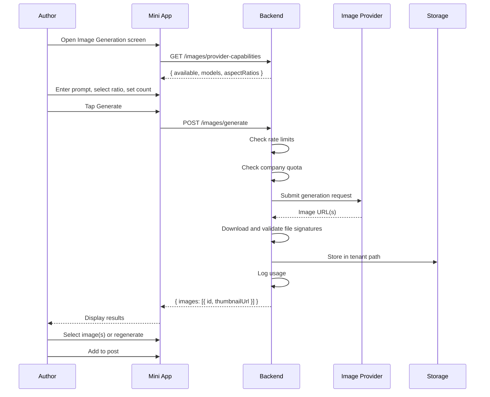

# 09 — AI and Media Pipeline

SocialPilot AI · Multi-Tenant Telegram Mini App SaaS

---

## Table of Contents

1. [Text Generation](#text-generation)
2. [Image Generation](#image-generation)
3. [Image Generation Workflow](#image-generation-workflow)
4. [Local Image Upload](#local-image-upload)
5. [Upload Validation](#upload-validation)
6. [Safe Storage](#safe-storage)
7. [No Base64 in Database](#no-base64-in-database)
8. [Editing and Preview](#editing-and-preview)
9. [Multi-Image Publishing](#multi-image-publishing)
10. [Telegram Media Group Limits](#telegram-media-group-limits)
11. [Over-Limit Validation](#over-limit-validation)
12. [Publishing Adapter Design](#publishing-adapter-design)

---

## Text Generation

### Provider Interface

The text generation subsystem is built around a `TextGenerationProvider` interface. The only guaranteed implementation for MVP is **Google Gemini**. The interface allows future swap to other LLM providers without changing callers.

```
interface TextGenerationProvider {
  generate(request: TextGenerationRequest): Promise<TextGenerationResult>
  validateConfig(): Promise<boolean>
  getModels(): Promise<ModelInfo[]>
}
```

| Field | Type | Description |
|-------|------|-------------|
| `request.prompt` | string | User-facing content prompt |
| `request.systemPrompt` | string | Brand context + anti-hallucination rules |
| `request.temperature` | number | 0.0–1.0; default 0.7 |
| `request.maxTokens` | number | Upper bound on output length |
| `request.tone` | string | Brand voice descriptor |
| `request.language` | string | Target language (BCP-47) |

### Prompt Construction with Brand Context

The system prompt is assembled at request time from the company's **Brand Settings**:

| Context Block | Source | Purpose |
|---------------|--------|---------|
| Company description | `companies.description` | Grounds generation in real business |
| Industry | `companies.industry` | Domain-appropriate vocabulary |
| Tone / Voice | `brand_settings.tone` | Consistent personality |
| Key messaging points | `brand_settings.key_messages[]` | Must-include or reference points |
| Target audience | `brand_settings.target_audience` | Appropriate register |
| Vocabulary do/don't | `brand_settings.vocabulary_do[]`, `vocabulary_dont[]` | Lexical constraints |

**Assembly order:** System role → Brand context JSON → User prompt → Output format instructions.

### Anti-Hallucination Rules

1. **No invented facts.** The model is instructed to only use information present in the brand context block.
2. **Empty context blocks are generation.** If brand settings are incomplete, the API returns `422` with message: "Complete brand settings before using AI generation."
3. **No fake statistics or quotes.** Explicit instruction in system prompt.
4. **Confidence scoring.** The response includes a `confidenceScore` (0–1). Scores below 0.6 display a warning chip in the UI: "Low confidence — review carefully."
5. **Human in the loop.** AI output is never auto-published; always lands in the Content Editor for review.

### Rate Limiting

| Scope | Limit | Window |
|-------|-------|--------|
| Per user | 20 requests | 1 hour |
| Per company | 200 requests | 1 hour |
| Per company | 2,000 requests | 1 day |

Rate limit headers returned on every response:

| Header | Meaning |
|--------|---------|
| `X-RateLimit-Limit` | Max requests in window |
| `X-RateLimit-Remaining` | Remaining requests |
| `X-RateLimit-Reset` | Unix timestamp when window resets |

Exceeded limits return `429 Too Many Requests` with `Retry-After` header.

### Usage Accounting

Every generation is logged to the `ai_usage_logs` table:

| Column | Type | Description |
|--------|------|-------------|
| `id` | UUID PK | Log entry |
| `company_id` | UUID FK | Tenant isolation |
| `user_id` | UUID FK | Requesting user |
| `provider` | text | `gemini` |
| `model` | text | Model identifier |
| `prompt_tokens` | integer | Input token count |
| `completion_tokens` | integer | Output token count |
| `total_tokens` | integer | Sum |
| `cost_micros` | integer | Cost in millionths of currency unit |
| `created_at` | timestamp | Request time |

Usage counters are incremented atomically in the same transaction.

### Error Handling

| Error | HTTP | User-Facing Message | Retry? |
|-------|------|---------------------|--------|
| Brand context missing | 422 | "Complete your brand settings first." | No |
| Rate limit exceeded | 429 | "Too many requests. Try again in {n} minutes." | After `Retry-After` |
| Gemini 5xx | 502 | "AI service temporarily unavailable." | Yes, exponential backoff |
| Gemini timeout | 504 | "Request timed out. Please try again." | Yes, 1 retry |
| Content policy violation | 400 | "Content blocked by safety filter. Try rephrasing." | No |
| Quota exceeded | 402 | "AI quota exceeded for this billing period." | No (upgrade plan) |

---

## Image Generation

### ImageGenerationProvider Interface

The image generation subsystem uses a provider-agnostic interface. MVP includes a default provider; alternatives (Replicate, Fal.ai, OpenAI, self-hosted) are **not guaranteed** at launch and may be added based on demand.

```
interface ImageGenerationProvider {
  generate(request: ImageGenerationRequest): Promise<ImageGenerationResult[]>
  checkCapabilities(): Promise<ProviderCapabilities>
  validateConfig(): Promise<boolean>
  getModels(): Promise<ModelInfo[]>
  estimateCost(request: ImageGenerationRequest): Promise<CostEstimate>
}
```

| Field | Type | Description |
|-------|------|-------------|
| `request.prompt` | string | Image description |
| `request.negativePrompt` | string | What to exclude (optional) |
| `request.aspectRatio` | string | `1:1`, `16:9`, `9:16`, `4:3` |
| `request.count` | integer | 1–4 images per request |
| `request.model` | string | Provider-specific model ID |
| `request.seed` | integer | For reproducible results (optional) |

### Capability Checks

Before presenting the Image Generation screen, the frontend calls:

```
GET /images/provider-capabilities
```

Response includes:

| Field | Description |
|-------|-------------|
| `available` | Whether any provider is configured |
| `models` | List of available models with labels |
| `aspectRatios` | Supported aspect ratios |
| `maxCount` | Maximum images per request |
| `estimatedCostPerImage` | Display cost for user transparency |

If `available` is `false`, the Image Generation screen shows an unavailable state with explanation.

### Provider Options (Alternatives — Not Guaranteed)

| Provider | Status | Notes |
|----------|--------|-------|
| **Default (MVP)** | ✅ Guaranteed | Configured via environment variables |
| Replicate | 🔄 Alternative | Needs API key; per-model pricing varies |
| Fal.ai | 🔄 Alternative | Fast inference; pay-per-generation |
| OpenAI (DALL-E / GPT-Image) | 🔄 Alternative | Requires OpenAI org billing |
| Self-hosted (Stable Diffusion / ComfyUI) | 🔄 Alternative | Infrastructure cost on customer; GPU required |

Each alternative requires:
- Provider-specific API credentials (encrypted at rest)
- Model registry configuration
- Cost mapping per model
- Rate limit configuration per provider

### Configuration

Provider is configured via environment variables (never in database):

| Variable | Purpose |
|----------|---------|
| `IMAGE_PROVIDER_ACTIVE` | Active provider slug |
| `IMAGE_PROVIDER_API_KEY` | Encrypted API credential |
| `IMAGE_PROVIDER_BASE_URL` | API endpoint override |
| `IMAGE_PROVIDER_DEFAULT_MODEL` | Fallback model |
| `IMAGE_PROVIDER_TIMEOUT_SECONDS` | Request timeout |
| `IMAGE_PROVIDER_MAX_RETRIES` | Retry count |

### Errors

| Error | HTTP | User-Facing Message | Retry? |
|-------|------|---------------------|--------|
| Provider not configured | 503 | "Image generation is not available." | No |
| Rate limit exceeded | 429 | "Generation limit reached. Try again later." | After `Retry-After` |
| Provider 5xx / timeout | 502 | "Image service unavailable. Trying alternative…." | Yes, failover |
| Content policy | 400 | "Prompt violates content policy." | No |
| Quota exceeded | 402 | "Image quota exceeded for this plan." | No |
| Invalid aspect ratio | 422 | "Selected aspect ratio not supported." | No |

### Usage Accounting

Every generation is logged to the `image_usage_logs` table with the same pattern as `ai_usage_logs`:

| Column | Description |
|--------|-------------|
| `company_id` | Tenant isolation |
| `user_id` | Requesting user |
| `provider` | Provider slug |
| `model` | Model identifier |
| `image_count` | Number of images generated |
| `cost_micros` | Cost in millionths |
| `created_at` | Request time |

---

## Image Generation Workflow

### Step-by-Step Flow



### Prompt Input

- Min 10 characters, max 2000
- Supports multi-line textarea
- Example prompts provided as tappable chips
- Optional negative prompt field (max 500 chars)

### Aspect Ratio Selection

| Ratio | Dimensions (typical) | Use Case |
|-------|----------------------|----------|
| `1:1` | 1024 × 1024 | Square feed posts |
| `16:9` | 1280 × 720 | Landscape banners, announcements |
| `9:16` | 720 × 1280 | Stories, vertical content |
| `4:3` | 1152 × 864 | Classic photo format |

### Count Configuration

- Range: 1–4 images per request
- Each image is an independent generation (same prompt, different seeds if seed not pinned)
- Rate limit counts each image individually

### Result Viewing

- Grid display (2 columns) with generated thumbnails
- Each card shows: thumbnail, model badge, select/deselect toggle
- Tap to enlarge in full-screen viewer

### Selection

- Tap image to select (checkmark overlay, order badge appears)
- Max 10 total selections (combined with uploaded media)
- Selection counter visible: "3 of 10 selected"

### Regeneration

- "Regenerate" button on each result card
- Uses same parameters but new random seed
- Previous results remain visible until replaced

### Prompt Editing

- "Edit Prompt" returns to form with all fields pre-filled
- Generation history per session retained (not persisted server-side beyond final selected images)

### Adding to Post

- "Add to Post" button on selected images
- Creates `post_media` associations
- Navigates to Content Editor

---

## Local Image Upload

### Device File Picker

The upload flow uses the Telegram Mini App's `openFilePicker` API when available, falling back to a standard `<input type="file">` element.

| Step | Detail |
|------|--------|
| 1 | User taps "Upload from Device" |
| 2 | System opens native file picker (multi-select enabled) |
| 3 | User selects 1–10 image files |
| 4 | Client-side pre-validation: file count, file size, MIME type |
| 5 | Files shown as preview thumbnails in horizontal strip |
| 6 | User can remove individual files or reorder |
| 7 | User taps "Upload" — files sent as multipart/form-data |

### Multi-Select

- Maximum 10 files per selection batch
- Selected files displayed as thumbnail cards with drag handles
- Each card shows: thumbnail, file name, file size, remove button
- Order is preserved (becomes album order)

### Preview

- Thumbnails generated client-side using `URL.createObjectURL()`
- Full-size preview on tap (lightbox overlay)
- Zoom and pan gestures supported in lightbox

### Remove

- Per-file remove button (X icon)
- Confirmation not required for individual removal (undo toast available for 3 seconds)
- "Clear All" button with confirmation dialog

### Reorder

- Drag-and-drop reordering in the selected files strip
- Long-press to initiate drag on mobile
- Visual feedback: elevated shadow on dragged item

### Telegram Fallback

If the native file picker is unavailable (older Telegram versions or non-Telegram context):

1. Fall back to `<input type="file" accept="image/*" multiple>`
2. If input is also unavailable, show instructions: "Please update Telegram to use file upload"
3. Provide alternative: forward image to bot (channel connection flow)

---

## Upload Validation

### Validation Pipeline

| Stage | Validation | Where |
|-------|-----------|-------|
| 1 | File count ≤ 10 | Client + Server |
| 2 | File size ≤ 10 MB each | Client + Server |
| 3 | MIME type in allowlist | Client + Server |
| 4 | File signature (magic bytes) | Server only |
| 5 | Image dimensions readable | Server only |
| 6 | Virus/malware scan (if configured) | Server only |

### MIME Type Allowlist

| MIME Type | Extension | Max Size |
|-----------|-----------|----------|
| `image/jpeg` | .jpg, .jpeg | 10 MB |
| `image/png` | .png | 10 MB |
| `image/webp` | .webp | 10 MB |
| `image/gif` | .gif | 10 MB (first frame validated) |

### File Signatures (Magic Bytes)

**Never trust the file extension.** The server reads the first 16 bytes and validates against known signatures:

| Format | Magic Bytes (hex) | Description |
|--------|-------------------|-------------|
| JPEG | `FF D8 FF` | Start of image marker |
| PNG | `89 50 4E 47 0D 0A 1A 0A` | PNG signature |
| WebP | `52 49 46 46` + `57 45 42 50` at offset 8 | RIFF....WEBP |
| GIF87a | `47 49 46 38 37 61` | GIF87a header |
| GIF89a | `47 49 46 38 39 61` | GIF89a header |

If the magic bytes do not match the declared MIME type, the file is rejected with `422` and message: "File content does not match its declared type."

### File Size Limits

| Context | Limit |
|---------|-------|
| Per file | 10 MB |
| Per upload batch | 50 MB total |
| Per company (storage) | Depends on subscription plan |

### Count Limits

| Context | Limit |
|---------|-------|
| Per post (album) | 10 images max |
| Per upload action | 10 files max |
| Per media library | Plan-dependent |

### Authorization

- Upload endpoint requires valid `initData` session
- User must have `Author` role or above in the target company
- Company must be in `active` state

### Never Trust Extensions

A file named `photo.png` containing JPEG data will be detected and handled. The server uses magic bytes as the source of truth; the extension is cosmetic only.

---

## Safe Storage

### Filesystem Layout

```
/data/socialpilot/
├── tenants/
│   └── {company_id}/
│       ├── uploads/
│       │   └── {year}/{month}/{file_id}.{ext}
│       ├── generated/
│       │   └── {year}/{month}/{file_id}.{ext}
│       └── quarantine/
│           └── {file_id}.{ext}
```

| Path | Purpose |
|------|---------|
| `uploads/` | User-uploaded images (validated) |
| `generated/` | AI-generated images (validated) |
| `quarantine/` | Files flagged during validation |

### Metadata in PostgreSQL

All media metadata is stored in the `media` table:

| Column | Type | Description |
|--------|------|-------------|
| `id` | UUID PK | File identifier |
| `company_id` | UUID FK | Tenant isolation |
| `uploaded_by` | UUID FK | Uploading user |
| `source` | text | `upload` or `generated` |
| `storage_path` | text | Relative filesystem path |
| `original_filename` | text | User's original name |
| `mime_type` | text | Validated MIME type |
| `file_size_bytes` | integer | File size |
| `width` | integer | Image width in pixels |
| `height` | integer | Image height in pixels |
| `sha256` | text | Content hash for dedup |
| `metadata` | jsonb | Provider info, prompt, etc. |
| `created_at` | timestamp | Upload time |
| `deleted_at` | timestamp | Soft delete time |

### Retention

| Policy | Rule |
|--------|------|
| Active media | Retained indefinitely |
| Soft-deleted media | Purged after 30 days |
| Orphaned files (no DB record) | Purged by daily cleanup job |
| Failed upload temp files | Purged after 24 hours |

### Deletion

- **Soft delete:** Set `deleted_at` timestamp; file remains on disk for 30 days
- **Hard delete:** Physical file removal + database record removal
- **Cascade:** Deleting a company purges all its media files

### Malicious File Handling

| Scenario | Action |
|----------|--------|
| Magic bytes mismatch | Reject immediately; log security event |
| File too large | Reject with 413 |
| Too many files | Reject with 422 |
| Suspected polyglot file | Move to quarantine; alert admin |
| Known malware signature | Reject; log; increment security counter |
| Corrupt image data | Reject with 422; do not store |

### Quarantine

Files in `quarantine/` are:
- Not accessible via any API endpoint
- Reviewable by platform owners via admin interface
- Auto-purged after 7 days if not manually reviewed

---

## No Base64 in Database

**Strict rule:** Binary data is never stored in PostgreSQL. The database stores only:

- File metadata (path, size, MIME type, dimensions)
- SHA-256 hash for integrity verification
- Storage path reference

**Rationale:**

| Concern | Impact |
|---------|--------|
| Database bloat | Base64 inflates size by 33%; 10 MB image becomes ~13.3 MB |
| Query performance | Large text columns slow down scans and backups |
| Memory pressure | Loading media rows loads binary data into app memory |
| Cost | PostgreSQL storage is expensive compared to filesystem/object storage |

**Image delivery flow:**

1. Client requests image by `media_id`
2. Backend resolves `storage_path` from database
3. Backend streams file from filesystem (or generates signed URL for object storage)
4. Client receives binary via HTTP response body

---

## Editing and Preview

### Caption

| Rule | Value |
|------|-------|
| Min length | 1 character |
| Max length | 1,024 characters (Telegram limit for album captions) |
| Max length (single image) | 1,024 characters |
| Multi-line | Supported |
| Rich text | Telegram HTML parse mode: `<b>`, `<i>`, `<u>`, `<s>`, `<code>`, `<pre>`, `<a href>`, `<blockquote>` |
| Spoiler | `<span class="tg-spoiler">` supported |

### Hashtags

| Rule | Value |
|------|-------|
| Max count | 30 |
| Max length per tag | 100 characters |
| Auto-prefix | `#` added automatically if missing |
| Validation | Alphanumeric + underscore only; no spaces |
| Suggestions | AI can suggest hashtags based on content |

### CTA (Call to Action)

| Field | Rule |
|-------|------|
| Label | Max 30 characters |
| URL | Valid HTTPS URL required |
| Position | Inline button below message (Telegram inline keyboard) |
| Max per post | 1 |

### Media Order

- Drag-and-drop reordering in Content Editor media strip
- Order is persisted in `post_media.sort_order` column
- First item in album receives the caption (Telegram requirement)
- Visual order badges: numbered overlay on each thumbnail

### Save Draft

| Behavior | Detail |
|----------|--------|
| Autosave | Debounced 2 seconds after last change |
| Manual save | "Save Draft" button always available |
| Conflict handling | Last-write-wins; revision history preserves prior states |
| Feedback | Toast: "Draft saved at HH:MM" |
| Failure | Banner: "Could not auto-save. Tap to retry." |

### Preview

- Renders in phone-mockup simulating Telegram message bubble
- Accurate media layout: single image, grid (2+), or album
- Caption with rendered rich text
- CTA button mockup
- Read-only — no editing in preview mode

### Submit

| Role | Can Submit |
|------|-----------|
| Author | Own posts |
| Content Creator | Own posts |
| Approver | Own posts (not for own approval) |
| Admin | Any post in company |
| Owner | Any post in company |

Submit action:
1. Validates all fields (caption length, media count, CTA format)
2. Creates new revision snapshot
3. Transitions post to `in_review`
4. Notifies approvers via WebSocket + notification

### Revisions

- Every save creates an immutable revision record
- Revision list shows: version number, author, timestamp, change summary
- Any prior version can be restored (creates new revision with restored content)
- Diff view shows field-level changes between versions

---

## Multi-Image Publishing

### Content Type Detection

The publishing adapter automatically determines content type based on media count:

| Media Count | Content Type | Telegram API Method |
|-------------|--------------|-------------------|
| 0 | Text-only | `sendMessage` |
| 1 | Single image | `sendPhoto` |
| 2–10 | Album (media group) | `sendMediaGroup` |

### Text-Only

- Uses `sendMessage` with `parse_mode = HTML`
- Caption becomes the message body
- CTA rendered as inline keyboard button
- No media attachment

### Single Image

- Uses `sendPhoto` with `caption` parameter
- Caption max 1,024 characters
- CTA rendered as inline keyboard button attached to the photo
- Supports spoiler mode (`has_spoiler = true`)

### Album

- Uses `sendMediaGroup` with array of `InputMediaPhoto` objects
- **Caption placement:** First media item carries the caption; all others have `caption = ""`
- Each media item supports individual `parse_mode`
- CTA is **not supported** on albums via `sendMediaGroup` — Telegram does not allow inline keyboards on media groups
- For albums with CTA: publish album first, then send follow-up `sendMessage` with CTA

### Mixed Uploaded + Generated

No special handling required — once media is stored and validated, it is treated uniformly regardless of source (`upload` vs `generated`). The `media.source` field is metadata only; publishing logic is source-agnostic.

---

## Telegram Media Group Limits

### Max 10 Items

| Limit | Value | Enforcement |
|-------|-------|-------------|
| Max media items per album | 10 | Pre-publish validation in backend |
| Max caption length (album) | 1,024 chars | First item only |
| Max caption length (single) | 1,024 chars | On the photo |
| Max file size per image | 10 MB | Telegram hard limit |

### Caption Placement

For albums, Telegram displays the caption **only on the first media item** in the group. The backend must:

1. Split caption from media array
2. Attach full caption to `media[0].caption`
3. Set `media[n].caption = ""` for all subsequent items
4. Apply `parse_mode` uniformly

### Caption Length Rules

| Context | Max Chars | Exceed Behavior |
|---------|-----------|-----------------|
| Text message | 4,096 | Hard error before publish |
| Photo caption | 1,024 | Hard error before publish |
| Album caption | 1,024 | Hard error before publish |

Validation occurs at three layers:
1. **Client-side:** Real-time character counter with color warning (green → yellow → red)
2. **API request validation:** Reject with 422 if exceeded
3. **Pre-publish validation:** Final check before calling Telegram API

---

## Over-Limit Validation

### Clear Error Messages

When media count exceeds 10, the system **never silently splits** the album. Instead:

| Scenario | Behavior |
|----------|----------|
| User selects 11 images | Inline error: "Telegram albums support up to 10 images. Please remove 1 or more." |
| User adds 11th to existing 10 | Toast: "Maximum 10 images per post. Remove an image first." |
| API receives >10 media | 422 with detail: `"Media count 11 exceeds maximum of 10"` |
| Caption exceeds 1,024 | Character counter turns red; tooltip: "Caption exceeds Telegram's 1,024 character limit" |
| File exceeds 10 MB | Per-file error: "image.jpg is 12.3 MB. Maximum file size is 10 MB." |

### No Silent Splitting

The system does **not** automatically split albums into multiple messages. Reasons:

1. User intent is unclear (split where? distribute caption how?)
2. Multiple messages may violate Telegram channel posting norms
3. Analytics tracking becomes ambiguous (one post or many?)
4. Revision history would reference multiple Telegram message groups

Instead, the user must explicitly choose:
- Remove images to get under 10
- Create a separate post for remaining images

---

## Publishing Adapter Design

### Architecture

The publishing adapter abstracts Telegram API interactions behind a common interface, allowing future expansion to other platforms (e.g., Discord, Slack, WhatsApp Business).

```
interface PublishingAdapter {
  publish(post: PreparedPost): Promise<PublishResult>
  validate(post: PreparedPost): Promise<ValidationResult>
  getChannelInfo(channelId: string): Promise<ChannelInfo>
  deleteMessage(channelId: string, messageId: number): Promise<void>
  editMessage(channelId: string, messageId: number, content: EditedContent): Promise<void>
}
```

### PreparedPost Object

The backend constructs a `PreparedPost` before invoking the adapter:

| Field | Description |
|-------|-------------|
| `caption` | Final caption text |
| `parseMode` | `HTML` or `Markdown` |
| `media` | Ordered array of media references |
| `cta` | Optional call-to-action button |
| `spoiler` | Whether to hide behind spoiler |
| `disableNotification` | Silent send flag |

### PublishResult

| Field | Description |
|-------|-------------|
| `success` | Boolean |
| `telegramMessageId` | Numeric message ID from Telegram |
| `telegramMessageIds` | Array for albums (one per media item) |
| `publishedAt` | Timestamp |
| `error` | Error details if failed |

### Album Publishing Logic

```
if media.length == 0:
    sendMessage(caption, parseMode, cta)
elif media.length == 1:
    sendPhoto(media[0], caption, parseMode, cta)
elif media.length <= 10:
    build MediaGroup:
        media[0].caption = caption
        media[0].parseMode = parseMode
        media[1..n].caption = ""
    sendMediaGroup(mediaGroup)
    if cta exists:
        sendMessage(cta_text, cta_button)  // follow-up message
else:
    reject: "Album exceeds 10 item limit"
```

### Retry and Idempotency

- Each publish request generates a UUID `idempotencyKey`
- On retry, the same key is sent
- Telegram does not natively deduplicate; backend checks for existing `telegram_message_id` before retrying
- Max 3 retries with exponential backoff (2s, 4s, 8s)
- After final failure: post status → `failed`, `failure_reason` recorded

### Failure Recovery

| Failure | Recovery |
|---------|----------|
| Partial album (some items sent) | Backend stores partial message IDs; retry skips already-sent items |
| Rate limit (429) | Wait `retry_after` seconds; retry |
| Bot missing permissions | Fail immediately; notify admin to fix bot permissions |
| Channel not found | Fail immediately; mark channel as disconnected |
| Network timeout | Retry with same idempotency key |
| Message too large | Fail immediately; user must reduce content |

---

*End of document.*


