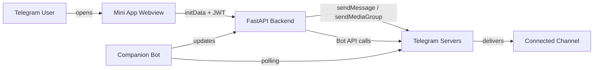
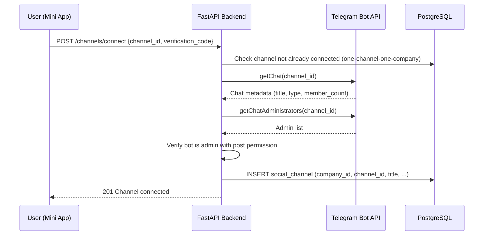

# Telegram Integration

This document defines how SocialPilot AI integrates with the Telegram platform: Mini App authentication, Bot API usage, channel verification, media publishing, and the companion bot. It is the authoritative reference for all Telegram-facing behavior.

**Official documentation:**
- Bot API: <https://core.telegram.org/bots/api>
- Mini Apps: <https://core.telegram.org/bots/webapps>

---

## 1. Architecture Overview

SocialPilot AI uses two distinct Telegram surfaces:

| Surface | Purpose | Protocol |
|---------|---------|----------|
| **Mini App** (webview) | Primary user interface for all company users | Telegram Mini Apps JS SDK + HTTPS backend |
| **Companion Bot** | Channel verification, notifications, deep links | Bot API (polling in MVP; webhook-ready) |



---

## 2. Telegram Mini Apps JavaScript SDK Integration

### 2.1 SDK Loading

The Mini App frontend loads the official Telegram Mini Apps script **synchronously** in `index.html` before any application code:

```html
<script src="https://telegram.org/js/telegram-web-app.js"></script>
```

- Pin the script URL; do not use a package manager copy (Telegram updates the SDK in place).
- The SDK exposes `window.Telegram.WebApp`.
- All SDK calls must be guarded: if `Telegram.WebApp` is undefined (e.g., opened in a regular browser during development), the app must show a "Open in Telegram" screen rather than crash.

### 2.2 Initialization Sequence

On every Mini App launch, the frontend must:

1. Call `Telegram.WebApp.ready()` to signal the webview is ready.
2. Call `Telegram.WebApp.expand()` to occupy the full available height.
3. Read `Telegram.WebApp.initData` (URL-encoded query string) and `Telegram.WebApp.initDataUnsafe` (parsed object, **never trusted for auth**).
4. Send `initData` to `POST /api/v1/auth/telegram` for server-side validation.
5. Store the returned JWT **in memory** (React context / module-level variable). **Never** in `localStorage`, `sessionStorage`, or cookies accessible to JS.
6. On subsequent launches, re-validate `initData` — do not persist sessions client-side.

### 2.3 initData Lifecycle

| Stage | Data | Trust Level |
|-------|------|-------------|
| `Telegram.WebApp.initData` | Raw signed blob from Telegram | Untrusted transport; must be validated server-side |
| `Telegram.WebApp.initDataUnsafe` | Parsed convenience object | Convenience only; **never** used for authorization decisions |
| Server validation result | Verified `user` object + `auth_date` | Trusted after HMAC verification |
| Issued JWT | Backend session token | Trusted until expiry |

---

## 3. initData Validation

### 3.1 What initData Is

When a Mini App opens, Telegram passes an `initData` query string containing:

| Field | Description |
|-------|-------------|
| `query_id` | Unique identifier for this Mini App session |
| `user` | JSON object: `id`, `first_name`, `last_name`, `username`, `language_code`, `is_premium`, `allows_write_to_pm` |
| `auth_date` | Unix timestamp of when the initData was generated |
| `hash` | Hex-encoded HMAC-SHA256 signature for validation |

### 3.2 Server-Side Validation Algorithm

The backend **must** perform the following steps on every `POST /api/v1/auth/telegram`:

1. **Parse** the `initData` query string into key-value pairs. Preserve exact values; do not re-encode.
2. **Extract** the `hash` field and remove it from the data set.
3. **Sort** the remaining keys alphabetically (byte-wise, per Telegram's specification).
4. **Build** the `data_check_string` by joining `key=value` pairs with `\n` (newline).
5. **Compute** the secret key: `HMAC-SHA256(key="WebAppData", data=<bot_token>)`.
6. **Compute** the expected hash: `HMAC-SHA256(key=<secret_key>, data=<data_check_string>)`, hex-encoded.
7. **Compare** the computed hash with the provided `hash` using a **constant-time comparison** (`hmac.compare_digest` in Python).
8. **Verify** `auth_date` is within the allowed window (see 3.3).
9. **Check** replay protection (see 3.4).
10. **Parse** the `user` JSON and extract `id`, `first_name`, `last_name`, `username`, `language_code`.
11. **Upsert** the `user` record in PostgreSQL.
12. **Issue** a JWT (see Section 4).

> **Critical:** The bot token used for HMAC validation is the **same token** used for Bot API calls. It must be stored as a secret (see [11-security-and-multi-tenancy.md](11-security-and-multi-tenancy.md) Section 9) and never exposed to the frontend.

### 3.3 auth_date Expiration Policy

| Parameter | Value | Rationale |
|-----------|-------|-----------|
| Maximum age | **24 hours** | Telegram's official recommendation |
| Clock skew tolerance | **5 seconds** | Accommodates minor client clock drift |
| Rejection response | `401 Unauthorized` with code `INIT_DATA_EXPIRED` | Forces re-launch from Telegram |

The check: `abs(current_time - auth_date) > 86400 + 5` → reject.

### 3.4 Replay Protection

A validated `initData` blob must not be reusable indefinitely. The backend implements replay protection via:

| Layer | Mechanism | Storage |
|-------|-----------|---------|
| Primary | Store a hash of the full `initData` string with a TTL of 25 hours | In-memory cache (Redis in production; in-process LRU for local dev) |
| Secondary | `query_id` uniqueness check — reject duplicate `query_id` within the same `auth_date` window | Same cache |

On cache hit (duplicate `initData` or `query_id`): return `401` with code `INIT_DATA_REPLAYED`.

> **Note:** The 24-hour `auth_date` expiration is the primary defense; replay cache is defense-in-depth against token theft within the validity window.

---

## 4. Session and JWT Management

### 4.1 Token Design

After successful `initData` validation, the backend issues a JWT:

| Claim | Value | Purpose |
|-------|-------|---------|
| `sub` | `user.id` (UUID) | Subject: internal user ID |
| `tid` | `user.telegram_id` | Telegram user ID for audit correlation |
| `iat` | Issued-at timestamp | Token freshness |
| `exp` | `iat + 12 hours` | Hard expiry |
| `type` | `"access"` | Token type discriminator |

### 4.2 Token Lifecycle

| Event | Behavior |
|-------|----------|
| Mini App launch | Frontend sends `initData`; backend validates and issues JWT |
| JWT expired | Frontend detects `401`; re-launches auth flow (re-reads `initData` from SDK) |
| User closes Mini App | JWT remains valid until `exp`; no server-side revocation needed for MVP |
| Company suspended | JWT still valid; API returns `403` with code `COMPANY_SUSPENDED` on workspace actions |
| Platform owner action | No JWT change; platform plane uses separate authorization |

### 4.3 Refresh Strategy

MVP uses **re-launch refresh**: the Mini App is re-opened from Telegram, producing fresh `initData`. This avoids storing refresh tokens client-side. A dedicated refresh endpoint is a post-MVP enhancement.

### 4.4 Token Transport

- Frontend sends JWT in `Authorization: Bearer <token>` header.
- Backend validates signature, expiry, and `type` claim on every protected endpoint.
- Tokens are never logged, never stored in the database, and never included in URLs.

---

## 5. Bot API Integration

### 5.1 HTTP Client

All Bot API calls go through a single `TelegramBotClient` service layer:

| Aspect | Decision |
|--------|----------|
| Library | `httpx.AsyncClient` (async, connection pooling) |
| Base URL | `https://api.telegram.org/bot<token>/<method>` |
| Timeout | 30 seconds (media uploads: 60 seconds) |
| Retry | 3 attempts with exponential backoff for 5xx and network errors |
| Rate limit | Respect Telegram's ~30 msg/sec global, ~1 msg/sec per chat |

### 5.2 Required Bot API Methods

| Method | Purpose | Used By |
|--------|---------|---------|
| `getChat` | Verify bot can access channel; retrieve channel metadata | Channel connection flow |
| `getChatAdministrators` | Verify bot has admin rights in channel | Channel connection flow |
| `sendMessage` | Send text-only posts; send verification codes | Publishing, companion bot |
| `sendPhoto` | Send single-image posts | Publishing |
| `sendMediaGroup` | Send multi-image albums (up to 10 items) | Publishing |
| `getMe` | Validate bot token at startup | Health check |

### 5.3 Channel Connection Flow



**One-channel-one-company rule:** Before creating a `social_channel` record, the backend queries for an existing channel with the same `channel_id`. If found and belonging to a different company, return `409 Conflict` with code `CHANNEL_ALREADY_CONNECTED`.

### 5.4 Bot Admin Verification

The backend verifies the bot's admin status by:

1. Calling `getChatAdministrators(channel_id)`.
2. Finding the bot's own user ID (from `getMe` at startup, cached).
3. Confirming the bot's status is `"administrator"`.
4. Confirming the bot has `can_post_messages` (for channels) or `can_send_messages` (for groups).

If any check fails: return `400` with code `BOT_NOT_ADMIN` and instructions to the user.

---

## 6. Polling and Webhook Migration Path

### 6.1 MVP: Long Polling

The companion bot uses `python-telegram-bot` v22 with long polling:

| Aspect | Configuration |
|--------|---------------|
| Library | `python-telegram-bot` v22 (`ApplicationBuilder`) |
| Polling method | `application.run_polling()` with `drop_pending_updates=True` |
| Update types | `message`, `channel_post`, `callback_query` |
| Concurrency | Single instance (MVP); `max_connections=1` |
| Offset management | Handled by python-telegram-bot automatically |

**Why polling for MVP:** No public HTTPS endpoint required; no webhook infrastructure; sufficient for low-volume companion bot traffic.

### 6.2 Webhook Migration Path

When webhook delivery is needed (higher volume, lower latency):

| Step | Action |
|------|--------|
| 1 | Provision HTTPS endpoint: `POST /webhooks/telegram/<secret_path>` |
| 2 | Set webhook: `setWebhook(url=..., secret_token=...)` |
| 3 | Validate `X-Telegram-Bot-Api-Secret-Token` header on every request |
| 4 | Replace `run_polling()` with `run_webhook(listen="0.0.0.0", port=8443)` |
| 5 | Implement idempotency: deduplicate `update_id` in a short-lived cache |
| 6 | Add health check endpoint for load balancer |

The `TelegramBotClient` service layer is unchanged; only the update ingestion mechanism differs.

---

## 7. Media Group (Album) Publishing

### 7.1 Telegram Limits

Per the [Bot API documentation](https://core.telegram.org/bots/api#sendmediagroup):

| Constraint | Value |
|------------|-------|
| Maximum items per media group | **10** |
| Minimum items per media group | 2 |
| Supported media types | `photo` and `video` only |
| Caption | Single caption for the entire group; max 1024 characters |
| Media type mixing | Photos and videos **cannot** be mixed in one media group |

### 7.2 Media Type Compatibility Matrix

| Combination | Allowed | Notes |
|-------------|---------|-------|
| All photos | Yes | Standard album |
| All videos | Yes | Video album |
| Photos + videos mixed | **No** | Telegram rejects; must split into separate sends |
| Documents (files) | **No** | Not supported in `sendMediaGroup`; use `sendDocument` separately |
| Audio | **No** | Not supported in `sendMediaGroup` |

### 7.3 Caption Rules

| Rule | Detail |
|------|--------|
| Caption length | Max 1024 characters for media groups (200 for single photo) |
| Caption source | Post caption from the draft; hashtags appended if configured |
| Formatting | Supports HTML parse mode; must be validated/escaped |
| Empty caption | Allowed for media-only posts |

### 7.4 Publishing Logic

```
if media_count == 0:
    sendMessage(caption)
elif media_count == 1:
    sendPhoto(photo, caption)
elif media_count <= 10:
    sendMediaGroup([InputMediaPhoto(...), ...], caption)
else:
    reject with validation error (no silent splitting)
```

### 7.5 Message ID Recording

After successful publish, the backend records **all** returned message IDs:

| Field | Value |
|-------|-------|
| `publication_result.message_ids` | JSON array of Telegram message IDs |
| `publication_result.message_links` | Resolved `https://t.me/c/<channel>/<id>` links (for public channels) |
| `publication_result.published_at` | UTC timestamp |
| `publication_result.post_id` | Internal post UUID |

These IDs enable future features: message editing, deletion, analytics correlation.

---

## 8. Theme Parameters

### 8.1 Reading Theme Data

The Mini App must adapt to Telegram's theme:

| SDK Property | Usage |
|-------------|-------|
| `Telegram.WebApp.colorScheme` | `"light"` or `"dark"` — select theme |
| `Telegram.WebApp.themeParams` | Background color, text color, hint color, link color, button color |
| `Telegram.WebApp.headerColor` | Match Mini App header to Telegram header |
| `Telegram.WebApp.backgroundColor` | Match Mini App background |

### 8.2 Theme Application

- Apply `colorScheme` to the React root via CSS custom properties.
- Subscribe to `Telegram.WebApp.onEvent('themeChanged', ...)` for live theme switches.
- Do not hardcode colors; always use theme-aware CSS variables.

---

## 9. Safe Area Handling

Telegram Mini Apps must respect device safe areas (notches, home indicators):

| SDK Property | Purpose |
|-------------|---------|
| `Telegram.WebApp.safeAreaInsets` | `{top, bottom, left, right}` in CSS pixels |
| `Telegram.WebApp.contentSafeAreaInsets` | Safe area excluding Telegram's own UI |

**Implementation:** Apply `safeAreaInsets` as CSS `padding` on the root container. Use `env(safe-area-inset-*)` as fallback for non-Telegram browsers.

---

## 10. Deep Linking and Launch Parameters

### 10.1 Mini App Link Format

```
https://t.me/<bot_username>/<app_name>?startapp=<param>
```

| Parameter | Purpose | Example |
|-----------|---------|---------|
| `invite` | Accept company invitation | `?startapp=invite_<token>` |
| `post` | Deep link to a specific post | `?startapp=post_<post_id>` |
| `channel` | Deep link to channel connection | `?startapp=channel_<channel_id>` |

### 10.2 Reading Launch Parameters

```typescript
const startParam = Telegram.WebApp.initDataUnsafe.start_param;
```

The backend resolves `start_param` to the appropriate action (accept invitation, navigate to post, etc.) after authentication.

### 10.3 Bot Commands

The companion bot supports these commands:

| Command | Description | Access |
|---------|-------------|--------|
| `/start` | Open Mini App; show welcome | All users |
| `/start invite_<token>` | Open Mini App with invitation | Invited users |
| `/link` | Get Mini App deep link | All users |
| `/status` | Check company status | Company members |
| `/help` | Show available commands | All users |

---

## 11. Error Handling for Telegram API Failures

### 11.1 Error Classification

| Category | HTTP Status | Examples | Backend Behavior |
|----------|-------------|----------|------------------|
| Auth errors | 401 | `Unauthorized` (bad token) | Log critical; alert; do not retry |
| Bad request | 400 | `Bad Request: chat not found` | Return user-friendly error; do not retry |
| Rate limit | 429 | `Too Many Requests: retry after N` | Honor `retry_after`; backoff |
| Server error | 5xx | `Internal Server Error` | Retry with backoff (max 3) |
| Network | Timeout | Connection reset | Retry with backoff (max 3) |

### 11.2 Error Response Mapping

The backend **never** exposes raw Telegram error responses to the frontend. All Telegram errors are mapped to internal error codes:

| Internal Code | User-Facing Message |
|---------------|---------------------|
| `TELEGRAM_CHAT_NOT_FOUND` | "Channel not found. Please check the channel ID." |
| `TELEGRAM_BOT_NOT_ADMIN` | "The bot is not an admin in this channel. Please add it and try again." |
| `TELEGRAM_RATE_LIMITED` | "Please wait a moment before trying again." |
| `TELEGRAM_MEDIA_TOO_LARGE` | "One or more files exceed Telegram's size limit." |
| `TELEGRAM_UNKNOWN` | "A Telegram error occurred. Please try again." |

### 11.3 Publishing Failure Recovery

| Failure Mode | Post State Transition | User Notification |
|--------------|----------------------|-------------------|
| `sendMessage` fails (network) | Remains `approved`; error recorded | "Publish failed. Please retry." |
| `sendMediaGroup` partial failure | Remains `approved`; partial message IDs recorded | "Some media could not be sent. Please retry." |
| `sendMediaGroup` fails (validation) | Returns to `draft`; error recorded | "Invalid media. Please review and resubmit." |
| Rate limited | Remains `approved`; retry after backoff | "Telegram rate limit hit. Retrying in N seconds." |

---

## 12. Security Considerations

See [11-security-and-multi-tenancy.md](11-security-and-multi-tenancy.md) for the full security model. Telegram-specific highlights:

- `initData` is validated server-side on every launch; the frontend never makes authorization decisions.
- The bot token is a server-side secret; it is never sent to the frontend.
- Bot API calls are made only from the backend; the frontend never calls `api.telegram.org` directly.
- Webhook secret tokens (post-MVP) must be validated on every request.
- All Telegram API errors are sanitized before reaching the frontend.
