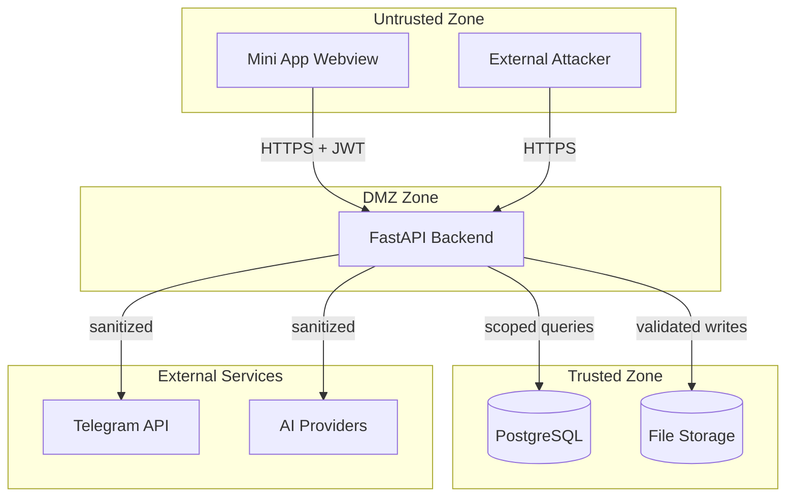

# Security and Multi-Tenancy

This document defines the security model for SocialPilot AI. Security is not a feature layer — it is a foundational design constraint. Every component in the system assumes hostile input, enforces tenant boundaries, and records sensitive actions.

---

## 1. Threat Modeling (STRIDE)

### 1.1 STRIDE Analysis

| Threat | Category | Attack Vector | Mitigation |
|--------|----------|---------------|------------|
| Stolen initData blob | **Spoofing** | Attacker captures valid `initData` from a victim's session and replays it | HMAC validation + `auth_date` expiration + replay cache (Section 3) |
| Stolen JWT | **Spoofing** | Attacker steals JWT from XSS or network sniffing | HTTPS-only; short expiry (12h); in-memory storage; no refresh token persistence |
| Cross-tenant data access | **Tampering** | Attacker modifies `company_id` in API requests to access another company's data | Tenant isolation (Section 6): `company_id` derived from resource ownership, never trusted from client |
| Privilege escalation | **Elevation of Privilege** | Attacker assigns themselves `company_admin` or `platform_owner` role | RBAC enforcement in FastAPI dependencies (Section 5); server-side role validation |
| Unauthorized channel connection | **Tampering** | Attacker connects a victim's channel to their own company | Bot admin verification + one-channel-one-company rule (Section 5.3 in [10-telegram-integration.md](10-telegram-integration.md)) |
| Repudiation | **Repudiation** | User denies performing an action (publishing, approving, deleting) | Audit logging (Section 11): every sensitive action recorded with actor, timestamp, IP |
| Data leakage via error messages | **Information Disclosure** | Raw provider errors or stack traces exposed to client | Provider error sanitization (Section 14); generic error responses |
| IDOR on sequential IDs | **Information Disclosure** | Attacker enumerates `/api/posts/1`, `/api/posts/2` to find other tenants' posts | UUID primary keys; tenant-scoped queries; 404 for cross-tenant (Section 8) |
| Malicious file upload | **Tampering / DoS** | Attacker uploads executable files, oversized files, or zip bombs | Upload validation (Section 10): MIME, magic bytes, size, count, quarantine |
| Rate limit bypass | **Denial of Service** | Attacker floods AI generation endpoints to inflate costs | Per-user and per-company rate limits (Section 10) |
| CSRF via Mini App webview | **Tampering** | Malicious Mini App or website triggers state-changing requests | SameSite cookies; custom headers required; origin validation (Section 15) |
| Secret leakage in logs | **Information Disclosure** | Bot token, API keys, or DB credentials written to logs | Secret redaction in logging config; env-only secrets (Section 9) |

### 1.2 Trust Boundaries



---

## 2. Server-Side initData Validation

### 2.1 Validation Algorithm (Detailed)

The backend implements the following algorithm on `POST /api/v1/auth/telegram`:

```
INPUT: initData (URL-encoded query string), bot_token (server secret)

1. Parse initData into key=value pairs. Do not URL-decode values.
2. Extract `hash` from pairs. Remove `hash` from the set.
3. Sort remaining keys alphabetically (byte-wise lexicographic).
4. Construct data_check_string = join("key=value" for each pair, separator="\n").
5. Compute secret_key = HMAC-SHA256(key="WebAppData", msg=bot_token).
6. Compute expected_hash = HMAC-SHA256(key=secret_key, msg=data_check_string).hexdigest().
7. Compare expected_hash with provided hash using hmac.compare_digest().
8. If mismatch: return 401 INIT_DATA_INVALID.
9. Parse `auth_date` as integer. If absent or non-numeric: return 401 INIT_DATA_INVALID.
10. If abs(now - auth_date) > 86400 + 5: return 401 INIT_DATA_EXPIRED.
11. Compute replay_key = SHA-256(initData). Check replay cache.
12. If replay_key in cache: return 401 INIT_DATA_REPLAYED.
13. Store replay_key in cache with TTL = 90000 seconds (25 hours).
14. Parse `user` JSON field. Extract: id, first_name, last_name, username, language_code.
15. If `user` missing or `id` missing: return 401 INIT_DATA_INVALID.
16. Upsert user record in PostgreSQL.
17. Issue JWT (see Section 4).
```

### 2.2 Implementation Constraints

| Constraint | Detail |
|------------|--------|
| Constant-time comparison | Always use `hmac.compare_digest`, never `==` for hash comparison |
| Bot token storage | Environment variable only; never in code, config files, or database |
| initData logging | Never log the full `initData` string (contains user PII and is sensitive) |
| Validation frequency | On every `/auth/telegram` call; JWT is the session token thereafter |

### 2.3 Frontend Integration

The frontend **must not**:
- Validate `initData` client-side (the HMAC secret is server-only).
- Store `initData` after JWT issuance.
- Send `initData` to any endpoint other than `POST /auth/telegram`.

---

## 3. Replay Protection and Expiration Policy

### 3.1 Defense Layers

| Layer | Window | Mechanism |
|-------|--------|-----------|
| 1. `auth_date` expiration | 24 hours + 5s skew | Telegram's built-in timestamp validation |
| 2. Replay cache | 25 hours | SHA-256 of full `initData` stored with TTL |
| 3. `query_id` uniqueness | Same as `auth_date` window | Duplicate `query_id` within window rejected |
| 4. JWT expiry | 12 hours | Short-lived session token |

### 3.2 Replay Cache Backend

| Environment | Implementation |
|-------------|----------------|
| Local development | In-process `cachetools.TTLCache` (max 10,000 entries) |
| Production | Redis with `SET key 1 EX 90000` (atomic set-with-TTL) |

### 3.3 Cache Eviction

- Entries expire automatically via TTL.
- No manual eviction needed; cache size is bounded by TTL and entry size.
- Cache miss = new `initData` (proceed with validation).

---

## 4. Session and Token Management

### 4.1 JWT Claims

| Claim | Type | Description |
|-------|------|-------------|
| `sub` | UUID | Internal user ID |
| `tid` | int | Telegram user ID (for audit correlation) |
| `iat` | int | Issued-at (Unix timestamp) |
| `exp` | int | Expiration (`iat + 43200` = 12 hours) |
| `type` | string | Always `"access"` |

### 4.2 JWT Configuration

| Parameter | Value |
|-----------|-------|
| Algorithm | HS256 |
| Secret key | 256-bit random, from environment variable `JWT_SECRET_KEY` |
| Expiry | 12 hours |
| Issuer | `"socialpilot-ai"` |
| Audience | `"socialpilot-api"` |

### 4.3 Token Validation Middleware

Every protected endpoint runs through FastAPI dependency injection:

1. Extract `Authorization: Bearer <token>` header.
2. Decode and validate JWT signature, `exp`, `iss`, `aud`.
3. Look up user by `sub` claim.
4. Load user's company memberships.
5. Inject `current_user` and `current_memberships` into the request context.
6. RBAC dependencies check permissions (Section 5).

### 4.4 Token Storage (Frontend)

| Storage | Allowed | Rationale |
|---------|---------|-----------|
| React context / module variable | Yes | In-memory; cleared on reload |
| `localStorage` | **No** | Persistent; XSS-accessible |
| `sessionStorage` | **No** | XSS-accessible |
| `document.cookie` | **No** | XSS-accessible; CSRF risk |
| HTTP-only cookie | Not in MVP | Would require CSRF tokens; re-evaluate post-MVP |

---

## 5. RBAC Enforcement in FastAPI

### 5.1 Dependency Chain

```python
# Conceptual — no application code in documentation
require_auth → require_company(company_id) → require_permission("resource:action")
```

| Dependency | Checks |
|------------|--------|
| `get_current_user` | Valid JWT → user exists and is active |
| `get_company_context` | User has membership in `company_id`; company is `active` |
| `require_permission(action)` | User's role bundle includes `action` |

### 5.2 Permission Resolution

Permissions are resolved from the user's role(s) in the **target company**. The system defines exactly three roles:

1. **Platform Owner** — global platform administration (company registration approval/rejection, suspension/reactivation)
2. **Company Admin** — company workspace, team management, channel connections, AI settings, post review/approval, scheduling, publishing, and publishing history
3. **Content Creator** — AI content generation, media uploads, draft creation/editing, and submitting posts for admin approval

The resolution algorithm:

1. Load `company_memberships` for `(user_id, company_id)`.
2. Collect all permission strings from the user's assigned role.
3. Check if the required permission is in the resolved set.
4. If not: return `403` with code `PERMISSION_DENIED`.

### 5.3 Platform Owner Authorization

`platform_owner` is **not** a company role. Platform-plane endpoints use a separate check:

| Check | Implementation |
|-------|---------------|
| Valid JWT | Standard `get_current_user` |
| Platform owner identity | `user.telegram_id == PLATFORM_OWNER_TELEGRAM_ID` |
| Permission | `platform:*` permission catalog |

The platform owner has **no implicit company membership** and cannot access company workspaces through company-scoped endpoints.

### 5.4 Role Hierarchy

| Role | Can Manage |
|------|------------|
| `company_admin` | `content_creator` (not other admins) |
| `content_creator` | No management |
| `platform_owner` | All companies at the platform level (not a company role) |

---

## 6. Tenant Isolation

### 6.1 Core Principle

**Every database query is scoped by `company_id`. The `company_id` is never trusted from the frontend request body or query parameters for resource access.**

### 6.2 company_id Derivation

| Scenario | How `company_id` is Determined |
|----------|-------------------------------|
| Resource access (GET/PUT/DELETE post, channel, etc.) | From the resource's ownership: `SELECT company_id FROM posts WHERE id = ?` → verify user has membership in that company |
| Resource creation | From the user's verified membership in the target company |
| Listing resources | `WHERE company_id IN (SELECT company_id FROM memberships WHERE user_id = ?)` |
| Platform owner queries | Cross-tenant by design; audited separately |

### 6.3 Cross-Tenant Access Response

| Situation | Response | Rationale |
|-----------|----------|-----------|
| User has no membership in the company that owns the resource | `404 Not Found` | Prevents ID enumeration; reveals nothing about resource existence |
| User has membership but lacks permission | `403 Forbidden` | User knows the resource exists but cannot access it |
| User has membership and permission | `200 OK` with resource | Normal access |

### 6.4 Query Scoping Pattern

All repository methods **must** include `company_id` in the `WHERE` clause:

```
# Conceptual pattern
SELECT * FROM posts WHERE id = :post_id AND company_id = :company_id
```

If the query returns no rows: return `404`. Do not distinguish between "does not exist" and "belongs to another company."

### 6.5 Defense-in-Depth: Application + Database

Tenant isolation is enforced at **both** layers:

| Layer | Mechanism | Purpose |
|-------|-----------|---------|
| Application | `company_id` in every query | Primary defense; testable |
| Database | Row-Level Security (Section 7) | Defense-in-depth; catches application bugs |

---

## 7. PostgreSQL Row-Level Security

### 7.1 Overview

PostgreSQL Row-Level Security (RLS) provides a second enforcement layer. Even if an application query forgets to scope by `company_id`, RLS blocks cross-tenant access at the database level.

### 7.2 Configuration

```sql
-- Enable RLS on all tenant-scoped tables
ALTER TABLE posts ENABLE ROW LEVEL SECURITY;
ALTER TABLE media_assets ENABLE ROW LEVEL SECURITY;
ALTER TABLE social_channels ENABLE ROW LEVEL SECURITY;
ALTER TABLE company_memberships ENABLE ROW LEVEL SECURITY;
ALTER TABLE brand_profiles ENABLE ROW LEVEL SECURITY;

-- Force RLS even for table owners
ALTER TABLE posts FORCE ROW LEVEL SECURITY;
```

### 7.3 Session Context

The application sets the current company context at the start of each transaction:

```sql
SET LOCAL app.current_company_id = 'uuid-of-current-company';
```

`SET LOCAL` ensures the variable is scoped to the current transaction and automatically resets.

### 7.4 Policy Examples

```sql
-- Posts: users can only see posts in their company
CREATE POLICY posts_tenant_isolation ON posts
    FOR ALL
    USING (company_id = current_setting('app.current_company_id')::UUID)
    WITH CHECK (company_id = current_setting('app.current_company_id')::UUID);

-- Media assets: same pattern
CREATE POLICY media_tenant_isolation ON media_assets
    FOR ALL
    USING (company_id = current_setting('app.current_company_id')::UUID)
    WITH CHECK (company_id = current_setting('app.current_company_id')::UUID);
```

### 7.5 Application Integration

| Step | Action |
|------|--------|
| 1 | Resolve `company_id` from resource ownership (Section 6.2) |
| 2 | Begin transaction |
| 3 | `SET LOCAL app.current_company_id = '<uuid>'` |
| 4 | Execute scoped queries |
| 5 | Commit (context auto-resets) |

### 7.6 Testing RLS

| Test | Method |
|------|--------|
| RLS blocks cross-tenant SELECT | Set context to Company A; query Company B's posts; expect empty set |
| RLS blocks cross-tenant INSERT | Set context to Company A; insert with Company B's ID; expect error |
| RLS blocks cross-tenant UPDATE | Set context to Company A; update Company B's rows; expect 0 rows affected |
| RLS allows same-tenant access | Set context to Company A; query Company A's posts; expect rows |
| RLS resets on rollback | Begin; SET LOCAL; ROLLBACK; verify context is gone |

---

## 8. IDOR Prevention

### 8.1 Vulnerability

Insecure Direct Object Reference (IDOR) occurs when an endpoint exposes a resource by identifier without verifying the caller has access to that resource.

### 8.2 Prevention Measures

| Measure | Implementation |
|---------|---------------|
| UUID primary keys | All resources use UUIDv4; no sequential IDs enumerable |
| Tenant-scoped queries | Every resource query includes `company_id` filter |
| Ownership verification | Before returning a resource, verify `resource.company_id` is in the user's memberships |
| 404 for cross-tenant | Return `404` (not `403`) when user has no membership in the resource's company |
| No direct object references in URLs | Use UUIDs, not sequential integers |

### 8.3 IDOR Test Matrix

| Test Case | Expected Result |
|-----------|----------------|
| User A requests User B's post (no shared company) | `404 Not Found` |
| User A requests User B's post (shared company, has permission) | `200 OK` |
| User A requests non-existent post | `404 Not Found` |
| User A requests post with invalid UUID format | `422 Unprocessable Entity` |

---

## 9. Secret Storage

### 9.1 Secret Inventory

| Secret | Storage | Rotation Frequency |
|--------|---------|-------------------|
| Telegram bot token | Environment variable `TELEGRAM_BOT_TOKEN` | On compromise |
| JWT signing key | Environment variable `JWT_SECRET_KEY` | 90 days |
| PostgreSQL password | Environment variable `DATABASE_URL` (with credentials) | 90 days |
| AI provider API keys | Environment variables `GEMINI_API_KEY`, etc. | 90 days |
| Webhook secret (post-MVP) | Environment variable `TELEGRAM_WEBHOOK_SECRET` | On compromise |

### 9.2 Rules

| Rule | Detail |
|------|--------|
| `.env` never committed | `.env` in `.gitignore`; `.env.example` with dummy values is committed |
| No secrets in code | Linter rule: no string literals matching secret patterns |
| No secrets in logs | Structured logging with redaction filters for keys, tokens, passwords |
| No secrets in error messages | Generic error responses; details logged server-side only |
| Environment-specific | Dev/staging/prod use separate secrets; no shared credentials |

### 9.3 Secret Rotation Procedure

| Step | Action |
|------|--------|
| 1 | Generate new secret value |
| 2 | Deploy alongside old secret (dual-key period for JWT) |
| 3 | Update environment variable |
| 4 | Restart services |
| 5 | Verify new secret works |
| 6 | Remove old secret after grace period |
| 7 | Log rotation event in audit log |

### 9.4 Log Redaction

All log output must pass through a redaction filter that masks:
- `Authorization` header values
- `TELEGRAM_BOT_TOKEN` values
- `JWT_SECRET_KEY` values
- Database connection strings
- AI provider API keys

---

## 10. Input Validation with Pydantic

### 10.1 Validation Layers

| Layer | Tool | Purpose |
|-------|------|---------|
| API schema | Pydantic models | Request body validation, type coercion, constraint enforcement |
| Business logic | Service layer | Cross-field validation, state machine enforcement |
| Database | Constraints | NOT NULL, CHECK, FOREIGN KEY, UNIQUE |

### 10.2 Pydantic Rules

| Rule | Detail |
|------|--------|
| Strict types | Use `UUID`, `HttpUrl`, ` constr(max_length=...)`, no raw strings for IDs |
| Extra fields | `model_config = ConfigDict(extra="forbid")` — reject unknown fields |
| Request size | FastAPI body size limit: 15 MB (accommodates multi-image uploads) |
| String lengths | Enforce max lengths matching database column limits |
| Enum values | Use Python `Enum` for status fields, roles, permissions |
| No client-generated IDs | Server assigns UUIDs; client cannot specify `id` on create |

### 10.3 Validation Error Format

```json
{
  "error": {
    "code": "VALIDATION_ERROR",
    "message": "Request validation failed",
    "details": [
      {"field": "caption", "issue": "ensure this value has at most 2000 characters"}
    ]
  }
}
```

---

## 11. Output Encoding

### 11.1 Principles

| Principle | Implementation |
|-----------|---------------|
| API responses | JSON only; no HTML rendering of user content |
| User-generated content | Treat as untrusted; encode on render in frontend |
| Error messages | Generic codes; no stack traces, no file paths, no SQL |
| Telegram message content | HTML parse mode requires escaping of `<`, `>`, `&` |

### 11.2 Frontend Encoding

The React frontend must:
- Use React's built-in JSX escaping (never `dangerouslySetInnerHTML` for user content).
- Validate and sanitize any rich-text rendering.
- Escape caption text before sending to Telegram HTML parse mode.

---

## 12. Upload Validation

### 12.1 Validation Pipeline

```
File → Size check → MIME type check → Magic bytes check → Extension check → Store
```

| Check | Rule | Rejection |
|-------|------|-----------|
| File size | Max 10 MB per image | `413 PAYLOAD_TOO_LARGE` |
| File count | Max 10 per post | `422 MEDIA_COUNT_EXCEEDED` |
| MIME type (declared) | `image/jpeg`, `image/png`, `image/webp`, `image/gif` | `415 UNSUPPORTED_MEDIA_TYPE` |
| Magic bytes (actual) | Match declared MIME type | `415 UNSUPPORTED_MEDIA_TYPE` |
| Extension | Matches MIME type | `415 UNSUPPORTED_MEDIA_TYPE` |
| Content integrity | Image decodable by Pillow | `422 INVALID_IMAGE` |
| Filename | Sanitized; no path traversal | `422 INVALID_FILENAME` |

### 12.2 Magic Bytes Reference

| MIME Type | Magic Bytes (hex) |
|-----------|-------------------|
| `image/jpeg` | `FF D8 FF` |
| `image/png` | `89 50 4E 47 0D 0A 1A 0A` |
| `image/webp` | `52 49 46 46` .... `57 45 42 50` (RIFF....WEBP) |
| `image/gif` | `47 49 46 38 37 61` (GIF87a) or `47 49 46 38 39 61` (GIF89a) |

### 12.3 Quarantine

| Action | Detail |
|--------|--------|
| Suspicious file | Store in `quarantine/` directory; do not serve; log event |
| Quarantine retention | 30 days; then permanent deletion |
| Quarantine access | Platform owner only; audit-logged |

### 12.4 Storage Security

| Rule | Detail |
|------|--------|
| Outside web root | Files served via authenticated endpoint, not direct URL |
| No execution | Storage directory has no execute permissions |
| Content-Disposition | `attachment` for downloads |
| Content-Type | Set from validated MIME type, not client-supplied |

---

## 13. Rate Limiting

### 13.1 Rate Limit Tiers

| Tier | Window | Limit | Applies To |
|------|--------|-------|------------|
| Authentication | 10 requests / 5 min / IP | Brute-force protection | `/auth/telegram` |
| AI text generation | 20 requests / hour / user | Cost control | `/ai/generate-text` |
| AI image generation | 10 requests / hour / user | Cost control | `/ai/generate-image` |
| General API | 100 requests / min / user | Abuse prevention | All other endpoints |
| Upload | 50 requests / hour / user | Storage abuse prevention | `/media/upload` |
| Company-scoped | 500 requests / hour / company | Fair usage | All company endpoints |

### 13.2 Implementation

| Component | Tool |
|-----------|------|
| Rate limiter | `slowapi` (Redis backend in production; in-memory for local dev) |
| Response on limit | `429 Too Many Requests` with `Retry-After` header |
| Headers | `X-RateLimit-Limit`, `X-RateLimit-Remaining`, `X-RateLimit-Reset` |

### 13.3 Rate Limit Headers

All API responses include rate limit headers:

```
X-RateLimit-Limit: 100
X-RateLimit-Remaining: 87
X-RateLimit-Reset: 1699999999
```

---

## 14. Provider Error Handling

### 14.1 Rule

**Raw provider error responses are never forwarded to the client.**

### 14.2 Error Processing Pipeline

```
Provider call → Provider returns error → Sanitize → Log full details → Return generic error to client
```

| Layer | Action |
|-------|--------|
| Provider | Returns raw error (may contain API keys, internal details) |
| Service layer | Catches error; logs full details server-side; maps to internal error code |
| API layer | Returns `502 Bad Gateway` or `503 Service Unavailable` with generic message |

### 14.3 Error Code Mapping

| Provider Error | Internal Code | Client Message |
|----------------|---------------|----------------|
| API key invalid | `PROVIDER_AUTH_ERROR` | "AI service temporarily unavailable" |
| Rate limited | `PROVIDER_RATE_LIMITED` | "AI service busy. Please try again later." |
| Timeout | `PROVIDER_TIMEOUT` | "AI service timed out. Please retry." |
| Content policy | `PROVIDER_CONTENT_REJECTED` | "Content was rejected by AI service. Please revise your prompt." |
| Quota exceeded | `PROVIDER_QUOTA_EXCEEDED` | "AI usage limit reached. Contact support." |

### 14.4 Logging

Full provider error details (including response body) are logged server-side with `ERROR` level and correlated by request ID. These logs must not contain API keys (redacted per Section 9.4).

---

## 15. Audit Logging

### 15.1 What to Log

| Action | Logged Fields |
|--------|---------------|
| User login (initData validation) | `user_id`, `telegram_id`, `timestamp`, `ip`, `user_agent` |
| Company created | `actor_user_id`, `company_id`, `timestamp` |
| Company approved/rejected | `actor_user_id` (platform owner), `company_id`, `action`, `timestamp` |
| Company suspended | `actor_user_id`, `company_id`, `reason`, `timestamp` |
| Member invited | `actor_user_id`, `invited_telegram_id`, `company_id`, `roles`, `timestamp` |
| Member removed | `actor_user_id`, `removed_user_id`, `company_id`, `timestamp` |
| Member roles changed | `actor_user_id`, `target_user_id`, `company_id`, `old_roles`, `new_roles`, `timestamp` |
| Channel connected | `actor_user_id`, `company_id`, `channel_id`, `timestamp` |
| Channel disconnected | `actor_user_id`, `company_id`, `channel_id`, `timestamp` |
| Post created/updated/deleted | `actor_user_id`, `post_id`, `company_id`, `action`, `timestamp` |
| Post submitted for review | `actor_user_id`, `post_id`, `timestamp` |
| Post approved/rejected | `actor_user_id`, `post_id`, `action`, `reason`, `timestamp` |
| Post published | `actor_user_id`, `post_id`, `channel_id`, `message_ids`, `timestamp` |
| Post publish failed | `actor_user_id`, `post_id`, `channel_id`, `error_code`, `timestamp` |
| Media uploaded | `actor_user_id`, `company_id`, `media_id`, `file_hash`, `timestamp` |
| Media deleted | `actor_user_id`, `media_id`, `timestamp` |
| AI text generated | `actor_user_id`, `company_id`, `prompt_hash`, `timestamp` |
| AI image generated | `actor_user_id`, `company_id`, `prompt_hash`, `timestamp` |
| Permission denied | `user_id`, `resource`, `action`, `timestamp` |
| Cross-tenant access attempt | `user_id`, `attempted_company_id`, `resource_id`, `timestamp` |
| Secret rotated | `actor_user_id`, `secret_name`, `timestamp` |
| Company data exported | `actor_user_id`, `company_id`, `export_id`, `timestamp` |

### 15.2 Audit Log Storage

| Field | Storage |
|-------|---------|
| Table | `audit_logs` (PostgreSQL) |
| Retention | 12 months |
| Immutability | Append-only; no UPDATE or DELETE grants |
| Access | Platform owner and `company_admin` (own company only) |

### 15.3 Audit Log Schema

| Column | Type | Description |
|--------|------|-------------|
| `id` | UUID | Primary key |
| `actor_user_id` | UUID | Who performed the action |
| `action` | String | Action type (e.g., `post.published`) |
| `entity_type` | String | Resource type (e.g., `post`) |
| `entity_id` | UUID | Resource ID |
| `company_id` | UUID | Tenant context |
| `metadata` | JSONB | Action-specific details |
| `ip_address` | INET | Client IP |
| `user_agent` | String | Client user agent |
| `created_at` | TIMESTAMP | UTC timestamp |

---

## 16. Backup and Restore

### 16.1 Backup Strategy

| Data | Method | Frequency | Retention |
|------|--------|-----------|-----------|
| PostgreSQL | `pg_dump` (custom format) | Daily | 30 days |
| File storage (media) | `rsync` to backup volume | Daily | 30 days |
| Audit logs | Archived to cold storage | Monthly | 12 months |

### 16.2 Backup Security

| Control | Detail |
|---------|--------|
| Encryption | Backups encrypted at rest (AES-256) |
| Access | Backup storage credentials are separate from production |
| Integrity | Checksums verified on restore |

### 16.3 Restore Procedure

| Step | Action |
|------|--------|
| 1 | Provision clean PostgreSQL instance |
| 2 | Restore `pg_dump` backup |
| 3 | Restore file storage from backup volume |
| 4 | Verify data integrity (row counts, checksums) |
| 5 | Re-run Alembic migrations if backup is from older schema version |
| 6 | Verify application connectivity |
| 7 | Update DNS / connection strings |

### 16.4 Disaster Recovery Targets

| Metric | Target |
|--------|--------|
| RPO (Recovery Point Objective) | 24 hours |
| RTO (Recovery Time Objective) | 4 hours |

---

## 17. Account Deactivation and Company Suspension

### 17.1 Company Status Behavior

| Status | Workspace Access | Data | Publishing |
|--------|-----------------|------|------------|
| `pending` | Company Admin can view; no workspace features | Retained | No |
| `active` | Full access | Retained | Yes |
| `suspended` | Read-only for members | Retained | No; API returns `403 COMPANY_SUSPENDED` |
| `rejected` | Company Admin can view rejection reason | Retained | No; re-registration allowed after 7 days |

### 17.2 Platform Owner Suspension

| Action | Effect |
|--------|--------|
| Platform owner suspends company | Company → `suspended`; all workspace mutations blocked; publishing halted |
| Platform owner reactivates company | Company → `active`; full functionality restored |
| Platform owner deletes company | Export archive → 24h retention → hard-delete cascade |

### 17.3 Admin-Initiated Self-Suspension

| Action | Effect |
|--------|--------|
| Company Admin self-suspends | Company → `suspended`; reversible by admin |
| Admin reactivates | Company → `active`; no platform owner approval needed |

### 17.4 User Deactivation

| Action | Effect |
|--------|--------|
| User removes all company memberships | User record retained (for audit); JWT still valid but no company access |
| Platform owner disables user | User `is_active = false`; JWT invalid; all access revoked |

---

## 18. CSRF and CORS Considerations

### 18.1 Mini App Webview Context

Telegram Mini Apps run in a **controlled webview** with the following properties:

| Property | Security Implication |
|----------|---------------------|
| No custom cookies set by Telegram | CSRF via cookie-based auth is not applicable |
| Origin is `https://telegram.org` (or client-specific) | CORS must allow Telegram origins |
| No third-party scripts allowed | XSS surface is reduced but not eliminated |

### 18.2 CORS Policy

| Setting | Value |
|---------|-------|
| `allow_origins` | `["https://telegram.org", "https://web.telegram.org"]` |
| `allow_credentials` | `True` |
| `allow_methods` | `["GET", "POST", "PUT", "PATCH", "DELETE"]` |
| `allow_headers` | `["Authorization", "Content-Type", "X-Request-ID"]` |

### 18.3 CSRF Mitigation

| Measure | Detail |
|---------|--------|
| Bearer token auth | JWT in `Authorization` header is not automatically sent by browsers (unlike cookies) |
| Custom header requirement | API requires `X-Requested-With: XMLHttpRequest` header; browsers cannot set this cross-origin without CORS |
| SameSite cookies | Not applicable (no cookies in MVP) |

---

## 19. Abuse Cases and Mitigations

| Abuse Case | Mitigation |
|------------|-----------|
| Mass company registration by bot accounts | Rate limit on `/auth/telegram`; platform owner approval gate |
| Channel squatting (connecting channels to block others) | One-channel-one-company rule; bot admin verification |
| AI prompt injection (extracting other companies' brand data) | Tenant isolation; brand profile scoped to company |
| Storage flooding (uploading thousands of images) | Upload rate limit; per-company storage quota |
| JWT theft via XSS | In-memory storage; short expiry; no localStorage |
| Enumeration of company IDs | UUIDs; 404 for cross-tenant; rate limit on list endpoints |
| Publishing to another company's channel | Channel ownership verified per company; 404 for cross-tenant |
| Audit log tampering | Append-only; separate DB role with no UPDATE/DELETE |
| Bot token theft from logs | Secret redaction; env-only storage |
| Provider key exfiltration via error messages | Error sanitization; generic client-facing messages |

---

## 20. Security Headers

All API responses must include the following headers:

| Header | Value | Purpose |
|--------|-------|---------|
| `Strict-Transport-Security` | `max-age=31536000; includeSubDomains` | Enforce HTTPS |
| `X-Content-Type-Options` | `nosniff` | Prevent MIME sniffing |
| `X-Frame-Options` | `DENY` | Prevent clickjacking |
| `Content-Security-Policy` | `default-src 'none'; frame-ancestors 'none'` | Restrict resource loading |
| `X-XSS-Protection` | `1; mode=Block` | Legacy XSS protection |
| `Cache-Control` | `no-store` | Prevent caching of API responses |
| `Referrer-Policy` | `no-referrer` | Prevent referrer leakage |
| `Permissions-Policy` | `geolocation=(), microphone=(), camera=()` | Restrict browser features |

---

## 21. Security Acceptance Criteria

| ID | Criterion | Verification |
|----|-----------|--------------|
| SEC-01 | All `initData` validation failures return 401 | Automated test |
| SEC-02 | Cross-tenant access returns 404 (not 403 or 200) | Automated test |
| SEC-03 | RLS blocks cross-tenant queries at database level | Automated test |
| SEC-04 | Rate limits return 429 with correct headers | Automated test |
| SEC-05 | Upload validation rejects non-image files | Automated test |
| SEC-06 | Provider errors are sanitized (no raw response to client) | Automated test |
| SEC-07 | Audit log records all sensitive actions | Manual + automated |
| SEC-08 | Secrets are not present in code or logs | CI lint rule |
| SEC-09 | Security headers present on all responses | Automated test |
| SEC-10 | JWT expires after 12 hours | Automated test |
| SEC-11 | Replayed initData is rejected | Automated test |
| SEC-12 | Permission denied returns 403 with correct code | Automated test |
