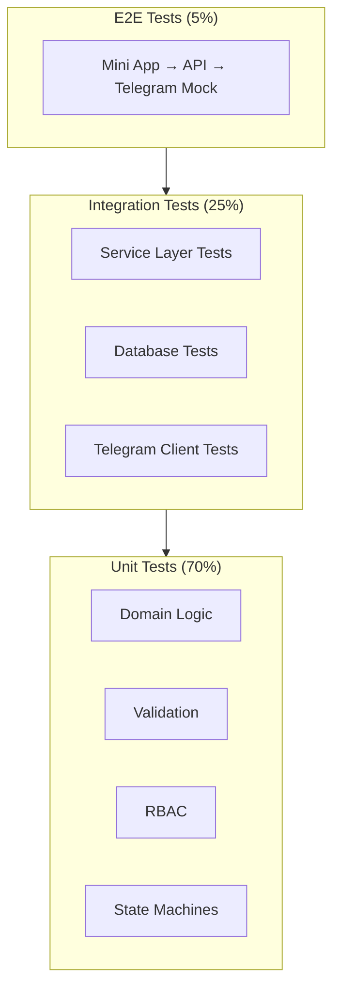
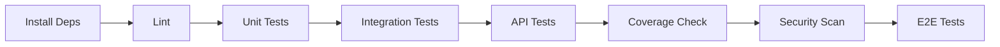

# Testing Strategy

This document defines the testing strategy for SocialPilot AI, covering the test pyramid, test structure, fixtures, acceptance criteria, and CI integration. The MVP is considered complete only when all acceptance criteria in this document pass.

---

## 1. Test Pyramid



| Layer | Percentage | Scope | Speed |
|-------|-----------|-------|-------|
| Unit | 70% | Pure functions, validators, state machines, RBAC logic | < 10ms per test |
| Integration | 25% | Database queries, service layer, Telegram client (mocked) | < 1s per test |
| E2E | 5% | Full Mini App → API → Telegram mock flow | < 5s per test |

---

## 2. Test Structure

### 2.1 Backend

```
backend/
├── tests/
│   ├── conftest.py                    # Shared fixtures
│   ├── unit/
│   │   ├── conftest.py
│   │   ├── test_initdata_validation.py
│   │   ├── test_jwt.py
│   │   ├── test_rbac.py
│   │   ├── test_state_machines.py
│   │   ├── test_upload_validation.py
│   │   ├── test_rate_limiting.py
│   │   └── test_input_validation.py
│   ├── integration/
│   │   ├── conftest.py
│   │   ├── test_database.py
│   │   ├── test_tenant_isolation.py
│   │   ├── test_rls_policies.py
│   │   ├── test_telegram_client.py
│   │   ├── test_ai_providers.py
│   │   └── test_audit_logging.py
│   ├── api/
│   │   ├── conftest.py
│   │   ├── test_auth.py
│   │   ├── test_companies.py
│   │   ├── test_members.py
│   │   ├── test_channels.py
│   │   ├── test_posts.py
│   │   ├── test_media.py
│   │   ├── test_approvals.py
│   │   ├── test_publishing.py
│   │   └── test_platform_admin.py
│   └── e2e/
│       ├── conftest.py
│       └── test_full_publish_flow.py
```

### 2.2 Frontend

```
frontend/
├── tests/
│   ├── unit/
│   │   ├── components/
│   │   ├── hooks/
│   │   └── utils/
│   ├── integration/
│   │   ├── auth-flow.test.ts
│   │   ├── draft-editor.test.ts
│   │   └── media-upload.test.ts
│   └── e2e/
│       └── mini-app-launch.spec.ts
```

---

## 3. pytest Configuration

### 3.1 `pyproject.toml` / `pytest.ini`

```ini
[pytest]
testpaths = backend/tests
python_files = test_*.py
python_classes = Test*
python_functions = test_*
addopts =
    -v
    --tb=short
    --strict-markers
    --cov=app
    --cov-report=term-missing
    --cov-report=html
    --cov-fail-under=70
markers =
    unit: Unit tests (fast, no I/O)
    integration: Integration tests (database, mocked services)
    api: API endpoint tests
    e2e: End-to-end tests
    slow: Tests that take > 1 second
    security: Security-critical tests
```

### 3.2 Test Execution Commands

| Command | Scope |
|---------|-------|
| `pytest -m unit` | Unit tests only |
| `pytest -m integration` | Integration tests only |
| `pytest -m api` | API tests only |
| `pytest -m "not slow"` | All except slow tests |
| `pytest -m security` | Security tests only |
| `pytest` | Full suite |

---

## 4. Test Fixtures

### 4.1 Database Fixtures

| Fixture | Scope | Description |
|---------|-------|-------------|
| `db_engine` | Session | Creates test database engine; runs migrations |
| `db_session` | Function | Provides transactional session; rolls back after each test |
| `db_cleanup` | Session | Drops and recreates test database |

### 4.2 User and Auth Fixtures

| Fixture | Scope | Description |
|---------|-------|-------------|
| `test_user` | Function | Creates a user record with known Telegram ID |
| `test_user_2` | Function | Second user for cross-tenant tests |
| `valid_initdata` | Function | Generates a valid initData string with correct HMAC |
| `expired_initdata` | Function | initData with auth_date 25 hours in the past |
| `tampered_initdata` | Function | Valid initData with modified user field |
| `replayed_initdata` | Function | Valid initData already in replay cache |
| `auth_headers` | Function | Returns `{"Authorization": "Bearer <jwt>"}` for test user |
| `auth_headers_2` | Function | Auth headers for second user |
| `platform_owner_headers` | Function | Auth headers for platform owner |

### 4.3 Company Fixtures

| Fixture | Scope | Description |
|---------|-------|-------------|
| `test_company` | Function | Creates an active company with owner membership |
| `test_company_2` | Function | Second company for cross-tenant tests |
| `pending_company` | Function | Company in `pending` status |
| `suspended_company` | Function | Company in `suspended` status |
| `company_owner_membership` | Function | Owner membership for test user in test company |
| `company_admin_membership` | Function | Admin membership |
| `creator_membership` | Function | Creator membership |
| `approver_membership` | Function | Approver membership |
| `publisher_membership` | Function | Publisher membership |
| `analyst_membership` | Function | Analyst membership |

### 4.4 Telegram Mock Fixtures

| Fixture | Scope | Description |
|---------|-------|-------------|
| `mock_telegram_api` | Function | Mocks all Bot API HTTP calls; returns configurable responses |
| `mock_get_chat` | Function | Mocks `getChat` response |
| `mock_get_chat_admins` | Function | Mocks `getChatAdministrators` response |
| `mock_send_message` | Function | Mocks `sendMessage` response with message ID |
| `mock_send_photo` | Function | Mocks `sendPhoto` response |
| `mock_send_media_group` | Function | Mocks `sendMediaGroup` response |
| `mock_telegram_error` | Function | Configures mock to return a Telegram error |
| `mock_telegram_timeout` | Function | Configures mock to simulate timeout |

### 4.5 Media Fixtures

| Fixture | Scope | Description |
|---------|-------|-------------|
| `sample_jpeg` | Function | Valid JPEG file (small, < 100KB) |
| `sample_png` | Function | Valid PNG file |
| `sample_webp` | Function | Valid WebP file |
| `sample_gif` | Function | Valid GIF file |
| `oversized_image` | Function | Valid image exceeding 10 MB |
| `fake_image` | Function | Text file with .jpg extension (magic bytes mismatch) |
| `executable_file` | Function | Executable file with image extension |
| `ten_images` | Function | List of 10 valid images |
| `eleven_images` | Function | List of 11 images (exceeds limit) |

### 4.6 AI Provider Fixtures

| Fixture | Scope | Description |
|---------|-------|-------------|
| `mock_ai_provider` | Function | Mocks AI text generation |
| `mock_ai_provider_failure` | Function | Configures mock to return provider error |
| `mock_ai_provider_timeout` | Function | Configures mock to simulate timeout |
| `mock_ai_provider_rate_limit` | Function | Configures mock to return 429 |

---

## 5. Acceptance Criteria Matrix

### 5.1 User Registration Tests

| ID | Test Case | Given | When | Then | Priority |
|----|-----------|-------|------|------|----------|
| REG-01 | New user registration | Valid initData for new Telegram ID | POST /auth/telegram | 201; user created; JWT returned | MVP |
| REG-02 | Returning user login | Valid initData for existing user | POST /auth/telegram | 200; same user ID; new JWT | MVP |
| REG-03 | Invalid HMAC | initData with wrong hash | POST /auth/telegram | 401; INIT_DATA_INVALID | MVP |
| REG-04 | Expired initData | auth_date 25h ago | POST /auth/telegram | 401; INIT_DATA_EXPIRED | MVP |
| REG-05 | Replayed initData | Same initData submitted twice | POST /auth/telegram (2nd) | 401; INIT_DATA_REPLAYED | MVP |
| REG-06 | Missing user field | initData without user JSON | POST /auth/telegram | 401; INIT_DATA_INVALID | MVP |
| REG-07 | Missing auth_date | initData without auth_date | POST /auth/telegram | 401; INIT_DATA_INVALID | MVP |
| REG-08 | Malformed initData | Random string | POST /auth/telegram | 401; INIT_DATA_INVALID | MVP |
| REG-09 | Company creation | Authenticated user, no company | POST /companies | 201; company pending; owner membership | MVP |
| REG-10 | Duplicate company name | Same user, same normalized name | POST /companies | 409; DUPLICATE_COMPANY_NAME | MVP |
| REG-11 | Max companies per user | User owns 5 active companies | POST /companies | 403; COMPANY_LIMIT_REACHED | MVP |

### 5.2 Telegram initData Validation Tests

| ID | Test Case | Given | When | Then | Priority |
|----|-----------|-------|------|------|----------|
| AUTH-01 | Valid initData accepted | Correctly signed initData | POST /auth/telegram | 200; JWT issued | MVP |
| AUTH-02 | Tampered user field | initData with modified first_name | POST /auth/telegram | 401; INIT_DATA_INVALID | MVP |
| AUTH-03 | Tampered auth_date | initData with modified auth_date | POST /auth/telegram | 401; INIT_DATA_INVALID | MVP |
| AUTH-04 | Wrong bot token | initData signed with different token | POST /auth/telegram | 401; INIT_DATA_INVALID | MVP |
| AUTH-05 | Boundary: auth_date exactly 24h | auth_date = now - 86400 | POST /auth/telegram | 200; accepted | MVP |
| AUTH-06 | Boundary: auth_date 24h + 6s | auth_date = now - 86406 | POST /auth/telegram | 401; INIT_DATA_EXPIRED | MVP |
| AUTH-07 | Replay within 24h | Same valid initData replayed | POST /auth/telegram (2nd) | 401; INIT_DATA_REPLAYED | MVP |
| AUTH-08 | JWT expiry | JWT with exp in past | Any protected endpoint | 401; TOKEN_EXPIRED | MVP |
| AUTH-09 | JWT invalid signature | JWT signed with wrong key | Any protected endpoint | 401; TOKEN_INVALID | MVP |
| AUTH-10 | Missing Authorization header | No Bearer token | Any protected endpoint | 401; TOKEN_MISSING | MVP |

### 5.3 Company Approval Tests

| ID | Test Case | Given | When | Then | Priority |
|----|-----------|-------|------|------|----------|
| APP-01 | Platform owner approves | Pending company; platform owner session | POST /platform/companies/{id}/approve | 200; company active; audit logged | MVP |
| APP-02 | Platform owner rejects | Pending company; platform owner session | POST /platform/companies/{id}/reject | 200; company rejected; reason recorded | MVP |
| APP-03 | Non-owner cannot approve | Company member (non-platform-owner) | POST /platform/companies/{id}/approve | 403; PERMISSION_DENIED | MVP |
| APP-04 | Approve non-existent company | Platform owner session | POST /platform/companies/{uuid}/approve | 404; COMPANY_NOT_FOUND | MVP |
| APP-05 | Approve already-active company | Active company | POST /platform/companies/{id}/approve | 409; INVALID_STATE | MVP |
| APP-06 | Owner notified on approval | Pending company | Platform owner approves | Notification created | MVP |

### 5.4 Invitation and Role-Assignment Tests

| ID | Test Case | Given | When | Then | Priority |
|----|-----------|-------|------|------|----------|
| INV-01 | Owner invites by username | Active company; owner session | POST /companies/{id}/invitations | 201; invitation created | MVP |
| INV-02 | Invite expires after 7 days | Invitation created 8 days ago | Accept invitation | 410; INVITATION_EXPIRED | MVP |
| INV-03 | Invited user accepts | Valid invitation; invited user session | POST /invitations/{id}/accept | 200; membership created | MVP |
| INV-04 | Invitee gets specified roles | Invitation with roles [creator, publisher] | Accept invitation | Membership has both roles | MVP |
| INV-05 | Non-invitee cannot accept | Different user session | POST /invitations/{id}/accept | 403; PERMISSION_DENIED | MVP |
| INV-06 | Owner changes member roles | Existing membership | PATCH /memberships/{id}/roles | 200; roles updated; audit logged | MVP |
| INV-07 | Admin cannot assign admin role | Admin session; target is creator | PATCH roles to [admin] | 403; PERMISSION_DENIED | MVP |
| INV-08 | Remove member | Owner session; target is creator | DELETE /memberships/{id} | 204; membership removed | MVP |
| INV-09 | Cannot remove last owner | Owner session; only owner | DELETE /memberships/{id} | 409; LAST_OWNER | MVP |
| INV-10 | Revoke unaccepted invitation | Owner session; pending invitation | DELETE /invitations/{id} | 204; invitation revoked | MVP |

### 5.5 Cross-Tenant Access-Denial Tests

| ID | Test Case | Given | When | Then | Priority |
|----|-----------|-------|------|------|----------|
| TEN-01 | User A accesses User B's post | No shared company | GET /posts/{B's post} | 404; not 403 | MVP |
| TEN-02 | User A lists User B's companies | No shared company | GET /companies | Only User A's companies | MVP |
| TEN-03 | User A accesses User B's channel | No shared company | GET /channels/{B's channel} | 404 | MVP |
| TEN-04 | User A accesses User B's media | No shared company | GET /media/{B's media} | 404 | MVP |
| TEN-05 | User A tries to publish to User B's channel | No shared company | POST /posts/{id}/publish | 404 | MVP |
| TEN-06 | RLS blocks cross-tenant SELECT | DB context = Company A | SELECT Company B's posts | Empty result | MVP |
| TEN-07 | RLS blocks cross-tenant INSERT | DB context = Company A | INSERT with Company B's ID | Error | MVP |
| TEN-08 | RLS blocks cross-tenant UPDATE | DB context = Company A | UPDATE Company B's rows | 0 rows affected | MVP |
| TEN-09 | Shared company access works | User in Company A and B | GET /posts/{A's post} | 200 | MVP |
| TEN-10 | Cross-tenant attempt logged | User A attempts access to B's resource | Any cross-tenant request | Audit log entry created | MVP |

### 5.6 Channel Ownership Verification Tests

| ID | Test Case | Given | When | Then | Priority |
|----|-----------|-------|------|------|----------|
| CHN-01 | Connect channel with bot admin | Bot is admin in channel | POST /channels/connect | 201; channel created | MVP |
| CHN-02 | Connect channel without bot admin | Bot is not admin | POST /channels/connect | 400; BOT_NOT_ADMIN | MVP |
| CHN-03 | Connect already-connected channel | Channel belongs to another company | POST /channels/connect | 409; CHANNEL_ALREADY_CONNECTED | MVP |
| CHN-04 | Connect channel to own company | Channel already connected to same company | POST /channels/connect | 409; CHANNEL_ALREADY_CONNECTED | MVP |
| CHN-05 | Disconnect channel | Owner session; channel exists | DELETE /channels/{id} | 204; channel disconnected | MVP |
| CHN-06 | Non-owner cannot connect | Creator session | POST /channels/connect | 403; PERMISSION_DENIED | MVP |
| CHN-07 | Bot loses admin after connection | Bot removed from channel | GET /channels/{id} | Channel shows warning status | MVP |
| CHN-08 | getChat returns not found | Invalid channel ID | POST /channels/connect | 400; TELEGRAM_CHAT_NOT_FOUND | MVP |

### 5.7 Draft CRUD Tests

| ID | Test Case | Given | When | Then | Priority |
|----|-----------|-------|------|------|----------|
| DFT-01 | Create draft | Creator session; company active | POST /posts | 201; post in draft state | MVP |
| DFT-02 | Edit draft caption | Draft exists; creator session | PATCH /posts/{id} | 200; revision created | MVP |
| DFT-03 | Edit non-draft post | Post in approved state | PATCH /posts/{id} | 409; INVALID_STATE | MVP |
| DFT-04 | Delete (cancel) draft | Draft exists; creator session | DELETE /posts/{id} | 204; post cancelled | MVP |
| DFT-05 | View draft revisions | Draft with 3 revisions | GET /posts/{id}/revisions | 200; 3 revisions returned | MVP |
| DFT-06 | List drafts with filters | Multiple drafts | GET /posts?status=draft | 200; filtered results | MVP |
| DFT-07 | Creator edits own draft | Creator session; own draft | PATCH /posts/{id} | 200 | MVP |
| DFT-08 | Creator cannot edit others' draft | Creator session; other's draft | PATCH /posts/{id} | 403; PERMISSION_DENIED | MVP |
| DFT-09 | Empty caption rejected | Draft with no caption | POST /posts | 422; VALIDATION_ERROR | MVP |
| DFT-10 | Caption max length | Caption > 2000 chars | POST /posts | 422; VALIDATION_ERROR | MVP |

### 5.8 AI Provider Failure Tests

| ID | Test Case | Given | When | Then | Priority |
|----|-----------|-------|------|------|----------|
| AI-01 | Provider returns 500 | Mock provider → 500 | POST /ai/generate-text | 502; generic error; no raw response | MVP |
| AI-02 | Provider times out | Mock provider → timeout | POST /ai/generate-text | 504; PROVIDER_TIMEOUT | MVP |
| AI-03 | Provider rate limited | Mock provider → 429 | POST /ai/generate-text | 429; PROVIDER_RATE_LIMITED | MVP |
| AI-04 | Provider auth error | Mock provider → 401 | POST /ai/generate-text | 502; PROVIDER_AUTH_ERROR | MVP |
| AI-05 | Provider content rejected | Mock provider → 400 content policy | POST /ai/generate-text | 422; PROVIDER_CONTENT_REJECTED | MVP |
| AI-06 | No draft created on failure | Provider fails | POST /ai/generate-text | No post record in database | MVP |
| AI-07 | Usage recorded on success | Provider succeeds | POST /ai/generate-text | usage_records entry created | MVP |
| AI-08 | Usage not recorded on failure | Provider fails | POST /ai/generate-text | No usage_records entry | MVP |
| AI-09 | Rate limit per user | 20 requests in 1 hour | POST /ai/generate-text (21st) | 429; RATE_LIMITED | MVP |
| AI-10 | Rate limit per company | Company exceeds hourly quota | POST /ai/generate-text | 429; COMPANY_RATE_LIMITED | MVP |

### 5.9 Image Upload Validation Tests

| ID | Test Case | Given | When | Then | Priority |
|----|-----------|-------|------|------|----------|
| IMG-01 | Valid JPEG upload | sample_jpeg | POST /media/upload | 201; media_asset created | MVP |
| IMG-02 | Valid PNG upload | sample_png | POST /media/upload | 201 | MVP |
| IMG-03 | Valid WebP upload | sample_webp | POST /media/upload | 201 | MVP |
| IMG-04 | Valid GIF upload | sample_gif | POST /media/upload | 201 | MVP |
| IMG-05 | Oversized file rejected | 11 MB image | POST /media/upload | 413; PAYLOAD_TOO_LARGE | MVP |
| IMG-06 | Fake image rejected | Text file with .jpg | POST /media/upload | 415; UNSUPPORTED_MEDIA_TYPE | MVP |
| IMG-07 | Executable rejected | .exe with .png extension | POST /media/upload | 415; UNSUPPORTED_MEDIA_TYPE | MVP |
| IMG-08 | SVG rejected | Valid SVG file | POST /media/upload | 415; UNSUPPORTED_MEDIA_TYPE | MVP |
| IMG-09 | 10 images accepted | 10 valid images | POST /media/upload (batch) | 201; 10 assets created | MVP |
| IMG-10 | 11 images rejected | 11 valid images | POST /media/upload (batch) | 422; MEDIA_COUNT_EXCEEDED | MVP |
| IMG-11 | No upload on validation failure | Invalid file | POST /media/upload | No file stored; no DB record | MVP |
| IMG-12 | File hash recorded | Valid upload | POST /media/upload | media_asset.file_hash is set | MVP |
| IMG-13 | Quarantine on suspicious file | File with magic byte mismatch | POST /media/upload | File in quarantine/; not served | MVP |

### 5.10 Media Ordering Tests

| ID | Test Case | Given | When | Then | Priority |
|----|-----------|-------|------|------|----------|
| MED-01 | Reorder media assets | Draft with 3 images | PATCH /posts/{id}/media-order | 200; order updated | MVP |
| MED-02 | Order persisted after reload | Reordered media | GET /posts/{id} | Order matches | MVP |
| MED-03 | Duplicate order values rejected | Two assets with same position | PATCH /posts/{id}/media-order | 422; VALIDATION_ERROR | MVP |
| MED-04 | Remove media from draft | Draft with 3 images | DELETE /posts/{id}/media/{media_id} | 204; asset removed; order reindexed | MVP |
| MED-05 | Add media to existing draft | Draft with 2 images | POST /posts/{id}/media | 201; asset added at end | MVP |

### 5.11 Multi-Image Validation Tests

| ID | Test Case | Given | When | Then | Priority |
|----|-----------|-------|------|------|----------|
| MUL-01 | Album with 2 images | 2 valid images | POST /posts (with media) | 201; post created | MVP |
| MUL-02 | Album with 10 images | 10 valid images | POST /posts (with media) | 201; post created | MVP |
| MUL-03 | Album with 11 images rejected | 11 valid images | POST /posts (with media) | 422; MEDIA_COUNT_EXCEEDED | MVP |
| MUL-04 | Mixed media types in album | 5 photos + 5 videos | POST /posts (with media) | 422; MIXED_MEDIA_TYPES | MVP |
| MUL-05 | Caption within limit | 1024 char caption | POST /posts | 201 | MVP |
| MUL-06 | Caption exceeds limit | 1025 char caption | POST /posts | 422; VALIDATION_ERROR | MVP |
| MUL-07 | Empty caption with media | No caption; 3 images | POST /posts | 201; caption optional for media | MVP |

### 5.12 Approval Transition Tests

| ID | Test Case | Given | When | Then | Priority |
|----|-----------|-------|------|------|----------|
| APR-01 | Submit for review | Draft; creator session | POST /posts/{id}/submit | 200; post in_review | MVP |
| APR-02 | Approve post | In review; approver session | POST /posts/{id}/approve | 200; post approved | MVP |
| APR-03 | Reject post with reason | In review; approver session | POST /posts/{id}/reject | 200; post rejected; reason recorded | MVP |
| APR-04 | Reject without reason | In review; approver session | POST /posts/{id}/reject (no reason) | 422; VALIDATION_ERROR | MVP |
| APR-05 | Request changes | In review; approver session | POST /posts/{id}/request-changes | 200; post changes_requested | MVP |
| APR-06 | Resubmit after changes | Changes requested; creator session | POST /posts/{id}/submit | 200; post in_review | MVP |
| APR-07 | Cannot approve own post (policy on) | Creator = approver; policy requires separation | POST /posts/{id}/approve | 403; SEPARATION_OF_DUTIES | MVP |
| APR-08 | Cannot submit non-draft | Post in approved state | POST /posts/{id}/submit | 409; INVALID_STATE | MVP |
| APR-09 | Approval event recorded | Any approval action | POST /posts/{id}/approve | approval_event created | MVP |
| APR-10 | Rejected post cannot publish | Post in rejected state | POST /posts/{id}/publish | 409; INVALID_STATE | MVP |

### 5.13 Duplicate-Publishing Protection Tests

| ID | Test Case | Given | When | Then | Priority |
|----|-----------|-------|------|------|----------|
| DUP-01 | Concurrent publish requests | Two simultaneous publish calls | POST /posts/{id}/publish (x2) | One succeeds; one gets 409 | MVP |
| DUP-02 | Idempotency key retry | Same idempotency key | POST /posts/{id}/publish (retry) | Same result; no duplicate send | MVP |
| DUP-03 | Publish already-published post | Post in published state | POST /posts/{id}/publish | 409; ALREADY_PUBLISHED | MVP |
| DUP-04 | Publish non-approved post | Post in draft state | POST /posts/{id}/publish | 409; INVALID_STATE | MVP |
| DUP-05 | Publish fails → post remains approved | Telegram API fails | POST /posts/{id}/publish | Post stays approved; error recorded | MVP |

### 5.14 Telegram API Failure and Retry Tests

| ID | Test Case | Given | When | Then | Priority |
|----|-----------|-------|------|------|----------|
| TEL-01 | sendMessage succeeds | Mock returns message_id | POST /posts/{id}/publish | 200; message_id recorded | MVP |
| TEL-02 | sendMessage 500 → retry | Mock returns 500 twice, then 200 | POST /posts/{id}/publish | 200 after retries | MVP |
| TEL-03 | sendMessage persistent 500 | Mock always returns 500 | POST /posts/{id}/publish | 502; post remains approved | MVP |
| TEL-04 | sendMessage timeout → retry | Mock times out once, then succeeds | POST /posts/{id}/publish | 200 after retry | MVP |
| TEL-05 | sendMediaGroup partial failure | Mock returns partial success | POST /posts/{id}/publish | 502; partial message IDs recorded | MVP |
| TEL-06 | Rate limit honored | Mock returns 429 with retry_after=5 | POST /posts/{id}/publish | Retry after 5 seconds | MVP |
| TEL-07 | Bot not admin error | Mock returns 403 BOT_NOT_ADMIN | POST /posts/{id}/publish | 502; TELEGRAM_BOT_NOT_ADMIN | MVP |
| TEL-08 | Chat not found error | Mock returns 400 CHAT_NOT_FOUND | POST /posts/{id}/publish | 502; TELEGRAM_CHAT_NOT_FOUND | MVP |
| TEL-09 | Media too large error | Mock returns 400 MEDIA_TOO_LARGE | POST /posts/{id}/publish | 502; TELEGRAM_MEDIA_TOO_LARGE | MVP |
| TEL-10 | Error not exposed to client | Any Telegram error | POST /posts/{id}/publish | No raw Telegram response in body | MVP |

### 5.15 Company Suspension Tests

| ID | Test Case | Given | When | Then | Priority |
|----|-----------|-------|------|------|----------|
| SUS-01 | Platform owner suspends | Active company; platform owner session | POST /platform/companies/{id}/suspend | 200; company suspended | MVP |
| SUS-02 | Suspended company read-only | Suspended company; member session | POST /posts | 403; COMPANY_SUSPENDED | MVP |
| SUS-03 | Suspended company cannot publish | Suspended company; publisher session | POST /posts/{id}/publish | 403; COMPANY_SUSPENDED | MVP |
| SUS-04 | Suspended company can view | Suspended company; member session | GET /posts | 200; read-only access | MVP |
| SUS-05 | Platform owner reactivates | Suspended company; platform owner session | POST /platform/companies/{id}/activate | 200; company active | MVP |
| SUS-06 | Owner self-suspends | Active company; owner session | POST /companies/{id}/suspend | 200; company suspended | MVP |
| SUS-07 | Non-owner cannot suspend | Admin session | POST /companies/{id}/suspend | 403; PERMISSION_DENIED | MVP |
| SUS-08 | Suspension audit logged | Any suspension action | POST /platform/companies/{id}/suspend | Audit log entry created | MVP |

### 5.16 Subscription and Usage-Limit Tests

| ID | Test Case | Given | When | Then | Priority |
|----|-----------|-------|------|------|----------|
| SUB-01 | Usage recorded on AI call | Active company | POST /ai/generate-text | usage_records entry created | LATER |
| SUB-02 | Usage recorded on publish | Active company | POST /posts/{id}/publish | usage_records entry created | LATER |
| SUB-03 | Usage quota enforced | Company at quota limit | POST /ai/generate-text | 429; QUOTA_EXCEEDED | LATER |
| SUB-04 | Usage quota per company | Two companies; one at quota | POST /ai/generate-text (other company) | 200; not affected | LATER |
| SUB-05 | Usage dashboard shows counts | Company with usage history | GET /usage | 200; counts returned | LATER |
| SUB-06 | Storage quota enforced | Company at storage limit | POST /media/upload | 413; STORAGE_QUOTA_EXCEEDED | LATER |

---

## 6. MVP Acceptance Criteria

The MVP is considered **complete** when all of the following conditions are met:

### 6.1 Functional Pass/Fail Conditions

| Criterion | Pass Condition | Fail Condition |
|-----------|---------------|----------------|
| All MVP test cases pass | 100% of MVP-tagged tests green | Any MVP test fails |
| Cross-tenant isolation | 100% of TEN-* tests pass | Any cross-tenant test fails |
| initData validation | 100% of AUTH-* tests pass | Any auth test fails |
| Upload validation | 100% of IMG-* tests pass | Any upload test fails |
| Approval workflow | 100% of APR-* tests pass | Any approval test fails |
| Publishing | 100% of DUP-* and TEL-* tests pass | Any publish test fails |
| Company lifecycle | 100% of APP-* and SUS-* tests pass | Any lifecycle test fails |

### 6.2 Security Pass/Fail Conditions

| Criterion | Pass Condition | Fail Condition |
|-----------|---------------|----------------|
| No secrets in codebase | CI lint rule passes | Any secret pattern detected |
| Security headers present | All 8 headers on every response | Any header missing |
| RLS policies active | All RLS tests pass | Any RLS test fails |
| Audit logging complete | All 18 action types logged | Any action type missing from audit log |
| Rate limiting enforced | All rate limit tests pass | Any rate limit test fails |
| Provider errors sanitized | No raw provider response in any test | Any raw provider response detected |

### 6.3 Performance Pass/Fail Conditions

| Criterion | Pass Condition | Fail Condition |
|-----------|---------------|----------------|
| API response time | p95 < 500ms for non-AI endpoints | p95 >= 500ms |
| AI generation time | p95 < 8 seconds | p95 >= 8 seconds |
| Upload validation | < 2 seconds for 5 MB image | >= 2 seconds |
| Mini App cold start | < 3 seconds on 4G | >= 3 seconds |

### 6.4 Coverage Pass/Fail Conditions

| Criterion | Pass Condition | Fail Condition |
|-----------|---------------|----------------|
| Backend line coverage | >= 70% | < 70% |
| Backend branch coverage | >= 60% | < 60% |
| Security-critical path coverage | >= 90% | < 90% |
| Frontend line coverage | >= 60% | < 60% |

---

## 7. Test Data Strategy

### 7.1 Data Generation

| Approach | Tool | Usage |
|----------|------|-------|
| Factory functions | `factory_boy` or hand-rolled | Generate users, companies, posts, media |
| Faker library | `faker` | Realistic names, text, URLs |
| Static fixtures | Pre-defined files | Sample images, initData strings |

### 7.2 Data Isolation

| Rule | Detail |
|------|--------|
| Unique per test | Each test gets unique company/user IDs via UUID |
| No shared mutable state | Fixtures create fresh data per test function |
| Database rollback | Integration tests use transactional rollback |
| Cleanup | E2E tests clean up created data in teardown |

### 7.3 Sensitive Data in Tests

| Rule | Detail |
|------|--------|
| No real bot token | Use `"test_bot_token_12345"` for HMAC tests |
| No real API keys | Use `"test_gemini_key"` for provider mocks |
| No real Telegram IDs | Use `100000001`, `100000002` (clearly fake) |
| initData generation | Compute HMAC with test bot token in fixture |

---

## 8. CI Integration

### 8.1 Pipeline Stages



### 8.2 CI Configuration

| Stage | Trigger | Timeout | Failure Action |
|-------|---------|---------|----------------|
| Lint | Every push | 2 min | Block merge |
| Unit tests | Every push | 5 min | Block merge |
| Integration tests | Every push | 10 min | Block merge |
| API tests | Every push | 10 min | Block merge |
| Coverage check | Every push | 2 min | Block merge if < 70% |
| Security scan | Every push + nightly | 5 min | Block merge on critical |
| E2E tests | Every PR to main | 15 min | Block merge |

### 8.3 Coverage Reporting

| Report | Destination | Format |
|--------|-------------|--------|
| Terminal summary | CI logs | Text |
| HTML report | CI artifact | HTML |
| Coverage badge | README | SVG |

---

## 9. Coverage Targets

### 9.1 Backend

| Module | Line Coverage | Branch Coverage |
|--------|--------------|-----------------|
| Auth (initData, JWT) | 90% | 85% |
| RBAC | 90% | 85% |
| Tenant isolation | 95% | 90% |
| Upload validation | 90% | 85% |
| State machines | 85% | 80% |
| API endpoints | 75% | 65% |
| Service layer | 75% | 65% |
| **Overall** | **>= 70%** | **>= 60%** |

### 9.2 Frontend

| Area | Line Coverage |
|------|--------------|
| Auth flow | 80% |
| Components | 60% |
| Hooks | 70% |
| Utils | 80% |
| **Overall** | **>= 60%** |

### 9.3 Security-Critical Paths

These paths require **>= 90%** coverage:

| Path | Rationale |
|------|-----------|
| initData validation | Authentication foundation |
| RBAC enforcement | Authorization foundation |
| Tenant isolation queries | Data leakage prevention |
| Upload validation | Malicious file prevention |
| Rate limiting | DoS prevention |
| Provider error sanitization | Information disclosure prevention |

---

## 10. Test Maintenance

| Rule | Detail |
|------|--------|
| Tests are code | Same linting, typing, and review standards as application code |
| No test skipping | `@pytest.mark.skip` requires a linked issue and justification |
| Flaky test policy | Quarantine flaky tests immediately; fix within 48 hours |
| Test data cleanup | E2E and integration tests must not leave orphaned data |
| Coverage regression | Coverage must not decrease between PRs without justification |
