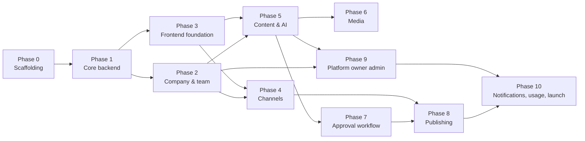

# 14 — Implementation Roadmap

This document is the phased implementation plan for SocialPilot AI, from project scaffolding through MVP launch. It assumes the architecture decisions in [15-architecture-decisions.md](15-architecture-decisions.md) and the requirements in [02-software-requirements.md](02-software-requirements.md). Each phase lists deliverables, dependencies, estimated effort for a **solo developer**, and test requirements, and ends with a milestone definition.

---

## 1. Assumptions

| Assumption | Detail |
|------------|--------|
| Team size | One developer (you), acting as product, backend, frontend, QA, and ops |
| Availability | ~20 productive hours/week for estimates; full-time equivalents noted where useful |
| Working style | One phase at a time; a phase is not done until its test requirements pass and its milestone is demoed |
| Database | PostgreSQL 15+ provisioned locally before Phase 1 (see [13-deployment-and-operations.md](13-deployment-and-operations.md)) |
| External accounts | BotFather bot created, Gemini API key obtained, platform-owner Telegram ID known |
| Prototype | The existing single-admin bot prototype (`app/`) is reference material only; it is **not** carried into the target codebase |

Effort figures are **person-days** (6–7 productive hours each). They include coding, self-review, and test writing, but exclude long-running review loops.

---

## 2. Phase Overview and Dependencies

| Phase | Title | Effort (person-days) | Depends On | Milestone |
|-------|-------|----------------------|------------|-----------|
| 0 | Project scaffolding | 1–2 | — | M0: repo + CI green |
| 1 | Core backend | 5–8 | 0 | M1: API skeleton + auth + migrations run |
| 2 | Company and team | 5–7 | 1 | M2: registration → approval → workspace works end-to-end via API |
| 3 | Frontend foundation | 4–6 | 1 | M3: Mini App shell opens in Telegram with login |
| 4 | Channels | 4–6 | 2, 3 | M4: channel connect + verification flow works |
| 5 | Content and AI | 7–10 | 2, 3 | M5: draft created via Gemini, edited, previewed |
| 6 | Media | 5–7 | 3, 5 | M6: upload → validate → library → attach to post |
| 7 | Approval workflow | 4–6 | 2, 5 | M7: Draft → In Review → Approved/Rejected enforced |
| 8 | Publishing | 5–7 | 4, 7 | M8: approved post publishes to channel, history recorded |
| 9 | Platform owner admin | 4–6 | 2, 5, 8 | M9: owner dashboard manages companies and sees metrics |
| 10 | Notifications, usage, polish, launch | 6–10 | all | M10: launch gate passed |

**Total: ~55–75 person-days** — roughly 3 months full-time, 5–7 months at 20 hours/week.

Note the two parallel tracks after Phase 1: backend-heavy work (Phase 2) and frontend-heavy work (Phase 3) proceed independently and merge at Phase 4. A solo developer should still do them sequentially; the graph marks where they *could* parallelize with a second person.

---

## 3. Phase Details

### Phase 0 — Project Scaffolding

**Goal:** a green, boring foundation so later phases add features instead of plumbing.

**Deliverables**

- Monorepo layout: `backend/` (FastAPI + Alembic), `frontend/` (Vite + React + TS), `bot/` (python-telegram-bot worker), `docs/`.
- `pyproject.toml` with pinned dependency groups (`prod`, `dev`); `requirements.txt` for the bot; `package.json` with scripts (`dev`, `build`, `test`, `lint`, `typecheck`).
- `.gitignore` (`.env`, `dist`, `__pycache__`, `data/media`, `.venv`) and the three `.env.example` files from [13-deployment-and-operations.md](13-deployment-and-operations.md).
- CI pipeline on GitHub Actions: backend lint + pytest, frontend lint + typecheck + build, docs link check.
- Pre-commit hooks (formatting, lint).
- README with run instructions.

**Dependencies:** none.

**Estimated effort:** 1–2 person-days.

**Test requirements:** CI passes on an empty skeleton (lint clean, `pytest` green on the smoke test, `tsc` clean, `vite build` succeeds).

**Milestone M0:** a fresh clone runs backend, frontend, and bot locally with one command each per the deployment doc.

---

### Phase 1 — Core Backend

**Goal:** the API skeleton every other phase builds on.

**Deliverables**

- FastAPI application factory with environment-driven settings (`pydantic-settings`) and structured JSON logging.
- SQLAlchemy 2.0 declarative models for the core entities: `users`, `companies`, `company_memberships`, `brand_profiles` (Phase 1 ships the auth-critical subset; the rest land with their phases).
- Alembic initialized and wired (`env.py` reads `DATABASE_URL`, imports all models); first migration creates the core tables.
- Telegram `initData` validation service: HMAC-SHA256 verification using the bot token, constant-time comparison, `auth_date` freshness window, single-use nonce replay cache (ADR-004).
- Auth endpoints: `POST /api/v1/auth/login` (initData → access + refresh JWT pair) and token refresh; JWT dependencies for the FastAPI app.
- Platform-owner bootstrap from `PLATFORM_OWNER_TELEGRAM_ID`; company-owner special-casing (ADR-014).
- Health endpoints (`/healthz`, `/readyz`) and the standard error format (see [06-api-specification.md](06-api-specification.md)).

**Dependencies:** Phase 0; local PostgreSQL running.

**Estimated effort:** 5–8 person-days.

**Test requirements:**

- initData validation: accepts a correctly signed payload; rejects tampered payloads, wrong-token signatures, expired `auth_date`, and replayed nonces (100% of tamper cases blocked — ties to the success criteria in [01-project-vision-and-scope.md](01-project-vision-and-scope.md)).
- JWT round-trip: login issues a usable token; refresh rotates; expired/invalid tokens rejected with the standard error format.
- Migration upgrade/downgrade runs cleanly on a fresh database.
- Health endpoints return expected status codes.

**Milestone M1:** `alembic upgrade head` succeeds; a test client can log in with a fixture initData and call an authenticated endpoint.

---

### Phase 2 — Company and Team

**Goal:** multi-tenant registration, approval, and membership with enforced RBAC.

**Deliverables**

- Company registration flow (Mini App entry point): creates a `pending` company with the registrant as `company_owner`.
- Platform-owner approval/rejection endpoints and notifications surface (bot message is enough for MVP).
- Team invitations: creator-generated, expiring (TTL from `INVITATION_TTL_HOURS`), single-use; membership accept flow.
- Role management endpoints constrained by permission (`member:invite`, `member:role:update`, `member:remove`) with the owner-immutability rule.
- RBAC dependency: `require_permission("resource:action")` wired to the permission catalog from [03-user-roles-and-use-cases.md](03-user-roles-and-use-cases.md); company context resolved from the authenticated membership.
- Brand profile CRUD (Phase 2 ships storage; AI consumes it from Phase 5).
- Tenant isolation middleware/dependency: every tenant-scoped query is filtered by the authenticated company id (ADR-005).

**Dependencies:** Phase 1.

**Estimated effort:** 5–7 person-days.

**Test requirements:**

- Registration → pending state; unapproved companies cannot authenticate or access workspace endpoints.
- Approval activates the workspace; rejection terminates it with no data access.
- Cross-tenant isolation: for every tenant-scoped endpoint, requests using company A's token cannot read or write company B's data (table-driven test over the endpoint matrix — this is the security backbone of the product).
- Permission matrix tests: each role is denied each forbidden action and allowed each granted action (catalog table from [03-user-roles-and-use-cases.md](03-user-roles-and-use-cases.md) as the test oracle).
- Invitation expiry and single-use enforcement.

**Milestone M2:** two test companies with different roles can be registered, approved, and fully operated with zero cross-tenant visibility.

---

### Phase 3 — Frontend Foundation

**Goal:** the Mini App shell that runs inside Telegram with real login.

**Deliverables**

- Vite + React 18 + TypeScript application matching the screen inventory in [08-mini-app-ui-ux.md](08-mini-app-ui-ux.md).
- Telegram Mini Apps SDK integration: theme parameters, color scheme adaptation, back button handling, main button where appropriate, `viewport` locking.
- Auth provider: read `initData` from the webview, call `/auth/login`, keep access token in memory and refresh token in `sessionStorage` (with XSS trade-off documented); auto-attach `Authorization` header.
- API client with interceptors (401 → refresh → retry once) and typed error surface.
- Client-side routing with the routes for all MVP screens; route guards enforcing login and company status.
- Base layout, navigation, loading/empty/error states, design tokens from the UX spec.

**Dependencies:** Phase 1 (auth endpoints live).

**Estimated effort:** 4–6 person-days.

**Test requirements:**

- Component tests for auth provider (login, refresh-on-401, logout) and route guards.
- `npm run typecheck`, `npm run lint`, `npm run build` all green in CI.
- Manual: Mini App opens inside Telegram on a device, logs in, and shows the shell over an HTTPS tunnel (see [13-deployment-and-operations.md](13-deployment-and-operations.md) §2.6).

**Milestone M3:** a logged-in user sees a working app shell in Telegram with theme adaptation.

---

### Phase 4 — Channels

**Goal:** connect a Telegram channel by proving bot-admin control, then manage it.

**Deliverables**

- Connection flow: user adds the bot to a channel as admin (posting rights), opens "Connect channel" in the Mini App, picks the channel from the bot's view.
- Verification service: bot checks `getChatMember` for admin + post permissions; only verified channels are stored as connected.
- Channel list and disconnect endpoints with `channel:connect/verify/list/disconnect` permissions.
- Channels UI: connect wizard, connected channel list, disconnect with confirmation.
- Bot-side support: handler that reports accessible chats (or a `/channels` command the bot answers in the Mini App chat).

**Dependencies:** Phases 2, 3.

**Estimated effort:** 4–6 person-days.

**Test requirements:**

- Verification state machine tests: non-admin bot rejected; admin without posting rights rejected; admin with rights accepted; revoked admin disconnects.
- API tests for channel CRUD with RBAC denials for non-privileged roles.
- Bot token with permission changes is reflected on re-verification.

**Milestone M4:** a company connects its channel end-to-end from the Mini App and appears in the channel list.

---

### Phase 5 — Content and AI

**Goal:** the core value loop — create, AI-assist, edit, preview.

**Deliverables**

- Post entity + CRUD service layer and endpoints (`post:create/list/view/update/delete`), tenant-scoped.
- Revision history: every edit creates an immutable revision; history endpoint returns the chain (audit requirement from [01-project-vision-and-scope.md](01-project-vision-and-scope.md)).
- AI provider interface (`TextProvider`) with the Gemini implementation behind it (ADR-006): prompt assembly from brand profile + user topic + tone/hashtag settings; timeout, empty-response, and quota handling.
- Content editor screen: compose/edit caption, AI assist panel (topic → generated draft inserted for editing), character counter against Telegram limits, brand-aware suggestions.
- Preview screen: post rendered as it will appear in Telegram (text + media placeholders).
- Image generation UI wiring points (generate button calls the Phase 6 endpoint once enabled; provider may be `none` — see ADR-007).

**Dependencies:** Phases 2, 3.

**Estimated effort:** 7–10 person-days (largest phase; the AI loop deserves the most care).

**Test requirements:**

- Provider contract tests: a fake `TextProvider` proves the interface (prompt passing, timeout, empty response, error mapping) without calling Gemini.
- Quota enforcement: daily cap per company returns a graceful error and is not exceeded.
- Post CRUD: create/read/update/delete happy paths + ownership rules (creators edit own drafts only) + tenant scoping (inherited from Phase 2 tests).
- Revision immutability: history entries never change; the current revision pointer moves.
- Editor/preview: component tests for counters, AI assist insertion, preview rendering.
- Gemini integration smoke test (marked `slow`, uses a small real quota): one generation round-trip.

**Milestone M5:** a creator generates a post with Gemini, edits it, and previews it — entirely inside the Mini App.

---

### Phase 6 — Media

**Goal:** bring your own images safely.

**Deliverables**

- Upload endpoint: multipart, server-side validation of extension **and** MIME **and** content sniffing (magic bytes), size limit `MEDIA_MAX_UPLOAD_MB`, optional image dimension checks.
- Local storage layout under `MEDIA_STORAGE_ROOT/<company_id>/<uuid>.<ext>` with the storage interface from ADR-008; tenant-scoped serving endpoint with auth (`/media/...`).
- Media library UI: grid, upload (multi-select), preview, rename/alt text, delete (`media:upload/list/delete`), reuse across posts.
- Post attachment model: ordered media references on a post (reorder UI), capped at Telegram's 10-item media group limit.
- Image generation endpoint wired behind the provider interface (ADR-007): enabled only when `IMAGE_GENERATION_PROVIDER != none`, quota-enforced; generated images land in the same library.

**Dependencies:** Phases 3, 5.

**Estimated effort:** 5–7 person-days.

**Test requirements:**

- Upload validation matrix: valid files accepted; oversized, wrong MIME, mismatched extension, and polyglot/malicious files rejected (test cases for at least: renamed `evil.php` as `.jpg`, SVG with script content, truncated JPEG).
- Path traversal: filenames containing `..`, absolute paths, or company-id prefixes never escape the tenant directory (table-driven).
- Serving auth: media URL is unauthenticated-access-rejected for non-members and cross-tenant users.
- Reorder + 10-item cap enforcement on save.
- With a fake image provider: generation endpoint stores a result in the library and decrements quota.

**Milestone M6:** a creator uploads images, arranges them, and attaches them to a post with instant library reuse.

---

### Phase 7 — Approval Workflow

**Goal:** governed content flow with a real state machine.

**Deliverables**

- Post status state machine: `Draft → In Review → Approved`, plus `Changes Requested` and `Rejected` branches (states per [01-project-vision-and-scope.md](01-project-vision-and-scope.md) and [07-user-flows-and-state-machines.md](07-user-flows-and-state-machines.md)).
- Transition service enforcing permissions per transition (`approval:submit`, `approval:review`) and role rules (creators cannot approve their own posts — owner-configurable exception noted as post-MVP).
- Review queue screen: pending posts with filters, reviewer actions (approve / request changes with comment / reject with comment), transition history visible on the post.
- Revision creation on every edit so reviewers diff against the submitted version.
- Comments thread on the post for reviewer/creator exchange (in-app; Telegram push in Phase 10).

**Dependencies:** Phases 2, 5.

**Estimated effort:** 4–6 person-days.

**Test requirements:**

- Transition matrix test: every legal transition succeeds with the right role; every illegal transition (wrong role, wrong current state) is rejected with a clear error (state machine as test oracle from the user-flows doc).
- Self-approval prevention; owner override behavior matches the company configuration.
- Concurrent review: two reviewers acting on the same post result in exactly one winner (optimistic concurrency).
- Queue reflects state changes immediately.

**Milestone M7:** a creator submits, a reviewer approves/rejects with comments, and the creator sees the outcome with full history.

---

### Phase 8 — Publishing

**Goal:** one-click publish to the connected channel with a durable history.

**Deliverables**

- Publisher service behind a `TelegramPublisher` interface (ADR-001 keeps it in-process): `sendMessage` for text, `sendMediaGroup` splitting attachments into ≤10-item albums, caption truncation to Telegram limits, failure mapping.
- Publish endpoint: idempotency-key support, transactional status transition (`Approved → Publishing → Published/Failed`), duplicate-publish prevention (the prototype's reserve-then-publish pattern, elevated to a proper state transition).
- Publication history: per-post Telegram message IDs and timestamps; per-channel history screen.
- Failure handling: transient errors retried with backoff inside the request window; permanent errors mark the post `Failed` with the reason and allow re-publish after fixes.
- Publish permission (`publish:execute`) enforced; only `Approved` posts publishable.

**Dependencies:** Phases 4, 7.

**Estimated effort:** 5–7 person-days.

**Test requirements:**

- Fake publisher (no Telegram calls): album splitting at 10 items, caption truncation, status transitions for success/failure paths, idempotency (same key twice → one publication).
- History records message IDs exactly as returned.
- Permission tests: publisher role can publish; creator cannot; approver-without-publish permission cannot.
- End-to-end smoke (marked `slow`, real bot + test channel): publish a text post and a 3-image album; verify in the channel.

**Milestone M8:** an approved post appears in the connected channel, and the history shows it with message IDs.

---

### Phase 9 — Platform Owner Admin

**Goal:** the operator's cockpit.

**Deliverables**

- Platform-owner-only routes guarded by the platform-plane permission check (separate from company RBAC, per [03-user-roles-and-use-cases.md](03-user-roles-and-use-cases.md)).
- Company management: list with filters (status, plan), detail view, approve/reject (feeds Phase 2), suspend/activate (suspended companies lose all access immediately), delete with data-export flow (24-hour export requirement).
- Platform metrics dashboard: companies count by status, posts by status, AI calls/images generated (from usage tracking), storage consumed, recent signups.
- Provider configuration view (read-mostly in MVP: keys stay in env; UI shows provider status/quotas).
- Audit log viewer: filterable by company, actor, action, date (retention per `AUDIT_LOG_RETENTION_DAYS`).
- Owner notifications for pending approvals via the bot.

**Dependencies:** Phases 2, 5, 8 (metrics read what they produce).

**Estimated effort:** 4–6 person-days.

**Test requirements:**

- Platform-plane isolation: company users (even owners) cannot reach platform endpoints; platform owner has no implicit company access.
- Suspend/activate immediately revokes/refreshes access (auth-layer test, not just UI hiding).
- Metrics aggregation correctness against seeded data.
- Delete flow produces a complete export artifact.

**Milestone M9:** the platform owner runs the whole platform from the admin UI with correct metrics and audit history.

---

### Phase 10 — Notifications, Usage, Polish, and Launch

**Goal:** harden for real users and pass the launch gate.

**Deliverables**

- **In-app notifications:** notification entity + endpoint + center screen (approval outcomes, publishing results, mentions). Telegram push notifications for approvals via the bot (optional enhancement).
- **Usage tracking and caps:** per-company counters for AI calls, generated images, posts published, storage used; enforce configured caps with graceful degradation; usage screen for owners/admins (`usage:view`).
- **Onboarding polish:** first-run experience, empty states, error copy, loading skeletons.
- **Accessibility and UX pass:** contrast, touch targets, screen-reader labels, per the UX spec.
- **Performance pass:** Mini App cold start < 3 s on 4G (success criteria), image lazy-loading, API response caching where safe.
- **Security review:** dependency audit, secret scan, OWASP top-10 checklist pass, re-run of the full isolation test suite.
- **Testing:** end-to-end critical path tests (login → register → approve → connect → create → review → publish), load smoke test, acceptance-criteria verification against [01-project-vision-and-scope.md](01-project-vision-and-scope.md).
- **Launch prep:** production deployment per [13-deployment-and-operations.md](13-deployment-and-operations.md), backups verified, monitoring + alerts live, runbooks written, rollback plan documented.

**Dependencies:** all previous phases.

**Estimated effort:** 6–10 person-days.

**Test requirements:**

- Full E2E suite green (automated where possible, scripted manual pass as backstop).
- Each success criterion in [01-project-vision-and-scope.md](01-project-vision-and-scope.md) measured and recorded (latency targets, isolation 100%, click counts).
- Restore-from-backup drill completed within RTO (see deployment doc §3.7).
- Launch gate checklist signed off.

**Milestone M10:** MVP is live and operated.

---

## 4. MVP Definition

**MVP = Phases 0–9**, plus the following **mandatory launch slice** of Phase 10:

1. In-app notifications for approval/publishing outcomes.
2. Usage tracking with working caps (at minimum for AI text and image generation).
3. Security review + full isolation test pass.
4. Production deployment, verified backups, and monitoring.

The remainder of Phase 10 (Telegram push notifications, advanced onboarding polish, performance tuning beyond the cold-start criterion) may land just after launch without blocking it.

An MVP build is judged against the success criteria table in [01-project-vision-and-scope.md](01-project-vision-and-scope.md): 30-minute onboarding, <3 s cold start, <8 s p95 AI latency, 100% cross-tenant block rate, <5 s p95 approval-to-publish, <5-click owner approval, 24-hour data export.

---

## 5. Post-MVP Backlog

Organized by theme (full scope boundary list in [01-project-vision-and-scope.md](01-project-vision-and-scope.md)):

| Theme | Items | Unblocks By |
|-------|-------|-------------|
| Scheduling | Scheduled/recurring publishing, queue UI, timezone handling | Redis + worker (see scaling path, [13-deployment-and-operations.md](13-deployment-and-operations.md) §7) |
| Monetization | Subscription plans, usage metering enforcement, invoicing, payments | Billing provider decision; usage data from Phase 10 |
| Intelligence | Advanced analytics (engagement, reach, best-time-to-post), content templates, snippet library | Telegram message IDs from Phase 8 |
| Scale | Webhook-based updates, Redis queue, object storage, read replicas, CDN | Triggers in the scaling path |
| Platform maturity | Platform administrator roles beyond owner, company ownership transfer, white-label theming, multi-language UI | Team growth; customer demand |
| Channels beyond Telegram | Instagram, LinkedIn publishing | New provider interfaces; separate compliance review |

---

## 6. Risk Register

| # | Risk | Likelihood | Impact | Mitigation |
|---|------|-----------|--------|------------|
| R1 | AI API cost overrun (Gemini/image generation) | Medium | High | Per-company quotas (Phase 5/6/10), cheapest-model default, billing alerts at $10/$25/$50, weekly cost review (deployment doc §4.3) |
| R2 | Gemini outage, rate limits, or pricing change | Medium | Medium | Provider interface (ADR-006) with swap path, graceful degradation messaging, fallback provider evaluation at each pricing change |
| R3 | initData authentication bug allows impersonation | Low | Critical | Server-side HMAC validation with freshness + nonce replay (Phase 1), 100% tamper-case test coverage, constant-time comparison, security review before launch |
| R4 | Cross-tenant data leakage | Low | Critical | Tenant-filtered repository layer (ADR-005), table-driven isolation tests in CI for every endpoint, optional RLS hardening later |
| R5 | Telegram Mini App platform constraints (HTTPS, review, SDK changes) | Low | Medium | Caddy/static-host TLS from day one, SDK pinned with abstraction, platform changelog monitoring |
| R6 | Scope creep inflating the solo timeline | High | Medium | Fixed MVP definition (§4), explicit post-MVP backlog (§5), phase-gate discipline, "cut list" maintained per phase |
| R7 | Solo developer burnout or bus factor of one | High | Medium | 20 hrs/week pacing in estimates, runbooks and docs (deployment doc §6) so the project survives interruptions, CI to catch regressions solo |
| R8 | Bot token or API key leak | Low | High | Env-only secret handling, secret manager (deployment doc §3.5), rotation runbooks, minimal key scopes |
| R9 | Data loss | Low | High | Daily `pg_dump` + media sync, monthly restore drills, managed PITR where affordable (deployment doc §3.7) |
| R10 | Image generation provider shutdown or price spike | Medium | Medium | Provider interface (ADR-007), provider-agnostic quota accounting, local-upload path means the feature degrades gracefully, never a hard dependency in MVP |
| R11 | Telegram API limits (media groups, caption length, flood control) | Medium | Low | 10-item album splitting, caption splitting/truncation, client-side flood handling with backoff (Phase 8 tests) |
| R12 | Manual platform-owner approval becomes a bottleneck | Medium | Medium | <5-click approval flow, bot notifications for pending decisions (Phase 9/10); open signup remains a post-MVP decision (ADR-014) |

---

## 7. Schedule (Solo Developer, ~20 hrs/week)

| Weeks | Phases | Cumulative Milestone |
|-------|--------|----------------------|
| 1 | Phase 0 | M0 |
| 2–4 | Phase 1 | M1 |
| 5–7 | Phase 2 | M2 |
| 8–9 | Phase 3 | M3 |
| 9–11 | Phase 4 | M4 |
| 11–15 | Phase 5 | M5 |
| 14–16 | Phase 6 | M6 |
| 16–18 | Phase 7 | M7 |
| 18–21 | Phase 8 | M8 |
| 21–23 | Phase 9 | M9 |
| 23–27 | Phase 10 + launch | M10 |

Reality check: this plan has little slack. If a phase overruns, cut within the phase (fewer edge-case handlers) or defer the optional slice of Phase 10 — **never cut Phase 1/2 isolation tests or Phase 10 security review.**

---

## 8. Related Documents

- [13-deployment-and-operations.md](13-deployment-and-operations.md) — how each phase's output is run and deployed
- [15-architecture-decisions.md](15-architecture-decisions.md) — the decisions this plan implements
- [12-testing-strategy.md](12-testing-strategy.md) — the test approach each phase's test requirements follow
- [07-user-flows-and-state-machines.md](07-user-flows-and-state-machines.md) — state machines used as test oracles in Phases 7–8
